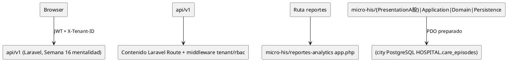

# Reportes y analytics básicos — Semana 3 (arquitectura Micro-HIS)

**Módulo:** `ASII-23` · **Issue:** `Refs #152` · **Estudiante:** `Yamilet1235`.
PHP 8.2+ vanilla (sin framework), PDO preparado, cuatro capas y pruebas de
camino feliz, regla de dominio y error de persistencia. El indicador sigue
siendo `IND-RA-01`/`TCI-1.0` de Semana 1.

## Capas

```
micro-his/reportes-analytics
├─ app.php                         Raíz de composición (reportes_router)
├─ database/schema.sql             Subset SQLite de care_episodes para pruebas
├─ tests/run.php                   11 escenarios ejecutables
└─ src
   ├─ Domain       IndicatorReading, IndicatorViolation, Period
   ├─ Application  CalculateCancellationRate + puerto EpisodeSummaryReader
   ├─ Persistence  PdoEpisodeSummaryReader (PDO preparado), InMemory (doble)
   └─ Presentation Router, IndicatorController, JsonView
```

- **Presentation:** enrutador + controlador sin SQL ni reglas de negocio;
  responde estados 200/422/404/503 del contrato.
- **Application:** un caso de uso (`calculate`) valida requeridos, delega el
  periodo al dominio y lee por el puerto una única lectura agregada.
- **Domain:** `Period` ([desde, hasta) con offset explícito y desde<hasta),
  `IndicatorReading` (valor + trazabilidad) y `IndicatorViolation`.
- **Persistence:** consulta agregada preparada (`count(*)` + `SUM(CASE …)`)
  compatible PostgreSQL/SQLite, sin datos personales; el doble InMemory
  permite forzar los estados del contrato.

## Diagrama C4 (Contenedor) y dependencias



(Salida visual pendiente al integrar la Semana 16; este texto se conserva
como fuente editable en `docs/reportes-analytics/semana-03/fuentes/06-arquitectura.puml`.)

## Pruebas ejecutadas (evidencia local)

```bash
php micro-his/reportes-analytics/tests/run.php
# => "run.php OK: 11 escenarios del indicador IND-RA-01."
```

| Escenario | Resultado |
|---|---|
| Camino feliz PDO/SQLite sin filtro | OK (25.00 % n=4/1) |
| Filtro `service_code` excluye otras salas | OK (33.33 %) |
| Trazabilidad completa en respuesta | OK (`indicator`, `formula_version`, `source`, `computed_at`) |
| Regla de dominio: periodo invertido | OK (422 `periodo_invalido` sin porcentaje) |
| Requisito faltante (`from`) | OK (422 `entrada_invalida`) |
| Periodo sin offset explícito | OK (422 `periodo_invalido`) |
| Error de persistencia | OK (503 `LECTURA_NO_DISPONIBLE` sin cifras) |
| Sin datos en el periodo | OK (200 `SIN_DATOS_EN_PERIODO` sin porcentaje) |
| Lectura incoherente (`cancelled>`finalized`) | OK (503 sin porcentaje) |
| Método no permitido (GET) | OK (404 `ROUTE_NOT_FOUND`) |
| Cero válido (40/0) | OK (0.00 con `computed_at`) |

`php -l` sobre todos los archivos del módulo: sin errores.

## Preguntar contra la Semana 4

El controlador ya no contiene contadores ni estados ocultos; la Semana 4
responde cómo se sustituye el Adaptador InMemory por el adaptador Laravel
`catalog` del cuerpo del sistema y cómo el `request` se integra al router.
