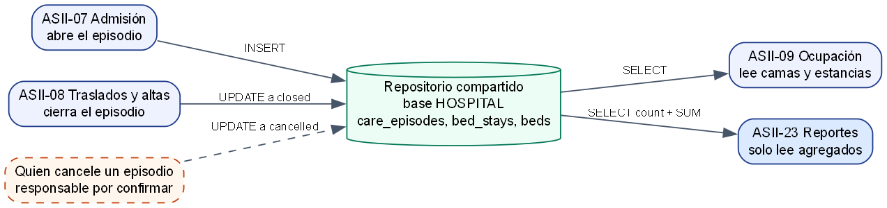

# ASII-23 Semana 4 — MVC, Repository y repositorio de datos compartido

**Issue:** `Refs #152` · **Estudiante:** María Yamilet Lindo Pablo (`Yamilet1235`).

## MVC en el módulo

| Pieza | Archivo en `micro-his/reportes-analytics/src` | Responsabilidad |
|---|---|---|
| Vista | `Presentation/JsonView.php` | Escribe siempre un documento JSON; no decide reglas ni estados. |
| Controlador | `Presentation/Router.php`, `Presentation/IndicatorController.php` | Interpreta ruta, método y cuerpo; traduce excepciones a estados HTTP. |
| Modelo | `Domain/Period.php`, `Domain/IndicatorReading.php`, `Application/CalculateCancellationRate.php` | Regla del periodo `[desde, hasta)` y del indicador, sin SQL ni HTTP. |
| Repositorio | `Application/EpisodeSummaryReader.php` (puerto), `Persistence/PdoEpisodeSummaryReader.php`, `Persistence/InMemoryEpisodeSummaryReader.php` | Oculta de dónde sale la lectura agregada. |
| Composición | `app.php` | Ensambla las piezas por constructor. |

## Separación comprobable

- `IndicatorController` no usa SQL ni PDO; solo decide entre los estados del contrato.
- `PdoEpisodeSummaryReader` no conoce HTTP: devuelve el agregado o lanza `RuntimeException`.
- Las únicas reglas de negocio están en `Period` y en la decisión de denominador cero del caso de uso.

## Repository: por qué un puerto de lectura

El módulo solo lee. Por eso el puerto tiene una sola operación, `read(desde, hasta, sala)`, y no un CRUD. `run.php` ejecuta los mismos escenarios con PDO sobre SQLite y con el doble `InMemory`; el doble además fuerza lo que SQL real no puede producir, como una lectura incoherente con más cancelados que finalizados.

## Repositorio de datos compartido



Fuente: [`fuentes/repositorio-compartido.dot`](./fuentes/repositorio-compartido.dot).

| Aspecto | Decisión | Evidencia |
|---|---|---|
| Dueños de `care_episodes` | Admisión (ASII-07) crea y Traslados (ASII-08) cierra | `micro-his/admision-camas/src/Persistence/PdoAdmissionRepository.php`, `micro-his/traslados-altas/src/Persistence/PdoRegistroInternacion.php` |
| Papel de Reportes | Solo `SELECT` agregado; sin migraciones ni escrituras | `PdoEpisodeSummaryReader::read` |
| Consistencia | Lee lo confirmado en el momento del cálculo; el resultado no se guarda | `Cache-Control: no-store, private` |
| Privacidad | Solo `count` y `SUM`: nunca sale un paciente ni un identificador | `IndicatorHospitalIntegrationTest` |
| Riesgo: cambio de esquema | Un cambio en `type`, `status` o `ended_at` rompe el indicador | La prueba de integración corre sobre las migraciones reales |
| Riesgo: quién cancela | Ningún módulo integrado escribe hoy `cancelled`; se probó con filas sembradas | Requisito por confirmar con ASII-07 y ASII-08 |
| Aislamiento | Una base por hospital; `EnsureHospitalDatabaseTenant` rechaza al hospital que no es dueño | `test_miembro_de_otro_hospital_…` |

## Ventajas y desventajas del repositorio compartido

- **Ventajas:** no hay copia que sincronizar, y el indicador refleja lo confirmado por los módulos dueños.
- **Desventajas:** Reportes depende de un esquema ajeno y una consulta costosa afecta a la base operativa. La Semana 5 describe la frontera que resolvería ambos puntos.

## Cómo reproducir

```bash
php micro-his/reportes-analytics/tests/run.php
php micro-his/reportes-analytics/tests/example-lsp.php
```
