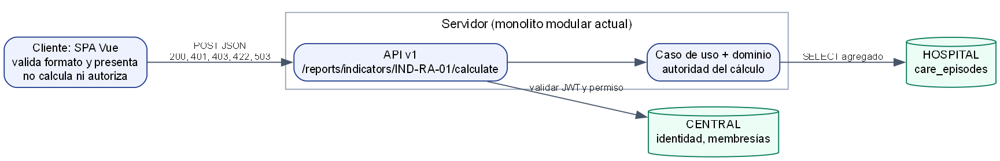
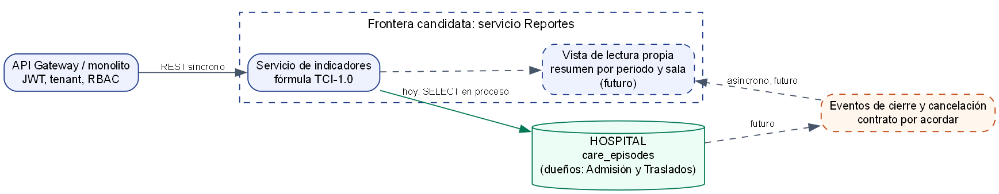

# ASII-23 Semana 5 — Cliente-servidor, frontera de servicio y plan de integración

## Vista cliente-servidor

Fuente: [`fuentes/cliente-servidor.dot`](./fuentes/cliente-servidor.dot).

El cliente valida el formato y muestra el resultado. El servidor es la autoridad: aunque se alterara la pantalla, el cálculo, el permiso y el hospital se deciden del lado del servidor.

## Frontera candidata a microservicio

Fuente: [`fuentes/frontera-microservicio.dot`](./fuentes/frontera-microservicio.dot). Las líneas punteadas **no existen**: son la evolución razonada, no algo implementado.

| Decisión | Valor |
|---|---|
| Responsabilidad | Calcular indicadores agregados, sin escribir datos clínicos |
| Datos propios | Hoy ninguno. Si se separa: una vista de lectura por periodo y sala |
| Datos ajenos | `care_episodes`, de Admisión y Traslados; solo lectura |
| Comunicación actual | REST síncrono desde el cliente; llamada en proceso hacia la lectura |
| Comunicación futura | Eventos de cierre y cancelación; su contrato no está acordado |

## Atributos

| Atributo | Estado actual | Evidencia o pendiente |
|---|---|---|
| Seguridad | JWT, tenant, guard de base y permiso; sin datos personales | `IndicatorEndpointTest`, `IndicatorHospitalIntegrationTest` |
| Resiliencia | Base caída: 503 `REPORTES_UNAVAILABLE`, nunca un cero falso. Sin reintentos automáticos: el cálculo es repetible a mano | `test_una_base_hospital_inexistente_responde_503_y_nunca_ceros` |
| Observabilidad | **No** hay `trace_id` propio ni métricas del indicador | Pendiente técnico, sin implementar |
| Consistencia | Fuerte respecto de lo confirmado: cada cálculo lee la base. Un servicio separado pasaría a consistencia eventual y tendría que mostrar la antigüedad del dato | Decisión de diseño |
| Rendimiento | Una consulta agregada. **No** se midió con volumen real | Pendiente con datos de staging |

## Migración razonada

No se recomienda separar el servicio ahora: hay un solo indicador, una sola lectura y sin carga medida. Separarlo añadiría red, despliegue y consistencia eventual sin un beneficio demostrado.

Condiciones para reconsiderarlo:

1. Más indicadores que afecten el rendimiento de la base operativa, medido en un entorno real.
2. Un contrato de eventos acordado con Admisión y Traslados.
3. Un equipo responsable de operar el servicio.

Los pasos serían: publicar los eventos, llenar la vista propia en paralelo, comparar resultados con la consulta actual y, cuando coincidan, cambiar el adaptador detrás del puerto `EpisodeSummaryReader`. El caso de uso no cambia.

## Plan de integración

| Elemento | Valor |
|---|---|
| Issue | #152 (`Refs #152`; no se cierra hasta la evaluación) |
| Rama | Patrón `feature/asii-23-…-yamilet1235`, desde `origin/develop` |
| Worktree | `git worktree add ../shi-asii-23-reportes-analytics -b feature/asii-23-reportes-analytics-yamilet1235 origin/develop` |
| PR | Hacia `develop`, con máximo 400 líneas y la plantilla del repositorio; después, promoción a `main` |
| Dependencias | Tenants y RBAC (`reportes.ver`, ya activo); esquema HOSPITAL de Admisión y Traslados |
| Riesgo | Sin Actions por facturación: las pruebas se ejecutan en local y se declaran así |
