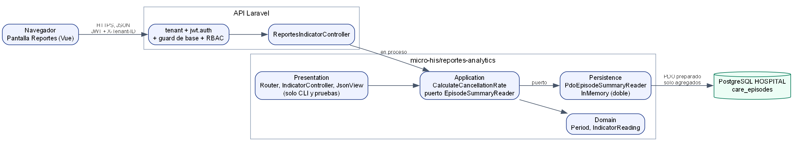

# Reportes y analytics básicos (ASII-23)

Primera evaluación parcial: indicador IND-RA-01

María Yamilet Lindo Pablo · `Yamilet1235` · Issue #152

---

# El problema

- Coordinación necesita el porcentaje de hospitalizaciones canceladas.
- Un número sin definición no sirve: hay que saber qué mide y sobre qué periodo.
- Tres errores que el módulo no puede cometer:
  - mostrar 0 % cuando no hay datos;
  - mostrar una cifra cuando la base falló;
  - exponer datos de pacientes.

---

# La regla: IND-RA-01, fórmula TCI-1.0

`porcentaje = 100 × cancelados / finalizadas`

- **Fuente:** `care_episodes`, tipo `inpatient`.
- **Finalizadas:** estado `closed` o `cancelled`.
- **Periodo:** `[desde, hasta)` sobre `ended_at`, con offset explícito.
- **Sin datos:** estado `SIN_DATOS_EN_PERIODO`, sin porcentaje.
- **Cero real:** `0.00 %`, distinto de «sin datos».

---

# Sustitución de Liskov

| | Antes | Después |
|---|---|---|
| Diseño | Jerarquía con reglas propias | Puerto `EpisodeSummaryReader` |
| Denominador 0 | Una subclase lanza excepción | Mismo estado en todos los lectores |
| Evidencia | `example-lsp.php`, bloque ANTES | `example-lsp.php`, bloque DESPUÉS |

Cualquier lector devuelve el mismo resultado para la misma lectura.

---

# Arquitectura

---

# Evidencia ejecutada

| Comando | Resultado |
|---|---|
| `php micro-his/reportes-analytics/tests/run.php` | 15 escenarios OK |
| `php micro-his/reportes-analytics/tests/example-lsp.php` | 7 OK |
| `php artisan test tests/Feature/Reportes` | 16 correctas |

- Enero con datos ficticios: **25.00 %**.
- Con la sala `HOSP-UCI`: **33.33 %**.
- Periodo invertido: 422 y ninguna cifra.

---

# Decisiones y cambio práctico

- **Decisión:** el servidor es la autoridad del cálculo y del permiso.
- **Decisión:** solo agregados; ningún paciente sale de la base.
- **Cambio practicado (ejercicio propio, no pedido por el docente):** rechazar fechas imposibles como `2026-02-31`.

Antes: 200 con N/A. Después: 422 `periodo_invalido`.

---

# Preguntas probables

- **¿Y si no hay datos?** Estado publicado; ni 0 % ni error.
- **¿Y si la base cae?** 503 sin cifra.
- **¿Quién autoriza?** `rbac:reportes.ver` en el servidor.
- **¿Otro hospital puede verlo?** No: 403 aunque tenga membresía válida.
