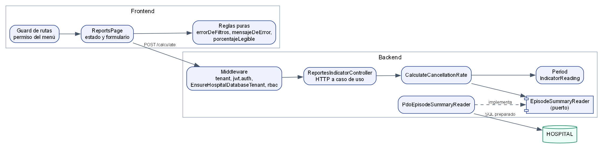

# ASII-23 Semana 7 — Componentes, contratos y refactor

**Issue:** `Refs #152` · **Estudiante:** María Yamilet Lindo Pablo (`Yamilet1235`).

## Diagrama de componentes



Fuente: [`fuentes/componentes.dot`](./fuentes/componentes.dot).

## Contratos de entrada y salida

| Componente | Archivo | Entrada | Salida |
|---|---|---|---|
| Página | `resources/js/modules/reportes/pages/ReportsPage.vue` | Fechas y sala del usuario | Resultado o un único error visible |
| Reglas puras | Módulo JavaScript de `resources/js/modules/reportes/` | Filtros, porcentaje, código de error | Mensaje o texto listo para mostrar |
| Guard de rutas | `resources/js/router/permissions.js` | Permisos de la sesión | Permitir o redirigir |
| Middleware | `routes/api.php` | JWT, `X-Tenant-ID` | Pasa, o 401/403/503 |
| Controlador | `app/Http/Controllers/Api/V1/ReportesIndicatorController.php` | `from`, `until`, `service_code` | JSON con `data` y `meta`, o `error.code` |
| Caso de uso | `Application/CalculateCancellationRate.php` | Arreglo validado por tipo | `IndicatorReading` o `IndicatorViolation` |
| Dominio | `Domain/Period.php` | Dos instantes con offset | Periodo válido o `periodo_invalido` |
| Puerto | `Application/EpisodeSummaryReader.php` | Desde, hasta, sala o vacío | `finalized` y `cancelled`, o `null` |
| Adaptador | `Persistence/PdoEpisodeSummaryReader.php` | Los mismos parámetros | Agregado o `RuntimeException` |

## Protocolos

- **Cliente a API:** HTTPS y JSON, con `Authorization: Bearer` y `X-Tenant-ID` en cada petición.
- **Sin caché:** `Cache-Control: no-store, private`, porque el dato cambia al cerrar o cancelar un episodio.
- **Dentro del servidor:** llamadas en proceso; el dominio no importa Laravel ni Vue.

## Refactor antes y después

Refactor real, aplicado el 30/10/2026 al corregir el defecto del resultado obsoleto. La página tenía dos fuentes de error y limpiaba el resultado tarde.

**Antes:**

```js
const filtroExiste = computed(() => errorDeFiltros({ desde: desde.value, hasta: hasta.value }));
async function calculate() {
    error.value = errorDeFiltros({ desde: desde.value, hasta: hasta.value });
    if (error.value) { return; } // el resultado anterior seguía visible
    resultado.value = null;
```

**Después:**

```js
watch([desde, hasta, servicio], limpiar);
function limpiar() { resultado.value = null; error.value = ''; }
async function calculate() {
    limpiar();
    error.value = errorDeFiltros({ desde: desde.value, hasta: hasta.value });
    if (error.value) { return; }
```

| Criterio | Antes | Después |
|---|---|---|
| Fuentes de error en pantalla | 2 (`filtroExiste` y `error`) | 1 (`error`) |
| Cifra junto a un error | Posible | Imposible: `limpiar()` va primero |
| Mensaje al cargar la página vacía | «Indica desde y hasta.» | Ninguno |

El segundo refactor está en `Period::instant`: dos llamadas encadenadas con `?:` pasan a un recorrido por formatos con una sola comprobación de ida y vuelta, que además rechaza fechas imposibles.

**Comprobación:** `reportes.a11y.test.mjs` y `semana-11/evidencia/recorrido-e2e.mjs`.
