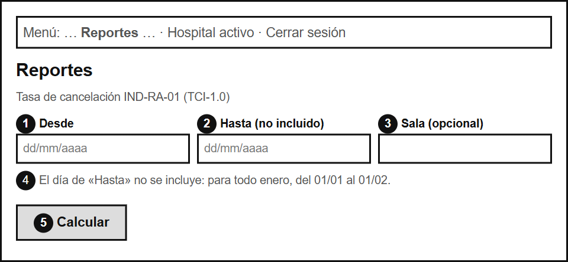
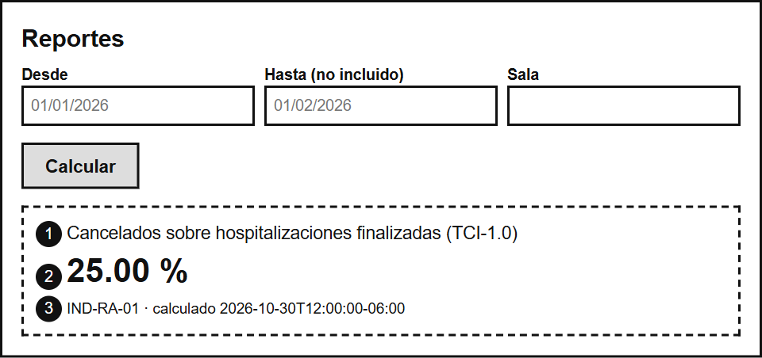
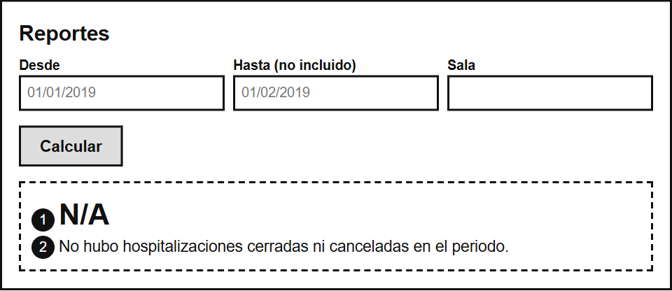
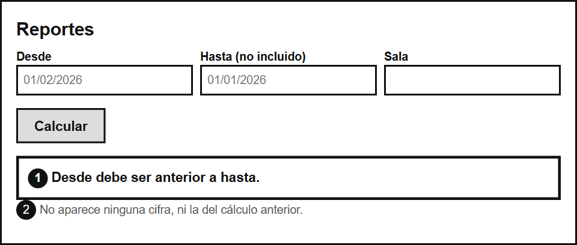
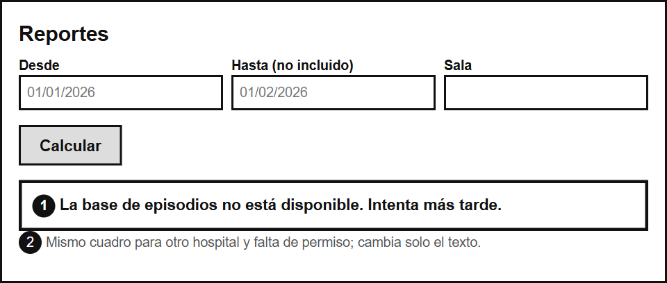
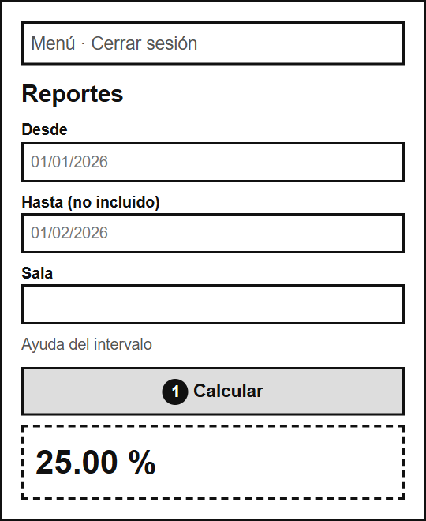

# ASII-23 Semana 8 — Wireframes anotados

Baja fidelidad, renderizados desde [`fuentes/wireframes.html`](./fuentes/wireframes.html). Los números de cada imagen remiten a estas notas.

## 1. Formulario

1 y 2: fechas nativas. 2: la etiqueta avisa que «Hasta» no se incluye. 3: la sala es opcional. 4: la ayuda da un ejemplo real. 5: el botón es el único foco primario.

## 2. Resultado

1: qué mide la cifra. 2: dos decimales, siempre. 3: indicador y hora del cálculo, sin datos personales.

## 3. Sin datos

1: N/A y no 0 %. 2: el porqué, en texto.

## 4. Periodo inválido

1: el error no depende del color. 2: nunca convive con una cifra anterior.

## 5. Error del servicio o de acceso

1: un mensaje útil, sin detalle técnico. 2: la misma zona para todos los errores.

## 6. Móvil

1: columna única y botón a todo el ancho.
