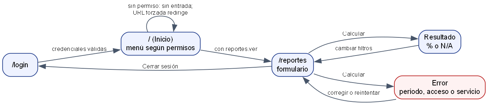

# ASII-23 Semana 11 — Prototipo navegable

**Issue:** `Refs #152` · **Estudiante:** María Yamilet Lindo Pablo (`Yamilet1235`).

El prototipo es la pantalla real integrada, con datos ficticios en PostgreSQL. No hay maqueta aparte.

## Mapa de navegación

Fuente: [`fuentes/mapa-navegacion.dot`](./fuentes/mapa-navegacion.dot).

## Capturas

| Caso | Escritorio (1280 px) | Móvil (375 px) |
|---|---|---|
| Formulario | [01](./capturas/01-formulario-1280.png) | ver Semana 10 |
| Camino feliz | [02](./capturas/02-resultado-25-1280.png) | [06](./capturas/06-resultado-375.png) |
| Error crítico: periodo inválido | [03](./capturas/03-periodo-invertido-1280.png) | [07](./capturas/07-periodo-invertido-375.png) |
| Sin datos | [04](./capturas/04-sin-datos-1280.png) | — |
| Error crítico: base no disponible (**503 simulado**) | [05](./capturas/05-error-503-1280.png) | — |
| Miembro de otro hospital | [08](./capturas/08-otro-hospital-1280.png) | — |

Generadas por [`evidencia/recorrido-e2e.mjs`](./evidencia/recorrido-e2e.mjs) (15/15, [`evidencia/salida-recorrido.txt`](./evidencia/salida-recorrido.txt)). Son de Chrome headless, no de una revisión humana.

## Datos y servicios simulados

- **Datos:** todos ficticios (`README.md` del módulo).
- **503:** la respuesta se intercepta en el navegador. La caída real de la base la cubre `IndicatorHospitalIntegrationTest`.

## Cómo probarla

Pasos, URL y filtros en el manual del módulo: [`../README.md`](../README.md).
