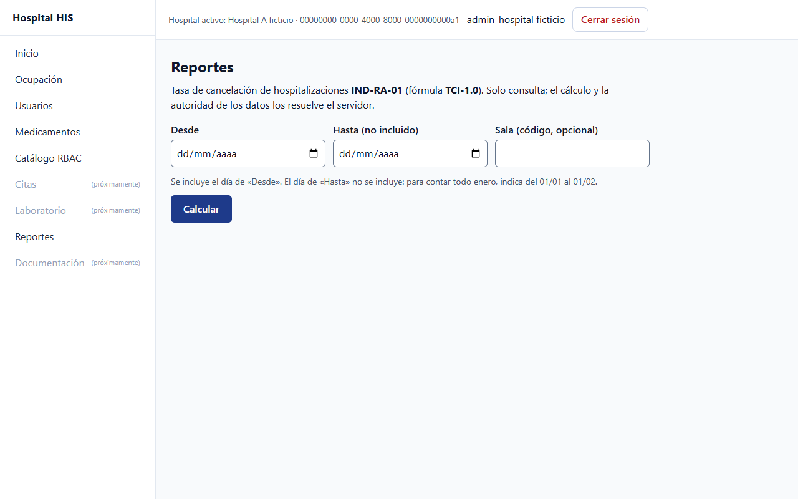
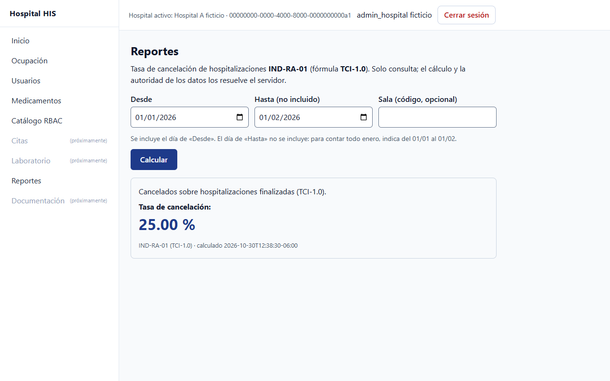
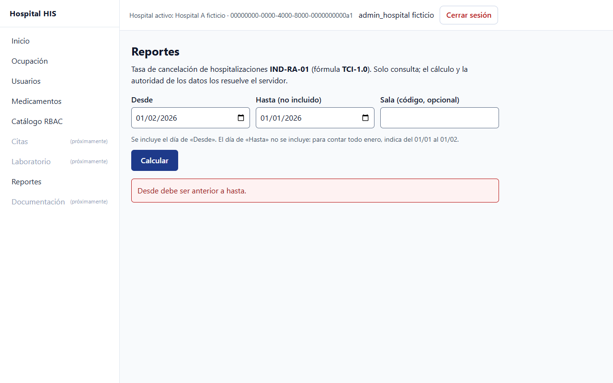
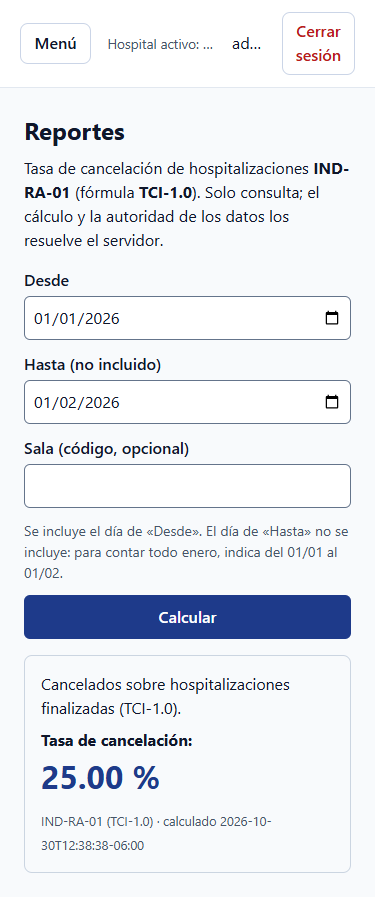
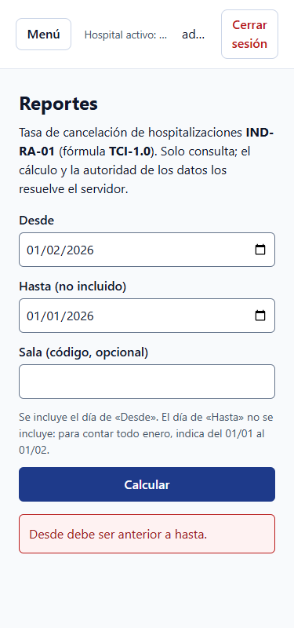

# Reportes y analytics básicos (ASII-23)

Segunda evaluación parcial: diseño de la experiencia con el prototipo

María Yamilet Lindo Pablo · `Yamilet1235` · Issue #152

---

# Recorrido navegable

 

Menú Reportes → fechas → Calcular → resultado con su definición.

---

# Decisiones visibles

- **Hasta (no incluido):** la ayuda explica el intervalo con un ejemplo.
- **Un solo mensaje:** nunca hay una cifra junto a un error.
- **N/A tiene razón:** el estado se explica con texto.

---

# Móvil y errores

 

Columna única, 44 px táctiles y sin desplazamiento horizontal a 320, 375 y 430 px.

---

# Decisión → requisito → evidencia

| Decisión | Requisito | Evidencia |
|---|---|---|
| Limpiar antes de validar | Sin cifra obsoleta | `recorrido-e2e.mjs` |
| Ayuda asociada a las fechas | Periodo comprensible | `reportes.a11y.test.mjs` |
| Sin datos ≠ cero | No inventar datos | `run.php` |
| Mensaje por hospital | Aislamiento | `recorrido-e2e.mjs` |

---

# Cambio practicado y pendientes

- **Ejercicio propio, no pedido por el docente:** retirar el resultado al cambiar un filtro.
- **Sin probar:** lector de pantalla y dispositivo físico.
- **Sin realizar:** exposición, evaluación docente y prueba con usuarios.
