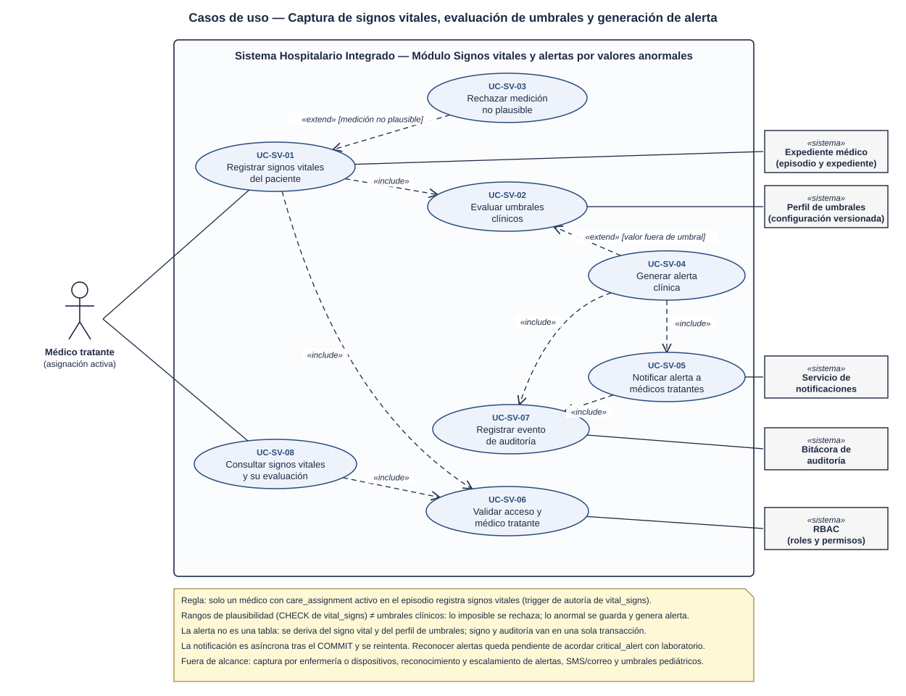
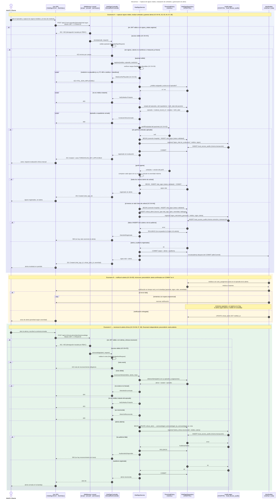

# Signos vitales y alertas por valores anormales — Semana 1

## Ficha de la asignación

- **Estudiante:** Hicho García, Josué Fernando (`Jhos-hgnu`)
- **Módulo:** ASII-13 — Signos vitales y alertas por valores anormales
- **Semana:** Semana 1 — Conceptos generales, orientación a objetos y UML
- **Tarea individual:** Modele el proceso «captura de signos vitales, evaluación de umbrales y generación de alerta». Casos de uso: delimitar actores y objetivo; el de actividad debe incluir decisiones, excepciones y resultado; el de secuencia debe mostrar participantes, mensajes, validaciones y respuesta. Mantenga trazabilidad entre los tres diagramas.
- **Entregable / evidencia:** UML de casos de uso y narrativa de alcance.
- **Estructura:** Sistema Hospitalario Integrado 2026 | Semanas 1–15.

---

## Contexto arquitectónico

- **Backend:** Laravel 12 (PHP 8.2+), JWT y RBAC por permisos (`signos_vitales.registrar`, `signos_vitales.ver`, `alertas_clinicas.ver`, `alertas_clinicas.reconocer`).
- **Base de datos HOSPITAL (PostgreSQL):** la tabla `vital_signs` ya existe en la migración `2026_08_11_000401_create_allergy_and_vital_sign_tables.php`:
  - Signos: `temperature`, `heart_rate`, `respiratory_rate`, `systolic_bp`, `diastolic_bp`, `oxygen_saturation`, `weight`, `height` y `glucose`. Se exige **al menos uno** (`vital_signs_measurement_check`).
  - **Rangos de plausibilidad** por `CHECK` (por ejemplo, temperatura entre 25 y 45, FC entre 1 y 300, sistólica ≥ diastólica). Rechazan valores **imposibles**; no son umbrales clínicos.
  - Estados `draft` / `validated` / `entered_in_error`. Un registro `validated` es **inmutable** y se corrige con una nueva versión (`version_no`, `supersedes_id`, `correction_reason`). No se borra (`vital_signs_retention`).
  - El trigger `enforce_vital_sign_integrity` exige que el expediente y el episodio sean del mismo paciente y que **quien registra sea médico con `care_assignment` activo** en el episodio (`vital_signs_author_assignment_trigger`). Por eso el actor principal es el **médico tratante**.
- **Umbrales clínicos:** el esquema no tiene una entidad de umbrales. Se modelan como **configuración versionada** detrás de la interfaz `ThresholdPolicy`, sin agregar tablas. El perfil de referencia para adultos está en el [Anexo B de la narrativa](./narrativa-alcance-trazabilidad.md#anexo-b--perfil-de-umbrales-de-referencia-adulto).
- **Alertas (propuesta):** la entidad `critical_alert` ya forma parte de las 27 entidades del esquema HOSPITAL (slice H7, aún sin migración ni columnas). En lugar de crear una tabla nueva, se propone que `critical_alerts` cubra **resultados de laboratorio y signos vitales** con un `source_type`. La propuesta está en el [Anexo A de la narrativa](./narrativa-alcance-trazabilidad.md#anexo-a--propuesta-de-la-tabla-critical_alerts-hospital) y debe acordarse con los módulos de laboratorio y con la persona encargada del esquema.
- **Auditoría:** la generación de alertas, el registro sin evaluación y el reconocimiento se auditan en `local_access_audits` (HOSPITAL, slice H8), **en la misma conexión `hospital` y la misma transacción** que el dato clínico. Se reutiliza la propuesta de columnas del [Anexo A de Notas SOAP](../../notas-soap/semana-01/narrativa-alcance-trazabilidad.md#anexo-a--propuesta-de-la-tabla-local_access_audits-hospital), sin definir otra tabla.
- **Notificación:** asíncrona, mediante una cola de Laravel despachada **después del `COMMIT`** (`afterCommit`) detrás de la interfaz `AlertNotifier`. Si la notificación falla, la alerta ya está guardada y sigue visible en la bandeja.
- **Multitenancy:** el hospital activo llega en `X-Tenant-ID`; el signo vital y la alerta viven en la base de ese hospital.
- **Frontend:** Vue 3, Pinia y Axios (formulario de signos vitales y bandeja de alertas).
- **Endpoints preliminares** (se formalizan en la Semana 5):
  - `POST /api/v1/care-episodes/{episode}/vital-signs`
  - `GET /api/v1/care-episodes/{episode}/vital-signs`
  - `GET /api/v1/clinical-alerts?status=open`
  - `POST /api/v1/clinical-alerts/{alert}/acknowledge`

---

## 1. Diagrama de casos de uso

[Abrir el diagrama de casos de uso en SVG](./01-casos-de-uso.svg)

### Descripción

El objetivo es que **todo valor anormal de un signo vital quede registrado con su alerta, que la alerta llegue a los médicos tratantes y que alguien la reconozca dejando constancia de la conducta tomada**.

- **Actor principal:**
  - *Médico tratante* (con `care_assignment` activo): registra los signos vitales, recibe y reconoce las alertas y las consulta. Se modela solo al médico porque el esquema actual exige que el autor de `vital_signs` sea médico asignado al episodio.
- **Actores secundarios (sistemas):** *Expediente médico* (episodio y expediente), *Perfil de umbrales* (configuración versionada), *Servicio de notificaciones*, *Bitácora de auditoría* y *RBAC*.
- **UC-SV-01 (Registrar signos vitales)** incluye `<<include>>` la evaluación de umbrales (UC-SV-02) y la validación de acceso y médico tratante (UC-SV-07). **UC-SV-03 (Rechazar medición no plausible)** extiende `<<extend>>` a UC-SV-01 cuando un valor está fuera del rango fisiológico posible.
- **UC-SV-04 (Generar alerta clínica)** extiende a UC-SV-02 cuando al menos un valor queda fuera de umbral, e incluye la notificación (UC-SV-05) y el registro de auditoría (UC-SV-08).
- **UC-SV-06 (Reconocer alerta)** incluye la validación de acceso (UC-SV-07) y la auditoría (UC-SV-08).
- **UC-SV-09 (Consultar signos vitales y alertas)** incluye UC-SV-07 con los permisos `signos_vitales.ver` y `alertas_clinicas.ver`.

## 2. Diagrama de actividades

[Abrir el diagrama de actividades en SVG](./02-actividad.svg)

### Descripción

Recorre el proceso en cuatro particiones. Los conectores UML **(B)** y **(C)** muestran que una partición continúa en la siguiente.

- **A · Capturar y validar plausibilidad:** acceso (401/403), formato (422), plausibilidad fisiológica (UC-SV-03, `422 VITAL_SIGN_IMPLAUSIBLE`, no se guarda nada), médico tratante (403) y episodio y expediente abiertos (409). Resultado: medición aceptada, continúa en B.
- **B · Evaluar umbrales y generar alerta:** se busca el perfil de umbrales según la edad del paciente.
  - Sin perfil aplicable (por ejemplo, paciente pediátrico): se guarda el signo vital `validated` con la auditoría `signo_vital.sin_evaluacion` y se responde `201` con el aviso `THRESHOLDS_NOT_APPLICABLE`. Nunca se omite la evaluación en silencio.
  - Todos los valores dentro de umbral: `201` sin alerta.
  - Algún valor fuera de umbral: **en una sola transacción** de la conexión `hospital` se insertan el signo vital, la alerta (`open`, con severidad y hallazgos) y la auditoría. Si la alerta o la auditoría fallan, `ROLLBACK` y `500`: **no existe valor anormal sin alerta**. Si todo va bien, `COMMIT`, `201` y la notificación se encola después del `COMMIT`.
- **C · Notificar:** el job obtiene a los médicos con asignación activa en el episodio y les envía la notificación en la aplicación. Si falla, reintenta con espera exponencial. Si se agotan los reintentos, se registra en el log y la alerta sigue abierta en la bandeja. Si llega, se registra `notified_at`.
- **D · Reconocer la alerta:** acceso (401/403), nota de reconocimiento obligatoria (422), alerta existente (404), médico tratante (403) y alerta abierta (409). El cambio a `acknowledged` y su auditoría van en una transacción: si la auditoría falla, `ROLLBACK` y `500`. Resultado: `200`.

## 3. Diagrama de secuencia

[Abrir el diagrama de secuencia en SVG](./03-secuencia.svg)

### Descripción

- **Participantes:** Vue (`VitalSignsForm` y `AlertInbox`), middlewares, `VitalSignController` / `ClinicalAlertController`, `VitalSignService`, `ThresholdPolicy` «interfaz», `VitalSignRepository` (HOSPITAL), `AuditLogger` (HOSPITAL · `local_access_audits`) y `AlertNotifier` «interfaz».
- **Dependencias como interfaz:** `ThresholdPolicy` se modela como interfaz para que el servicio no dependa de dónde vienen los umbrales (archivo de configuración hoy, tabla o servicio clínico después). `AlertNotifier` permite cambiar el canal (bandeja, tiempo real u otros) sin tocar el servicio. Se desarrolla en la Semana 2 con el principio DIP.
- **Escenario A (capturar, evaluar y generar alerta):** `alt` para 401/403 y 422 de formato; `break` para medición no plausible (422), médico no tratante (403) y episodio o expediente cerrado (409); `alt` para perfil no aplicable (201 con aviso), valores normales (201) y valores fuera de umbral. En ese último caso, signo, alerta y auditoría van en una transacción: si algo falla, `ROLLBACK` y 500; si no, `COMMIT`, se encola la notificación (`afterCommit`) y se devuelve 201 con el `critical_alert_id`.
- **Escenario B (notificar):** asíncrono, después del `COMMIT` de A. `alt` para envío fallido (`loop` de reintentos; al agotarse, la alerta sigue abierta en la bandeja) y entrega correcta (`notified_at`).
- **Escenario C (reconocer):** escenario independiente; precondición: alerta abierta. `alt` para 401/403, 422 (nota vacía), 404, 403 y 409. El reconocimiento y su auditoría van en una transacción: si la auditoría falla, `ROLLBACK` y 500; si no, `COMMIT` y 200.

### Propuesta de tabla de alertas (resumen)

`critical_alerts` (HOSPITAL), compartida con laboratorio. La definición SQL completa y la justificación de cada columna están en el [Anexo A](./narrativa-alcance-trazabilidad.md#anexo-a--propuesta-de-la-tabla-critical_alerts-hospital).

| Columna | Tipo | Nota |
|---|---|---|
| `critical_alert_id` | `uuid` PK | `gen_random_uuid()` |
| `source_type` | `text` (`vital_sign` / `lab_result_version`) | Origen de la alerta |
| `vital_sign_id` | `uuid` FK → `vital_signs` (opcional) | Una sola alerta por registro de signos vitales |
| `lab_result_version_id` | `uuid` FK (opcional) | La define el módulo de laboratorio |
| `local_patient_id` / `care_episode_id` | `uuid` FK | Paciente y episodio de la alerta |
| `severity` | `text` (`warning` / `critical`) | Severidad máxima de los hallazgos |
| `findings` | `jsonb` arreglo | Signo, valor, unidad, umbral y severidad de cada hallazgo |
| `threshold_profile_version` | `text` | Versión del perfil de umbrales usado |
| `status` | `text` (`open` / `acknowledged`) | Ciclo de vida de la alerta |
| `notified_at` | `timestamptz` | Cuándo se entregó la notificación |
| `acknowledged_by_user_ref_id`, `acknowledged_at`, `acknowledgment_note` | | Quién, cuándo y qué conducta tomó |

## 4. Narrativa de alcance y trazabilidad

La narrativa completa, con la tabla de trazabilidad UC ↔ actividad ↔ secuencia, los riesgos detectados en el esquema, la propuesta de `critical_alerts` y el perfil de umbrales de referencia, está en [narrativa-alcance-trazabilidad.md](./narrativa-alcance-trazabilidad.md).

## Fuentes editables

- Casos de uso: el SVG es editable en draw.io o Inkscape.
- Actividad y secuencia: [`fuentes/02-actividad.mmd`](./fuentes/02-actividad.mmd) y [`fuentes/03-secuencia.mmd`](./fuentes/03-secuencia.mmd) (Mermaid; GitHub los renderiza y se pueden editar en mermaid.live).

## Declaración de uso de IA

Se usó Claude (Anthropic) para proponer la estructura de los diagramas, generar los SVG y redactar el primer borrador de este documento a partir del repositorio del proyecto (en particular, la migración de `vital_signs`, el inventario de entidades del esquema HOSPITAL y la entrega de Notas SOAP) y del enunciado de la tarea. El estudiante revisó los actores, las reglas clínicas (plausibilidad frente a umbrales, ningún valor anormal sin alerta, reconocimiento obligatorio y falla segura) y la trazabilidad, y es responsable del contenido final.
