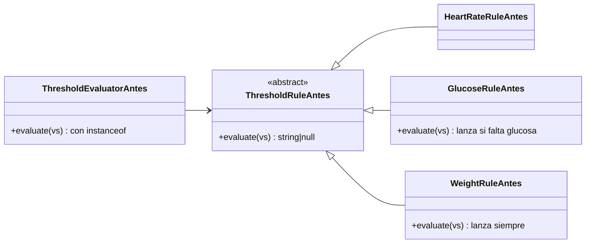
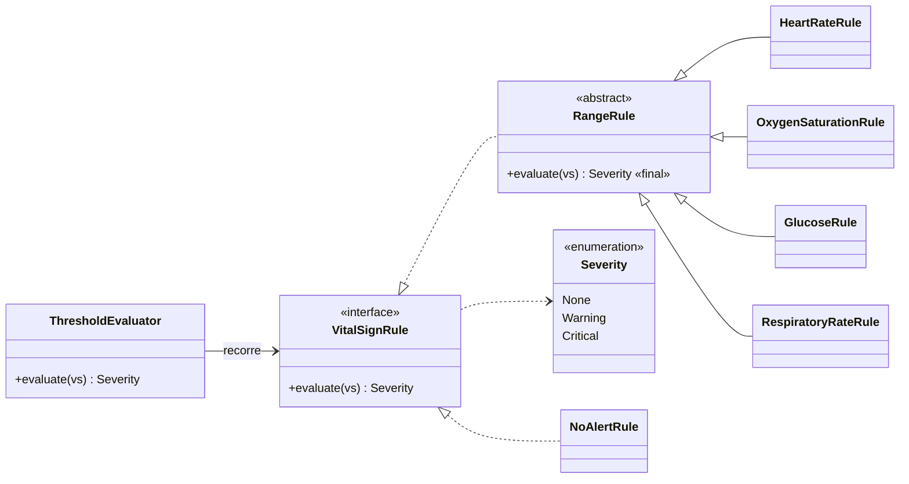

# Aplicación de LSP — Signos vitales y alertas por valores anormales

## Principio aplicado

> «Viene a decir que una clase derivada de otra debe poder ser sustituida por su clase base», y «debemos garantizar que los métodos de la primera no provoquen un mal funcionamiento de los métodos de la clase base.» (Rodríguez González, L. M. *Principios básicos del diseño de software*. MVP Cluster. <https://mvpcluster.com/diseno-de-software-2/>)

La fuente usa el caso del cuadrado que hereda del rectángulo y rompe el código que espera un rectángulo. En este módulo el riesgo está en la **evaluación de umbrales** (partición B de la Semana 1): si una regla de un signo se comporta distinto al tipo base, puede ocultar la alerta de otro signo.

## Diseño antes de LSP

**Problemas:**

- `GlucoseRuleAntes` **refuerza la precondición**: exige glucosa, aunque el contrato base acepta mediciones sin ese signo.
- `WeightRuleAntes` **rechaza la herencia**: lanza una excepción porque el peso no tiene umbral.
- Para no fallar, `ThresholdEvaluatorAntes` pregunta `instanceof` por cada subclase. Si alguien agrega una regla y olvida el `if`, la excepción corta el ciclo y **la FC 138 crítica no genera alerta**. Es el defecto más grave posible en este módulo.

## Diseño después de LSP

**Contrato de `VitalSignRule::evaluate()`** (lo que todo subtipo debe respetar):

1. **Precondición:** acepta cualquier medición, tenga o no su signo. No exige más que el tipo base.
2. **Postcondición:** siempre devuelve un `Severity`; si el signo falta o es normal, `None`. Nunca lanza por un signo ausente.
3. **Invariante:** no modifica la medición ni depende de otras reglas.

## Responsabilidades

| Elemento | Responsabilidad | Cómo respeta el contrato |
|---|---|---|
| `VitalSignRule` «interfaz» | Contrato de una regla de umbral. | Lo define |
| `RangeRule` «abstracta» | Plantilla `final` de evaluación por bandas (crítico bajo, alerta baja, alerta alta, crítico alto). | Signo ausente → `None`; las subclases no pueden reescribir `evaluate()` |
| `HeartRateRule`, `OxygenSaturationRule`, `GlucoseRule`, `RespiratoryRateRule` | Aportar las bandas del perfil `adulto-2026.1`. | Solo pasan números al constructor |
| `NoAlertRule` | Peso y talla: no generan alerta. | Devuelve `None` en lugar de lanzar |
| `ThresholdEvaluator` | Recorrer las reglas y quedarse con la severidad máxima. | No usa `instanceof` ni conoce subclases |

## Justificación de dependencias

- `ThresholdEvaluator` depende solo de `VitalSignRule`; cualquier subtipo es intercambiable porque el contrato está escrito y probado.
- `evaluate()` es `final` en `RangeRule`: así ninguna subclase puede reforzar la precondición. La variación queda en los datos (bandas), no en el comportamiento.
- El perfil de umbrales sigue detrás de `ThresholdPolicy` (Semana 1), que entrega la lista de reglas vigente en `measured_at`.
- La falla de perfil no aplicable (`THRESHOLDS_NOT_APPLICABLE`) la decide el servicio antes de evaluar, no una regla.

## Beneficio verificable

La [demo ejecutable](./evidencia/demo-lsp.php) ejecuta **la misma prueba de contrato** contra cada subtipo: dos reglas del diseño antes la incumplen y las cinco del después la cumplen. También comprueba que ambos diseños dan la misma severidad, que el evaluador nuevo no usa `instanceof` y que una regla nueva se sustituye sin tocarlo. La salida está en [evidencia-verificable.md](./evidencia-verificable.md).
