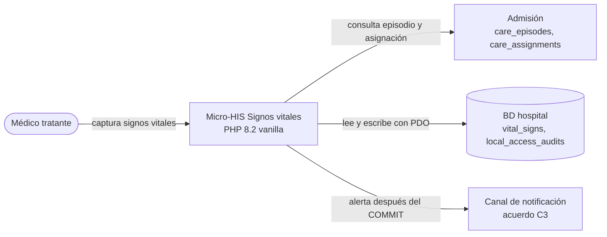
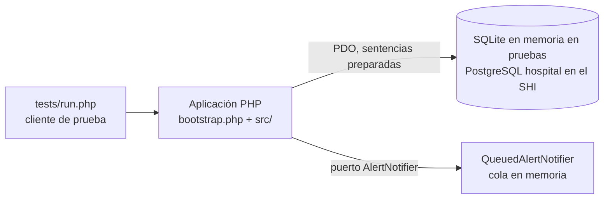
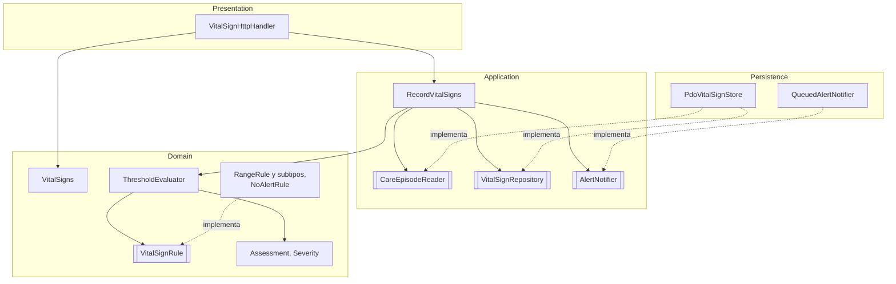
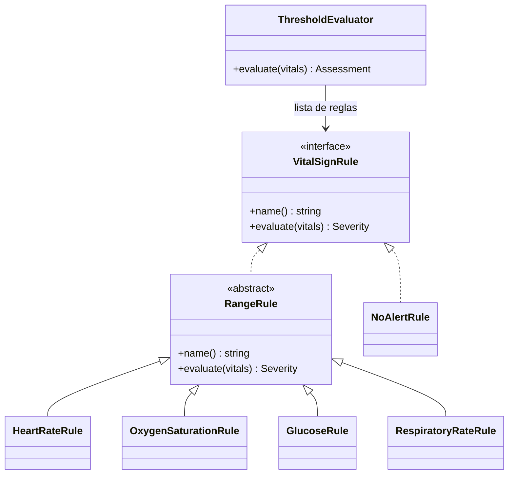

# Vista arquitectónica C4/UML — Micro-HIS Signos vitales y alertas

## Nivel 1: contexto

## Nivel 2: contenedores

En el prototipo el cliente es `tests/run.php`. En el SHI será la ruta HTTP con JWT y `X-Tenant-ID` (fuera de alcance esta semana).

## Nivel 3: componentes por capa

## UML de clases: jerarquía sustituible (LSP de la Semana 2)

`RangeRule::evaluate()` es `final`: las subclases solo aportan bandas y no pueden reforzar la precondición. La prueba `honorsContract()` de `tests/run.php` es la misma para las seis reglas: signo ausente → `None`, sin excepciones.

## Decisiones arquitectónicas

| Decisión | Justificación |
|---|---|
| Puertos en Application, adaptadores en Persistence | Inversión de dependencias: Application define lo que necesita y PDO queda en el borde. |
| `VitalSigns` valida plausibilidad al construirse | RF-SV-02: un valor imposible se rechaza antes de evaluar umbrales; las reglas reciben siempre datos válidos. |
| Contrato `VitalSignRule` sin `instanceof` | Agregar una regla es agregar una clase a la lista; `ThresholdEvaluator` no cambia (LSP y OCP). |
| Medición y auditoría en una transacción; notificación después | RF-SV-07: si falla la auditoría hay rollback y no se envía ninguna alerta. |
| Sin tabla de alertas propia | `critical_alert` (slice H7) es de laboratorio y queda sin tocar. La alerta queda trazada en `local_access_audits`. |
