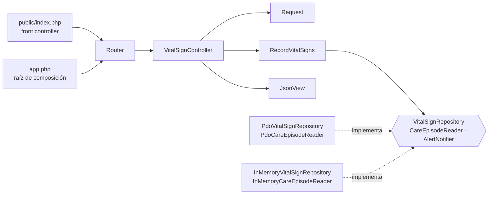

# Signos vitales y alertas por valores anormales — Semana 4

## Ficha de la asignación

- **Estudiante:** Hicho García, Josué Fernando (`Jhos-hgnu`)
- **Módulo:** ASII-13 — Signos vitales y alertas por valores anormales
- **Semana:** Semana 4 — Arquitectura en capas y patrón repositorio
- **Tarea individual:** Continúe el MISMO «Micro-HIS Signos vitales y alertas por valores anormales» y el flujo «captura de signos vitales, evaluación de umbrales y generación de alerta». Organice la entrada con MVC; defina una interfaz Repository en el límite apropiado y adaptadores PDO e InMemory. El controlador no tendrá SQL ni reglas de negocio. Además, analice y diagrame cómo un repositorio de datos compartido integraría este módulo.
- **Entregable / evidencia:** Capas, responsabilidades y objetos reutilizables. Código en [`micro-his/signos-vitales/`](../../../micro-his/signos-vitales/).

## Punto de partida

La Semana 3 dejó cuatro capas con `VitalSignHttpHandler` como entrada y `PdoVitalSignStore` implementando dos puertos. Esta semana se construye sobre las ramas `semana-03-...-core` (#1) y `semana-03-...-adapters-tests` (#2), que todavía no están integradas en `develop`; ver [organización de la entrega](#organización-de-la-entrega).

## Qué cambió (implementado)



- **MVC:** `Router` elige la acción; `VitalSignController` lee la `Request` (que rechaza con `422` los campos con tipo incorrecto), llama a `RecordVitalSigns` y entrega el resultado a `JsonView`. `VitalSignHttpHandler` se reemplazó por el controlador.
- **Repository:** `VitalSignRepository` se define en Application, con `record()` y `find()`. Lo implementan `PdoVitalSignRepository` e `InMemoryVitalSignRepository`. La lectura de episodios (`CareEpisodeReader`) tiene sus propios adaptadores.
- **Composición:** `app.php` arma el mismo MVC con cualquiera de los dos adaptadores.

## Archivos de esta entrega

- [Capas, responsabilidades y contrato del Repository](./capas-y-repository.md)
- [Repositorio de datos compartido](./repositorio-compartido.md)
- [Declaración de uso de IA](./DECLARACION_IA.md)

## Cómo verificar

```bash
php micro-his/signos-vitales/tests/run.php
php micro-his/signos-vitales/tests/repository.php
php -S 127.0.0.1:8013 -t micro-his/signos-vitales/public
```

La segunda línea levanta el front controller con InMemory (`ep1`, médica `dra.lopez`); con `SIGNOS_VITALES_DSN` usa PDO:

```bash
curl -X POST http://127.0.0.1:8013/episodes/ep1/vital-signs -H "X-User-ID: dra.lopez" -d '{"heart_rate":138,"oxygen_saturation":94,"measured_at":"2026-10-14 08:30:00"}'
```

Resultado con PHP 8.3.33 (código de salida 0):

```text
OK: camino feliz: FC 138 + SpO2 94 -> 201 alerta critical con dos hallazgos
OK: camino feliz: alerta auditada en la transacción y notificada después
OK: camino feliz: FC 80 y peso 70 -> 201 sin alerta ni notificación
OK: RF-SV-03: solo FC 95 -> warning; la glucosa ausente no bloquea
OK: regla de dominio: sin signos -> 422
OK: regla de dominio: temperatura 50 °C -> 422 antes de evaluar
OK: regla de dominio: asignación terminada -> 403
OK: regla de dominio: episodio cerrado -> 409
OK: RF-SV-06: paciente de 9 años -> 201 THRESHOLDS_NOT_APPLICABLE, auditado y sin alerta
OK: validación: measured_at inválido -> 422
OK: validación de tipos: encabezado o measured_at no string -> 422 sin guardar
OK: LSP: las 6 reglas cumplen la misma prueba de contrato
OK: error de persistencia: auditoría caída -> 500, rollback y sin notificación
OK: MVC: ruta desconocida -> 404 ROUTE_NOT_FOUND
OK: MVC: la vista entrega JSON UTF-8 con Content-Type
OK: InMemory: el mismo MVC da 201 critical, guarda, audita y notifica sin PDO
OK: InMemory: usuario sin asignación activa -> 403 igual que con PDO
OK: InMemory: persistencia no disponible -> 500 y sin notificación nueva
OK: el controlador y el router no contienen SQL, PDO ni reglas de umbral
Todas las pruebas pasaron.
```

```text
OK: PDO: guarda y recupera la medición con sus valores
OK: PDO: una alerta deja registrado y alerta_generada
OK: PDO: sin alerta solo registra; sin perfil audita sin_evaluacion
OK: PDO: un id desconocido devuelve null
OK: InMemory: guarda y recupera la medición con sus valores
OK: InMemory: una alerta deja registrado y alerta_generada
OK: InMemory: sin alerta solo registra; sin perfil audita sin_evaluacion
OK: InMemory: un id desconocido devuelve null
OK: InMemory: persistencia no disponible lanza RuntimeException y no guarda
Todas las pruebas de contrato pasaron.
```

## Organización de la entrega

Para respetar el límite de 400 líneas por PR, la semana se entrega en tres ramas apiladas sobre la Semana 3:

| Rama | Contenido | Se apila sobre | Líneas propias |
|---|---|---|---|
| `feature/asii-13-semana-04-signos-vitales-repository-jhos-hgnu` | Puertos, `StoredVitalSign`, adaptadores PDO e InMemory y `tests/repository.php` | Semana 3 `core` + `adapters-tests` | ~210 |
| `feature/asii-13-semana-04-signos-vitales-mvc-tests-jhos-hgnu` | `Router`, `Controller`, `Request`, `JsonView`, `app.php`, `public/index.php` y `tests/run.php` | Rama `repository` | ~285 (224 añadidas, 60 eliminadas) |
| `feature/asii-13-semana-04-signos-vitales-docs-jhos-hgnu` | Esta documentación | Semana 3 `arquitectura` | ~250 |

Orden de integración: Semana 3 `core`, `adapters-tests`, `arquitectura`; luego `repository`, `mvc-tests` y `docs`. Las pruebas se ejecutan con `repository` y `mvc-tests` integradas.

## Límites de la Semana 4

- Sin autenticación JWT ni `X-Tenant-ID`: `X-User-ID` sigue identificando al médico.
- Los adaptadores PostgreSQL del repositorio compartido son propuesta, no código.
- Sin reconocimiento de alertas ni corrección de mediciones.
