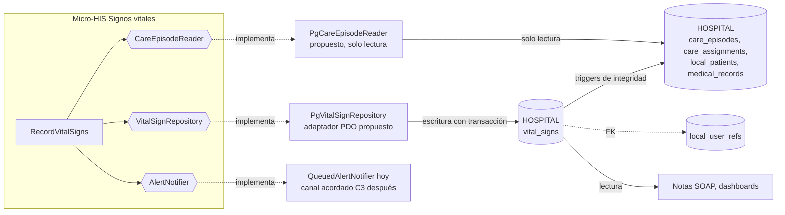

# Repositorio de datos compartido

## Situación actual

Las tablas del módulo ya viven en la base **HOSPITAL**, que comparten todos los módulos clínicos: `vital_signs` se crea en la migración `database/migrations/hospital/2026_08_11_000401_create_allergy_and_vital_sign_tables.php`. Para validar al autor y al paciente se apoya en tablas de otros módulos:

| Tabla | Dueño | Cómo la usa Signos vitales |
|---|---|---|
| `care_episodes`, `care_assignments` | Admisión (ASII-07) | Solo lectura: episodio abierto y médico tratante con asignación activa (`valid_to IS NULL`). Un trigger de `vital_signs` repite esta comprobación. |
| `local_patients` | Admisión / pacientes | Solo lectura: `birth_date` para calcular la edad y elegir el perfil de umbrales. |
| `medical_records` | Historia clínica (ASII-11) | `vital_signs.medical_record_id` es obligatorio; un trigger exige que el episodio y la historia sean del mismo paciente. |
| `local_user_refs`, `doctor_profiles` | Usuarios (ASII-02) y Médicos (ASII-04) | `recorded_by_user_ref_id` apunta a `local_user_refs`; la asignación apunta a `doctor_profiles`. |
| `vital_signs` | **Signos vitales** | Única tabla clínica que este módulo escribe. |

## Integración propuesta

- **El módulo no cambia.** Se agregan dos adaptadores PDO para PostgreSQL que implementan los mismos puertos. El controlador, el caso de uso y el dominio quedan iguales, y el contrato se valida con la misma batería de `tests/repository.php`.
- **Escritura:** solo Signos vitales inserta en `vital_signs`. Los demás módulos la leen; una corrección se hace con una fila nueva (`supersedes_id`), nunca con un `UPDATE`.
- **Lectura de Admisión:** `PgCareEpisodeReader` solo lee estado del episodio, asignación activa y fecha de nacimiento; no expone nombre ni documento del paciente.

## Correspondencia de datos

| Micro-HIS (`schema.sql`) | HOSPITAL (migración `000401`) | Diferencia que absorbe el adaptador |
|---|---|---|
| ids `TEXT` (`sv-…`) | `uuid` con `gen_random_uuid()` | El adaptador PostgreSQL deja que la base genere el id y lo obtiene con `RETURNING`. |
| `recorded_by` (texto de `X-User-ID`) | `recorded_by_user_ref_id uuid` → `local_user_refs` | El adaptador resuelve la identidad autenticada al `local_user_ref_id`. |
| Sin historia clínica | `medical_record_id uuid NOT NULL` | El adaptador la obtiene de `medical_records` por el paciente del episodio. Si no existe, el caso de uso necesita un error nuevo (propuesta SD-SV-13). |
| `status` `validated` por defecto | `status` `draft` por defecto; `validated` exige `validated_at >= recorded_at` | El adaptador inserta `validated` con `validated_at = now()`. |
| Valores `REAL` (por ejemplo FC 138.5) | `heart_rate`, `respiratory_rate`, `systolic_bp`, `diastolic_bp` son `integer` | PostgreSQL redondearía o rechazaría el decimal; hay que decidir si `VitalSigns` exige enteros en esos signos (SD-SV-14). |
| `measured_at` texto `Y-m-d H:i:s` | `timestamptz` y `recorded_at >= measured_at` | El adaptador convierte con la zona del hospital; una medición futura la rechaza el `CHECK`. |
| `care_episodes.patient_birth_date` | La fecha está en `local_patients.birth_date` | `PgCareEpisodeReader` hace el `JOIN`; el prototipo la copia al episodio. |
| `local_access_audits (event, actor_id, detail)` | **No existe** en las migraciones de `develop` | Ver SD-SV-12. |
| SpO₂ > 0 | `CHECK` acepta 0 | Diferencia ya documentada en la Semana 3. |

## Propiedad, consistencia y riesgos

| Tema | Decisión |
|---|---|
| Propiedad | Signos vitales es dueño de `vital_signs` y del significado de `draft`, `validated` y `entered_in_error`. |
| Consistencia | Fuerte: misma base y misma transacción para la medición y su auditoría. La notificación sale después del `COMMIT`; si el canal falla la medición ya está guardada (limitación conocida). |
| Doble defensa | `VitalSigns` valida la plausibilidad antes de tocar la base y los `CHECK` y triggers de `000401` la repiten. Si dos peticiones concurrentes pasan el dominio, la base rechaza lo inválido. El adaptador debe traducir la excepción del trigger a `403` o `409`. |
| Acoplamiento | Notas SOAP y los paneles leen columnas de `vital_signs`. Renombrar `status`, `measured_at` o los nombres de los signos rompe a esos consumidores: son contrato público. |
| Borrado | `ON DELETE RESTRICT` en todas las FK: una medición no se borra, se corrige con `supersedes_id`. |
| Alcance de lectura | Un repositorio compartido no debe devolver mediciones de pacientes sin asignación activa. El filtro por tenant y por consentimiento vive en la capa de acceso (ASII-01/02), no en el repositorio. |

## Supuestos y decisiones pendientes

- **SD-SV-12:** la auditoría de la medición y de la alerta se guardará en la tabla común de auditoría del HOSPITAL en la misma transacción. Está pendiente del módulo Gobernanza y auditoría; el prototipo usa `local_access_audits` mínima en SQLite.
- **SD-SV-13:** falta decidir qué responde el módulo cuando el paciente no tiene `medical_record`. Se propone `409 MEDICAL_RECORD_NOT_FOUND`.
- **SD-SV-14:** falta decidir si FC, FR y presión se aceptan solo como enteros para igualar el tipo de la columna.
- El adaptador PostgreSQL es **propuesta**: el prototipo usa SQLite y no ejercita triggers ni `timestamptz`. No se necesita una entidad de base de datos nueva.
