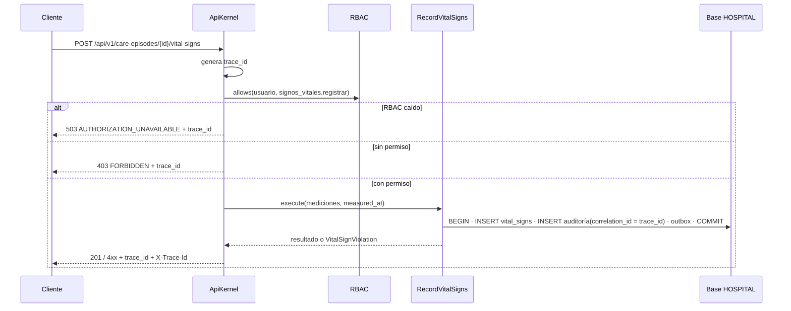

# Frontera de microservicio — Signos vitales y alertas

## Vista cliente-servidor

```mermaid
flowchart LR
  subgraph Clientes
    UI[Expediente / panel médico]
    NOTAS[Notas SOAP]
    ALERT[Alertas críticas ASII-21]
  end
  UI -->|POST/GET /api/v1| K
  NOTAS -->|GET /api/v1/vital-signs/id| K
  subgraph SV[Micro-HIS Signos vitales — servidor]
    K[ApiKernel<br>401 · 403 · 503 · trace_id] --> R[Router + Controller MVC]
    R --> UC[RecordVitalSigns]
    UC --> REPO{{VitalSignRepository}}
  end
  K -->|allows usuario, permiso| RBAC[RBAC ASII-02]
  REPO --> DB[(HOSPITAL<br>vital_signs)]
  UC -.outbox, misma transacción.-> OB[(outbox_events)]
  OB -.signo_vital.alerta_generada.-> ALERT
```

## Flujo con las garantías de la frontera



## Pregunta

¿Signos vitales debe ser un servicio con base propia, o basta con exponer una API versionada dentro del HIS?

## Criterios medibles

La medición sale de `php micro-his/signos-vitales/tests/bench.php` (PHP 8.3.33, 16 núcleos, 5000 peticiones, flujo completo Router → caso de uso → Repository con alerta crítica). Es una medición **en proceso, sin red ni PostgreSQL**: da el costo de la lógica del módulo, no el de producción.

| Criterio | Situación actual | ¿Favorece separar? |
|---|---|---|
| Costo de cómputo del módulo | InMemory: p50 0,007 ms, p95 0,012 ms. PDO sobre SQLite: p50 0,049 ms, p95 0,087 ms, unas 17 800 peticiones/s en un solo proceso. | **No.** La lógica de evaluación es despreciable frente a la red. |
| Escala independiente | Supuesto a validar con Admisión: hospital de 300 camas con signos cada 4 h son unas 75 mediciones por hora, con picos de unas 100 por minuto. Eso es ~0,01 % de la capacidad medida. | **No.** Sin carga que justifique escalar aparte. |
| Acoplamiento de datos | `vital_signs` tiene 3 FK a otros módulos (`medical_records`, `care_episodes`, `local_user_refs`) y el trigger `enforce_vital_sign_integrity` lee `doctor_profiles`, `care_assignments` y `medical_records` en cada INSERT. | **No.** Con base propia se pierden 3 FK y las validaciones del trigger; cada escritura validaría por red. |
| Consistencia exigida | Medición + auditoría + (propuesta) evento van en un `COMMIT`. | **No.** Separar obliga a un saga u outbox para algo que hoy resuelve una transacción. |
| Inmutabilidad | Una medición `validated` no se modifica; se corrige con una fila nueva (`supersedes_id`). | Neutro: simplifica un contrato, no exige separar. |
| Equipo dueño | Un integrante; el HIS se despliega junto. | **No.** Suma operación sin quien la sostenga. |
| Acoplamiento con Alertas críticas | Hoy `QueuedAlertNotifier` en memoria; el canal real (C3) no está acordado. | **Sí, pero solo como evento**, no como servicio de datos. |

## Decisión

**No dividir Signos vitales.** Se evoluciona a cliente-servidor con API `/api/v1`, OpenAPI, permisos RBAC y un cliente en proceso, y se deja **una frontera de eventos** con Alertas críticas: `signo_vital.alerta_generada` por outbox ([contrato](./contrato-api.md#evento-de-salida-propuesto)). Ningún criterio medido justifica una base ni un proceso propios.

### Disparadores para reevaluar

| Disparador | Umbral sugerido |
|---|---|
| Carga | Más de 1 000 mediciones por minuto sostenidas, o p95 de `POST` mayor que 200 ms en el HIS completo. |
| Equipo | Un equipo distinto que despliegue Signos vitales con su propio ciclo. |
| Dependencias | Otros módulos leen `vital_signs` solo por API (ninguna consulta SQL directa). |

## Migración razonada

| Paso | Qué cambia | Por qué en este orden |
|---|---|---|
| 1. Contrato y cliente (esta semana) | API v1, OpenAPI, `ApiKernel` y `VitalSignApiClient` en proceso. | Fija la frontera sin mover datos. |
| 2. Consumidores solo por API | Notas SOAP y paneles dejan cualquier SQL directo sobre `vital_signs`. | Mientras alguien lea la tabla, separar la base lo rompería. |
| 3. Eventos por outbox | La medición escribe `outbox_events` en su transacción; Alertas críticas consume `signo_vital.alerta_generada` y reemplaza a `QueuedAlertNotifier`. | Quita la dependencia síncrona antes de cualquier corte. |
| 4. Base y proceso propios | `StreamTransport` entre procesos, `CareEpisodeReader` por HTTP, y el trigger del autor reemplazado por esa validación. | Es lo más caro; solo si un disparador se cumple. |

## Comunicación, seguridad, resiliencia, observabilidad y consistencia

| Tema | Diseño |
|---|---|
| Comunicación | HTTP/JSON síncrono con `/api/v1` para registrar y consultar; evento asíncrono solo para alertas (outbox, propuesto). |
| Seguridad | `401` sin actor; `403 FORBIDDEN` sin permiso RBAC; `403 NOT_TREATING_PHYSICIAN` sin asignación activa, sin revelar si el episodio existe; falla cerrada si RBAC cae (`503`). Los eventos y los errores no llevan valores clínicos. |
| Resiliencia | Timeout de 2 s en el transporte HTTP; un solo reintento y solo en `GET`. `POST` no se reintenta para no duplicar mediciones (propuesta: `Idempotency-Key` para poder hacerlo). Persistencia caída: `500` sin guardar ni notificar. |
| Observabilidad | `trace_id` UUID v4 en cuerpo y `X-Trace-Id`, guardado como `correlation_id` en la auditoría; bitácora de acceso por petición (actor, método, ruta, estado) sin cuerpo clínico. |
| Consistencia | Fuerte dentro del hospital (una transacción: medición + auditoría + outbox). Eventual hacia Alertas críticas: puede haber retraso o repetición, nunca pérdida; el consumidor es idempotente por `event_id`. Sin transacciones entre bases. |

## Decisiones pendientes

- **Auditoría (slice H8):** `local_access_audits` aún no existe en `develop`; se alineará con el Anexo A (`correlation_id`, `module`, `action`, `resource_id`, `metadata`) cuando Javier confirme.
- **Enfermería:** el trigger exige un `doctor_profile` como autor, así que enfermería solo tiene `signos_vitales.ver`. Registrar por enfermería requiere cambiar el trigger.
- **Outbox:** `outbox_events` no existe todavía; se coordina con Alertas críticas (ASII-21) y base de datos.
- **Carga real:** las cifras de carga son un supuesto; hay que validarlas con Admisión antes de usarlas como argumento.
