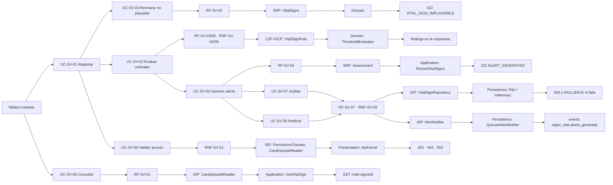

# Signos vitales y alertas por valores anormales — Semana 6

## Ficha de la asignación

- **Estudiante:** Hicho García, Josué Fernando (`Jhos-hgnu`)
- **Módulo:** ASII-13 — Signos vitales y alertas por valores anormales
- **Semana:** Semana 6 — Primera evaluación parcial
- **Tarea individual:** Defienda la arquitectura propuesta para «captura de signos vitales, evaluación de umbrales y generación de alerta» en Signos vitales y alertas por valores anormales: conecte actores, UML, RF/RNF, principio SOLID, capas, Repository y contrato API. Responda un cambio práctico considerando signos vitales, unidades, umbrales, valores anormales y alertas clínicas.
- **Entregable / evidencia:** Presentación de 6–8 diapositivas, diagrama trazable, matriz decisión→evidencia y registro del cambio práctico defendido.

## Tesis

**Una alerta clínica es una decisión derivada: el mismo valor debe producir la misma severidad sin importar quién lo envíe, por dónde llegue o qué adaptador lo guarde.** De ahí salen las garantías que se defienden: lo imposible se rechaza antes de evaluar, una regla nueva no puede ocultar la alerta de otra, el valor anormal no existe sin su traza, y la frontera del módulo falla cerrada. Cada eslabón de la cadena actor → UML → RF/RNF → SOLID → capas → Repository → API protege que la alerta ni se pierda ni se invente.

## Diagrama trazable

Cada fila de la cadena tiene los mismos identificadores que los documentos de las Semanas 1 a 5. Se lee de izquierda a derecha.



La [matriz decisión → evidencia](./matriz-decision-evidencia.md) liga cada decisión con su archivo, su prueba y su PR.

## Qué se defiende

| Eslabón | Decisión | Por qué |
|---|---|---|
| Actores y UML | Solo el médico tratante captura | El trigger `enforce_vital_sign_integrity` exige un médico con asignación activa; modelar otro actor contradiría el esquema. |
| RF/RNF | 7 RF y 5 RNF medibles, cada uno con un UC de origen | Que el criterio de aceptación sea una prueba, no una opinión. |
| SOLID | LSP en las reglas de umbral, apoyado en SRP, ISP y DIP | Una regla que lanza ante un signo ausente corta el ciclo y oculta una FC 138 crítica. |
| Capas | Presentation, Application, Domain y Persistence | El dominio (plausibilidad y umbrales) no conoce PDO, HTTP ni RBAC. |
| Repository | `VitalSignRepository` en Application, con adaptadores PDO e InMemory | Quien define la garantía (todo o nada con su auditoría) es la aplicación; la misma batería prueba ambos adaptadores. |
| Contrato API | `/api/v1`, permisos `signos_vitales.*`, `{code, trace_id}`, falla cerrada | Los consumidores dependen del contrato, no del SQL. |
| Frontera | No dividir en microservicio; evento hacia Alertas críticas | 3 FK, un trigger, una sola transacción y p95 de 0,087 ms en proceso no justifican otra base. |

## Lo implementado y lo propuesto

- **Implementado y probado:** registrar, evaluar, alertar, consultar por id, Repository PDO e InMemory, MVC, `ApiKernel`, cliente. 50 casos entre `run.php` (19), `repository.php` (9), `api.php` (14) y `client.php` (8).
- **Solo propuesto:** consulta por episodio, corrección con `supersedes_id`, outbox hacia Alertas críticas, auditoría H8 con `correlation_id`, adaptadores PostgreSQL, frontend.
- **Cambio práctico (unidades):** defendido en [cambio-practico.md](./cambio-practico.md) y sin código de producción nuevo; la demo ejecutable va en la Semana 7.

## Riesgos abiertos

| Riesgo | Estado |
|---|---|
| Los umbrales `adulto-2026.1` son ilustrativos, sin validación clínica | Pendiente de un responsable clínico; son configuración, no código. |
| `local_access_audits` y `outbox_events` no tienen migración | Pendientes con base de datos; el prototipo usa una tabla mínima. |
| RBAC es un doble en memoria y `X-User-ID` no es autoritativo | Se reemplaza por JWT y `X-Tenant-ID` al integrar ASII-01 y ASII-02. |
| `vital_signs` no tiene columna de unidad (R3) | El cambio práctico lo resuelve en la frontera, sin migración. |
| Enteros en FC/FR/presión y `medical_record_id` obligatorio | Pendientes de confirmar con base de datos. |

## Archivos de esta entrega

- [Presentación de 8 diapositivas](./presentacion.md)
- [Matriz decisión → evidencia](./matriz-decision-evidencia.md)
- [Registro del cambio práctico](./cambio-practico.md)
- [Declaración de uso de IA](./DECLARACION_IA.md)
- Base: [Semana 1](../semana-01/README.md), [Semana 2](../semana-02/rf-rnf-criterios.md), [Semana 3](../semana-03/README.md), [Semana 4](../semana-04/README.md) y [Semana 5](../semana-05/contrato-api.md).

## Cómo verificar

```bash
php micro-his/signos-vitales/tests/run.php
php micro-his/signos-vitales/tests/repository.php
php micro-his/signos-vitales/tests/api.php
php micro-his/signos-vitales/tests/client.php
```

Resultado con PHP 8.3.33: las cuatro suites terminan con código de salida 0 (19, 9, 14 y 8 casos).

> Los enlaces a las Semanas 3 a 5 resuelven con la cadena de PRs #131, #132, #133, #529, #530, #531, #546, #549 y #550 integrada en `develop`; esta rama solo añade la entrega de la Semana 6.
