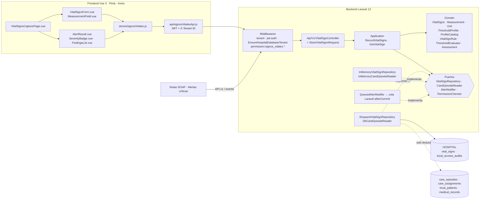

# Signos vitales y alertas por valores anormales — Semana 7

## Ficha de la asignación

- **Estudiante:** Hicho García, Josué Fernando (`Jhos-hgnu`)
- **Módulo:** ASII-13 — Signos vitales y alertas por valores anormales
- **Semana:** Semana 7 — Diseño de componentes y refactorización
- **Tarea individual:** Diseñe los componentes backend y frontend propios de Signos vitales y alertas por valores anormales para «captura de signos vitales, evaluación de umbrales y generación de alerta». Refactorice conceptualmente el punto con mayor acoplamiento entre signos vitales, unidades, umbrales, valores anormales y alertas clínicas, separando UI, aplicación, dominio y persistencia sin ampliar el módulo.
- **Entregable / evidencia:** Diagrama de componentes, contratos de entrada/salida y comparación antes/después de un refactor concreto con justificación.
- **Alcance:** diseño. El código Laravel/Vue queda **propuesto** para la integración; el refactor se demuestra con una demo ejecutable que no modifica el micro-HIS.

## Diagrama de componentes



Los componentes nuevos de la refactorización son `Measurement`, `Unit`, `ThresholdProfile` y `ProfileCatalog`; el resto sale del micro-HIS de las Semanas 3 a 5 y se copia sin cambios de lógica.

## Archivos de esta entrega

- [Componentes backend y frontend](./componentes.md): responsabilidad de cada componente y su estado en `develop`.
- [Contratos de entrada y salida](./contratos-io.md): HTTP, puertos, Pinia, props y eventos.
- [Refactor antes/después](./refactor-antes-despues.md): el punto más acoplado, la comparación y la justificación.
- [Demo ejecutable](./evidencia/demo-refactor.php)
- [Declaración de uso de IA](./DECLARACION_IA.md)
- Base: [Semana 5](../semana-05/contrato-api.md) y [cambio práctico de la Semana 6](../semana-06/cambio-practico.md).

## Cómo verificar

```bash
php docs/signos-vitales/semana-07/evidencia/demo-refactor.php
php micro-his/signos-vitales/tests/run.php
```

Resultado con PHP 8.3.33 (código de salida 0): 15 comprobaciones `PASS` en la demo, y las 19 de `run.php` siguen pasando porque el micro-HIS no se modificó.

```text
== Unidades: el cambio práctico de la Semana 6 ==
PASS  glucosa 5,5 mmol/L (normal)                    antes: 201 ALERT_GENERATED/critical después: 201 OK/none
PASS  glucosa 12 mmol/L (216 mg/dL, warning)         antes: 201 ALERT_GENERATED/critical después: 201 ALERT_GENERATED/warning
PASS  glucosa 2,9 mmol/L (52,2 mg/dL, critical)      antes: 201 ALERT_GENERATED/critical después: 201 ALERT_GENERATED/critical
PASS  temperatura 98,6 °F                           antes: 422 VITAL_SIGN_IMPLAUSIBLE después: 201 OK/none
PASS  temperatura 122 °F (50 °C, imposible)        antes: 422 VITAL_SIGN_IMPLAUSIBLE después: 422 VITAL_SIGN_IMPLAUSIBLE
PASS  glucosa con unidad que no existe (mg/L)        antes: no expresable              después: 422 UNIT_NOT_SUPPORTED
PASS  FC en mmol/L                                   antes: no expresable              después: 422 UNIT_NOT_SUPPORTED

== Regresión: con valores canónicos el comportamiento no cambia ==
PASS  glucosa 5,5 sin unidad (compatibilidad)        antes: 201 ALERT_GENERATED/critical después: 201 ALERT_GENERATED/critical
PASS  FC 138 + SpO2 94                               antes: 201 ALERT_GENERATED/critical después: 201 ALERT_GENERATED/critical
PASS  FC 95 (la glucosa ausente no bloquea)          antes: 201 ALERT_GENERATED/warning después: 201 ALERT_GENERATED/warning
PASS  solo peso 70 kg                                antes: 201 OK/none                después: 201 OK/none
PASS  paciente de 9 años                            antes: 201 THRESHOLDS_NOT_APPLICABLE/none después: 201 THRESHOLDS_NOT_APPLICABLE/none
PASS  temperatura 50 °C (imposible)                 antes: 422 VITAL_SIGN_IMPLAUSIBLE después: 422 VITAL_SIGN_IMPLAUSIBLE

== Lo que gana el después ==
PASS  la respuesta lleva el perfil aplicado (adulto-2026.1) y el valor canónico (52.2 mg/dL)
PASS  un perfil nuevo se agrega al catálogo sin modificar el caso de uso (OCP)
```

## Fuera de alcance

Consulta por episodio, corrección de mediciones, reconocimiento de alertas, perfiles pediátricos reales y el centro de notificaciones. El perfil pediátrico de la demo es un doble para probar la extensión, no una propuesta clínica.
