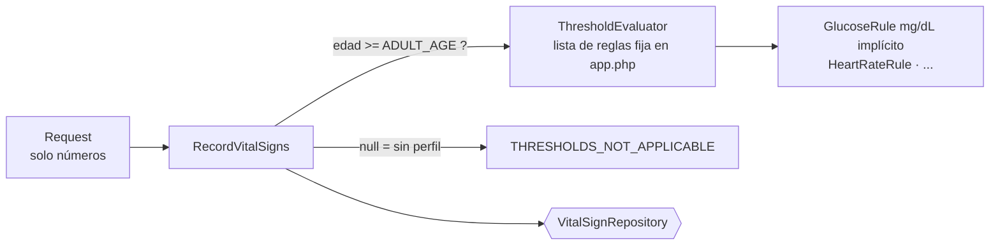
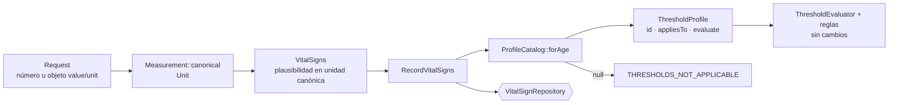

# Refactor antes/después — perfil de umbrales y unidades

## El punto más acoplado

Entre **signos vitales, unidades, umbrales, valores anormales y alertas**, el nudo está en `RecordVitalSigns::execute()` y su raíz de composición:

| Dónde | Acoplamiento |
|---|---|
| `RecordVitalSigns::ADULT_AGE` | El caso de uso decide **qué perfil de umbrales aplica** según la edad: `$context->patientAge >= self::ADULT_AGE ? evaluate : null`. El `null` significa «sin perfil», un significado escondido en un valor. |
| `app.php` | La lista de reglas del perfil se arma a mano en la raíz de composición. El perfil no tiene nombre ni versión: no existe como concepto. |
| Reglas (`GlucoseRule` `53, 69, 181, 400`) y `VitalSigns::LIMITS` | Las **unidades son implícitas**: aparecen en un comentario (`mg/dL`) y en los rangos. Dos tablas deben coincidir sin que ningún tipo las ligue. |
| `Request::measurements()` | Solo acepta números. No hay forma de declarar la unidad, así que un valor en mmol/L entra como si fuera mg/dL. |

Consecuencias medidas con el código real (ver [cambio práctico](../semana-06/cambio-practico.md)): glucosa 5,5 mmol/L (normal) produce una alerta **crítica falsa**; 12 mmol/L (warning real) sale `critical`. Y el cambio que haría falta (otra unidad, otro perfil) obliga a editar el caso de uso.

`PdoVitalSignRepository` y `InMemoryVitalSignRepository` también repiten la decisión de qué eventos de auditoría genera una alerta (`alerta_generada`, `sin_evaluacion`). Es un acoplamiento real, pero entre persistencia y alertas; no se aborda aquí para no ampliar el refactor.

## Antes

Razones para modificar `RecordVitalSigns`: fecha válida, acceso y episodio, **elección del perfil por edad**, guardar y notificar, formato de la respuesta. Cinco.

## Después

- **`Unit` y `Measurement`** (Domain): una medida declara su unidad y se convierte a la canónica **antes** de que exista `VitalSigns`. Las reglas siguen recibiendo mg/dL y °C.
- **`ThresholdProfile`** (Domain): interfaz con `id()`, `appliesTo($age)` y `evaluate()`. `AdultProfile` (`adulto-2026.1`) envuelve las reglas y el evaluador actuales.
- **`ProfileCatalog`** (Domain/Application): elige el perfil por edad. `null` sigue siendo «sin perfil aplicable», pero ahora es el resultado explícito de una búsqueda.
- **`RecordVitalSigns`**: pierde `ADULT_AGE` y la lista de reglas; pide el perfil al catálogo.

## Comparación

| Aspecto | Antes | Después |
|---|---|---|
| Razones para cambiar `RecordVitalSigns` | 5 | 4 (la elección del perfil se va al catálogo) |
| Dónde viven las unidades | Comentarios y rangos, implícitas | `Unit` y `Measurement`, explícitas y verificables |
| Glucosa 5,5 mmol/L | `critical` (alerta falsa) | `OK` (99,1 mg/dL) |
| Temperatura 98,6 °F | `422` (inutilizable) | `201 OK` (37,0 °C) |
| Unidad desconocida | No expresable | `422 UNIT_NOT_SUPPORTED` (falla cerrada) |
| Agregar un perfil (por ejemplo, pediátrico) | Editar `RecordVitalSigns` y `app.php` | Una clase que implementa `ThresholdProfile` y una línea en el catálogo |
| Versión del perfil en la alerta | No existe | `threshold_profile_version` en la respuesta |
| Reglas, evaluador, Repository, base de datos | — | **Sin cambios** |
| Comportamiento con valores canónicos | — | Idéntico (6 casos de regresión en la demo) |

## Justificación

1. **SRP.** Elegir un perfil y orquestar un registro son dos razones de cambio distintas.
2. **OCP.** Un perfil o una unidad nuevos se agregan sin editar el caso de uso ni el evaluador; la demo lo prueba con un perfil pediátrico de prueba.
3. **LSP y seguridad del paciente.** Las reglas no cambian: siguen sin lanzar ante un signo ausente, así que ninguna conversión puede ocultar la alerta de otro signo.
4. **Falla cerrada.** La unidad desconocida se rechaza; la plausibilidad se evalúa **después** de convertir, así 122 °F (50 °C) se rechaza como 50 °C.
5. **Sin ampliar el módulo.** No se agregan signos, endpoints, tablas ni actores. La base guarda el mismo valor canónico, así que no hay migración ni entidad nueva.

## Riesgos

- **Se guarda el valor canónico y se pierde el original.** Propuesta: `metadata` de la auditoría H8 con valor y unidad originales, sin texto clínico, cuando exista esa tabla.
- **Un número sin unidad sigue siendo canónico** (compatibilidad). Exigir la unidad queda para una futura `/api/v2`.
- **El factor 18,016 y los umbrales** necesitan validación clínica.
- **Alcance.** `ProfileCatalog` tiene un solo perfil real; la extensión pediátrica es solo una prueba de que la estructura la admite.
