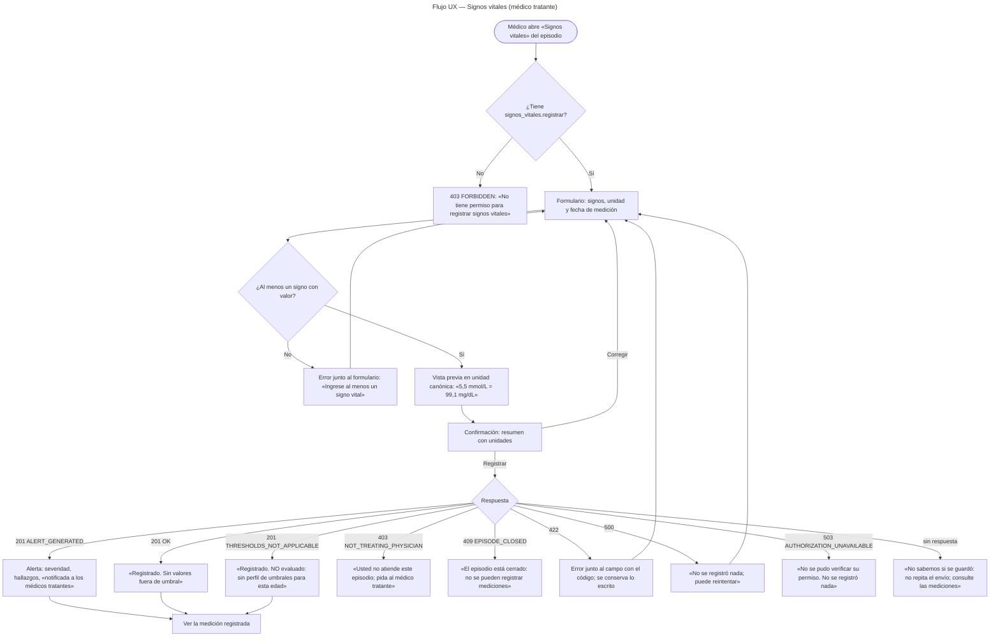
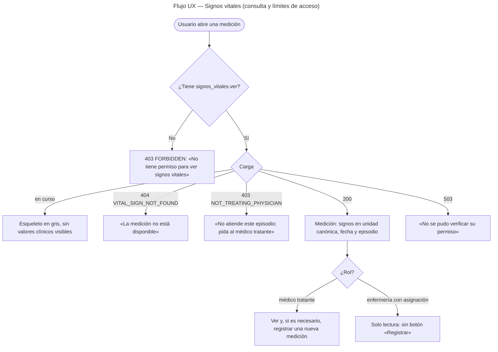

# Signos vitales y alertas por valores anormales — Semana 8: flujo UX por rol

**Estudiante:** Hicho García, Josué Fernando (`Jhos-hgnu`) · **Módulo:** ASII-13 — Signos vitales y alertas por valores anormales · **Entrega:** user flow por rol, wireframes anotados y reglas de interacción.

## Ficha de la asignación

- **Semana:** Semana 8 — Diseño de experiencia de usuario
- **Tarea individual:** Diseñe el flujo UX de «captura de signos vitales, evaluación de umbrales y generación de alerta» por sus roles autorizados. Incluya inicio, decisión, confirmación, estados vacío/carga/éxito, errores recuperables, ayuda contextual y protección de datos vinculados con signos vitales, unidades, umbrales, valores anormales y alertas clínicas.
- **Entregable / evidencia:** user flow por rol y 4–6 wireframes anotados con estados, mensajes, validaciones y reglas de interacción.
- **Issue:** Refs #23
- **Alcance:** diseño. **No se implementa código**: los componentes Vue de la [Semana 7](../semana-07/componentes.md) quedan *propuestos* y aquí se define cómo se comportan.

## Objetivo

Que el médico tratante registre signos vitales sin equivocarse de unidad, entienda al instante si hubo una alerta y de qué gravedad, y que nunca confunda «sin alerta» con «no evaluado». Los mensajes usan los `code` reales del [contrato de la Semana 5](../semana-05/contrato-api.md); la elección de unidad y `UNIT_NOT_SUPPORTED` vienen de la [propuesta de la Semana 7](../semana-07/contratos-io.md) y **aún no están implementados**. Los wireframes están en [wireframes.md](./wireframes.md).

## Roles y permisos

| Rol | Objetivo en el flujo | Permisos |
|---|---|---|
| **Médico tratante** | Capturar la medición, ver la alerta y consultar la medición | `signos_vitales.registrar` · `signos_vitales.ver` (+ `signos_vitales.corregir`, propuesto) |
| **Enfermería** | Consultar mediciones, sin registrarlas | `signos_vitales.ver` |
| **Sin asignación** | Tiene el permiso pero no atiende el episodio | Permiso sí, episodio no: `403 NOT_TREATING_PHYSICIAN` |

`admin_hospital` **no** entra al flujo: es dato clínico y el acceso se limita a quien atiende al paciente.

Enfermería tiene el permiso `ver`, pero hoy la consulta exige además asignación activa, y el esquema solo asigna médicos. Su flujo termina entonces en `403 NOT_TREATING_PHYSICIAN` hasta que Admisión decida cómo asignar a enfermería (coordinación C4 de la Semana 1); la pantalla lo dice con claridad y no oculta el problema.

## User flow por rol

### Flujo 1 — Médico tratante: capturar, confirmar y ver la alerta

### Flujo 2 — Consulta por rol: médico tratante, enfermería y sin asignación

## Estados de la pantalla

| Estado | Qué ve el usuario |
|---|---|
| **Inicio** | El médico entra al formulario del episodio; enfermería, a la consulta. Si la URL no trae episodio, la pantalla pide elegirlo de la lista del paciente. |
| **Decisión** | «Registrar» solo se ofrece con `signos_vitales.registrar`; la autorización real la decide el servidor y la UI solo la refleja. |
| **Confirmación** | Antes de enviar, un resumen con cada valor **y su unidad**, y la conversión a la unidad canónica. «Corregir» vuelve al formulario sin perder lo escrito. |
| **Vacío** | «Este episodio aún no tiene mediciones registradas» (un `200` sin datos, no un error). |
| **Carga** | «Registrar» se deshabilita con el texto «Registrando…». En consulta, un esqueleto gris **sin** valores clínicos. |
| **Éxito** | Tres resultados distintos y nunca intercambiables: **alerta** (`ALERT_GENERATED`), **sin valores fuera de umbral** (`OK`) y **no evaluado** (`THRESHOLDS_NOT_APPLICABLE`). |
| **Error recuperable** | Panel con el mensaje claro, el `code` y el `trace_id` en letra pequeña. Lo escrito se conserva. |
| **Sin permiso (403 FORBIDDEN)** | «No tiene permiso para registrar signos vitales» / «para ver signos vitales», con el permiso faltante. El botón no se muestra si el rol no lo tiene. |
| **Sin asignación (403 NOT_TREATING_PHYSICIAN)** | «Usted no atiende este episodio; pida al médico tratante». Distinto del 403 de permiso. |
| **Conflicto (409)** | `EPISODE_CLOSED`: «El episodio está cerrado: no se pueden registrar mediciones». |
| **Validación (422)** | `VITAL_SIGNS_INVALID`, `VITAL_SIGN_IMPLAUSIBLE`, `MEASURED_AT_INVALID`, `UNIT_NOT_SUPPORTED` y `PAYLOAD_INVALID`, junto al campo y con el foco en el primero. |
| **Servicio caído (503)** | `AUTHORIZATION_UNAVAILABLE`: «No se pudo verificar su permiso. No se registró nada». Nunca se muestra un vacío que parezca «sin alertas». |
| **Sin respuesta** | «No sabemos si se guardó: no repita el envío; consulte las mediciones». El `POST` no es idempotente, así que la UI **no** reintenta sola. |

## Ayuda contextual

| Dónde | Ayuda |
|---|---|
| Título del formulario | «Registre al menos un signo. El sistema lo compara con los umbrales del paciente y le avisa si hay un valor anormal.» |
| Campo con unidad | «Elija la unidad del equipo que usó. El sistema convierte a °C y mg/dL antes de evaluar.» |
| Glucosa | «Glucosa capilar. mg/dL es la unidad de referencia; si su glucómetro muestra mmol/L, elíjala.» |
| Fecha de medición | «Cuándo se tomó la medición, no cuándo la registra. No puede ser futura.» |
| Peso y talla | «No generan alerta: se guardan sin evaluar.» |
| Resultado «No evaluado» | «Este paciente no tiene un perfil de umbrales aplicable. La medición se guardó, pero no se evaluó; revise los valores usted mismo.» |
| Resultado de alerta | «Se notificó a los médicos tratantes del episodio. La notificación no incluye los valores.» |
| Mensajes de error | Cada mensaje dice qué pasó y qué hacer, y muestra el `trace_id` para que soporte lo encuentre. |

## Protección de datos

- **Signos vitales.** Se muestran solo a quien tiene `signos_vitales.ver` **y** asignación activa. La consulta no muestra valores a un rol sin asignación: ve el mensaje de acceso.
- **Unidades.** La unidad se muestra siempre junto al valor y nunca se asume. El resultado se presenta en la unidad canónica para que dos pantallas no discrepen. La unidad original solo vive en la sesión: no se guarda.
- **Umbrales.** Los umbrales no se editan ni se muestran como reglas modificables desde esta pantalla. La alerta indica el perfil aplicado (`adulto-2026.1`) y que es ilustrativo, pendiente de validación clínica.
- **Valores anormales y alertas.** Los valores no salen en toasts, en el título de la pestaña ni en notificaciones del navegador. La notificación de una alerta lleva el episodio y la severidad, nunca los valores; para verlos hay que abrir la medición con permiso.
- **Almacenamiento.** Lo escrito vive en la memoria de la página: no se guarda en `localStorage` ni en la URL. Los campos llevan `autocomplete="off"`.
- **Paciente y episodio.** Salen del contexto (ruta y sesión); no hay selector de paciente en el formulario, así que una medición no puede quedar anclada al episodio equivocado. El nombre del paciente no va en la URL.
- **Recarga y botón «atrás».** Tras un envío exitoso la pantalla navega a la medición registrada: recargar no reenvía el `POST`.
- **Errores sin datos internos.** El usuario ve el mensaje, el `code` y el `trace_id`; el detalle técnico de la excepción y los valores no salen nunca al navegador. La bitácora de acceso guarda `trace_id`, actor, método, ruta y estado, sin cuerpo.

## Reglas de interacción

- «Registrar» se deshabilita mientras la petición está en curso: no es idempotente y un doble clic duplicaría la medición y la alerta.
- La UI **nunca** reintenta sola un `POST`. Ante una caída muestra «no sabemos si se guardó» y ofrece consultar las mediciones; la lectura sí se puede repetir.
- La unidad se elige antes de confirmar y se muestra en la confirmación. La vista previa de la conversión es ayuda, no regla: el servidor decide.
- Una advertencia suave (no bloqueante) avisa cuando el valor es raro para la unidad elegida, por ejemplo glucosa de 150 en mmol/L. El servidor sigue siendo la autoridad.
- La severidad nunca se comunica solo con color: lleva ícono y texto («Crítica», «Advertencia»), para que se lea con daltonismo y en blanco y negro.
- La alerta crítica no se cierra sola ni con un toast que desaparece: queda en pantalla hasta que el médico pulsa «Cerrar». «Cerrar» no es un reconocimiento (el reconocimiento de alertas está fuera del alcance del módulo).
- Los errores de validación se muestran junto al campo, no borran lo escrito y el foco vuelve al primer campo con problema.
- Los mensajes usan el `code` del contrato como fuente de verdad: la UI mapea `code` → texto y nunca muestra el texto crudo de una excepción.

## Pendientes

| # | Con quién | Qué se necesita |
|---|---|---|
| 1 | María (ASII-02) | Permisos `signos_vitales.*` y el alias `permission`: sin ellos la UI no puede decidir qué botones mostrar. |
| 2 | Admisión / Médicos | Cómo se asigna enfermería a un episodio (C4): hoy su consulta termina en `403 NOT_TREATING_PHYSICIAN`. |
| 3 | Responsable clínico | Validar los umbrales, el factor de conversión y qué advertencias suaves de unidad son útiles. |
| 4 | Alertas críticas (ASII-21) | Canal de notificación (C3) y reconocimiento de alertas; hoy «Cerrar» no reconoce nada. |
| 5 | Javier (base de datos) | Si se guardará la unidad original en la auditoría (H8); hoy la pantalla solo conserva la unidad en sesión. |

## Archivos

- [Wireframes anotados](./wireframes.md): seis pantallas con estados, mensajes, validaciones y reglas.
- [Declaración de uso de IA](./DECLARACION_IA.md).
