# Signos vitales y alertas por valores anormales — Semana 11: prototipo navegable desktop y móvil

**Estudiante:** Hicho García, Josué Fernando (`Jhos-hgnu`) · **Módulo:** ASII-13 — Signos vitales y alertas por valores anormales · **Entrega:** prototipo navegable, mapa de navegación y capturas del camino feliz y del error crítico.

## Ficha de la asignación

- **Semana:** Semana 11 — Mejores prácticas para diseño móvil/web
- **Tarea individual:** Construya un prototipo navegable desktop y móvil del flujo principal de Signos vitales y alertas por valores anormales, cubriendo camino feliz y un error crítico relacionado con signos vitales, unidades, umbrales, valores anormales y alertas clínicas; mantenga consistencia de roles, estados y accesibilidad.
- **Entregable / evidencia:** enlace o archivo del prototipo, mapa de navegación y capturas desktop/móvil del camino feliz y del error crítico.
- **Issue:** Refs #23
- **Alcance:** prototipo de diseño en un solo archivo HTML, **sin servidor ni datos reales**. No toca el HIS ni el micro-HIS. Implementa las pantallas de la [Semana 8](../semana-08/wireframes.md) y de la [Semana 10](../semana-10/pantallas.md) con las correcciones P0 y P1 del [backlog de la Semana 9](../semana-09/backlog.md).

## Cómo abrir el prototipo

Archivo: [`prototipo.html`](./prototipo.html). Se abre con doble clic en cualquier navegador; no necesita instalación. Un solo archivo con HTML, CSS y JavaScript, sin dependencias externas.

- **Desktop:** ventana de 768 px o más: los tres grupos de signos en una página y los resultados en un panel.
- **Móvil:** menos de 768 px (o el modo dispositivo del navegador, 390 × 844): captura en tres pasos, barra de acción inferior y mediciones como tarjetas.
- **Rol:** el selector «Rol» alterna entre *Médico tratante* y *Enfermería (con asignación)*; las acciones cambian con el rol.
- **Error crítico:** la casilla «Simular error crítico» al pie hace que el siguiente «Registrar» falle como si la conexión se hubiera cortado.
- **Atajos para revisar** (precargan FC 138 y SpO2 94 %): `prototipo.html?demo#/resultado`, `?demo=glu#/confirmar` (suma glucosa 5,5 mmol/L), `?demo=glu#/error`, `?demo=glu#/revision`, `?edad=9&demo=glu#/resultado` (paciente sin perfil de umbrales) y `?rol=enfermeria#/episodio`.

## Mapa de navegación

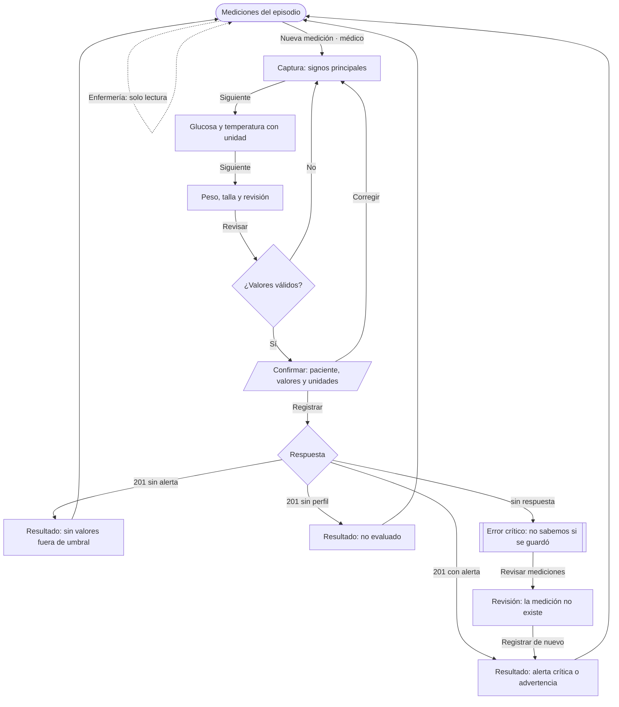

| Ruta (`#/…`) | Pantalla | Rol |
|---|---|---|
| `episodio` | Mediciones del episodio (tabla en desktop, tarjetas en móvil) | Médico y enfermería |
| `captura/1…3` | Formulario (en móvil, un paso por pantalla) | Médico |
| `confirmar` | Confirmación con paciente, valores y unidades | Médico |
| `resultado` | Alerta, advertencia, sin alerta o no evaluado | Médico |
| `error` | Error crítico: sin respuesta | Médico |
| `revision` | Revisión de mediciones tras el error | Médico |

## Camino feliz

Registrar FC 138, SpO2 94 % y glucosa 5,5 mmol/L: de «episodio con una medición» a «alerta crítica».

| Paso | Desktop | Móvil |
|---|---|---|
| 1. Mediciones del episodio | 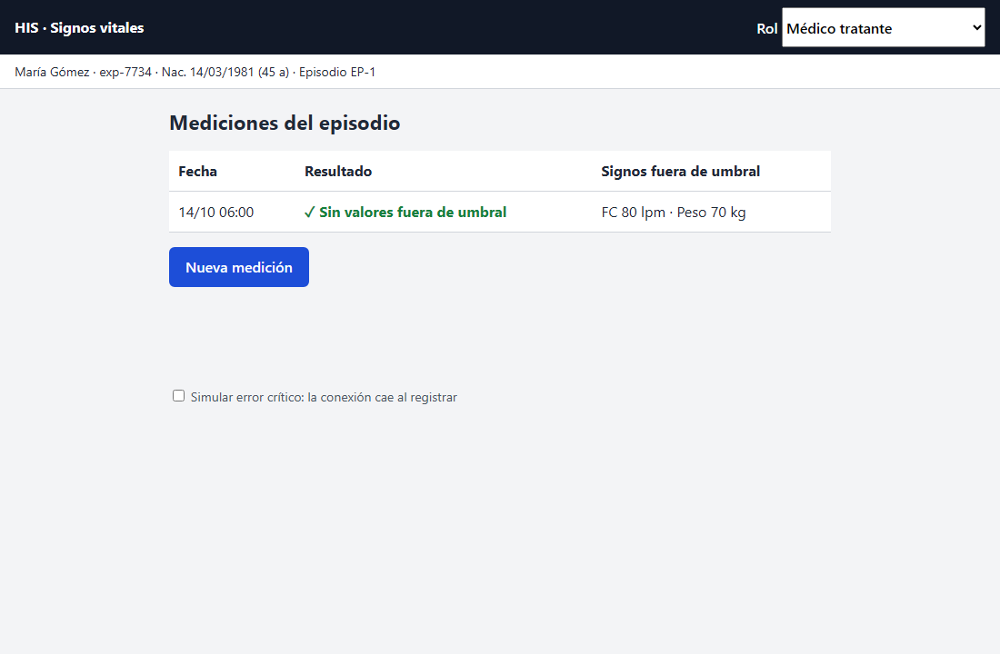 | 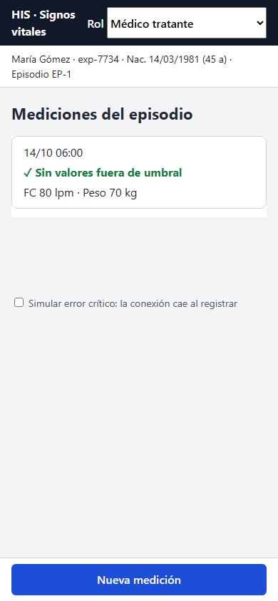 |
| 2. Captura con unidad elegida | 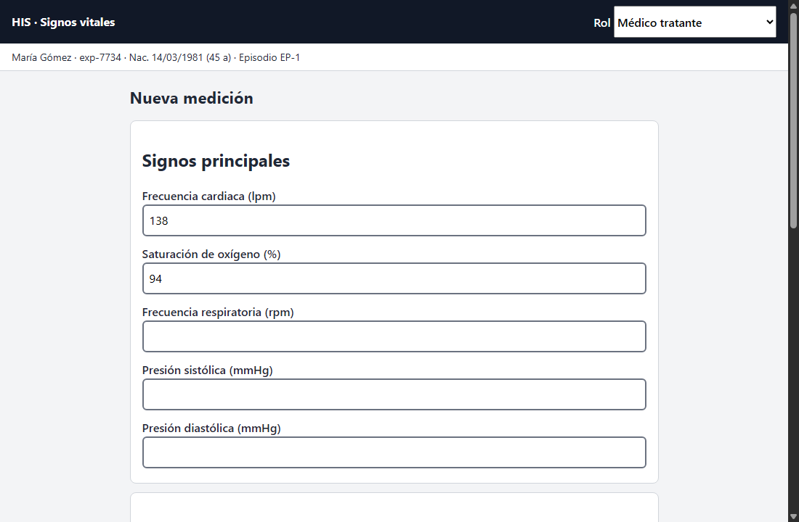 | 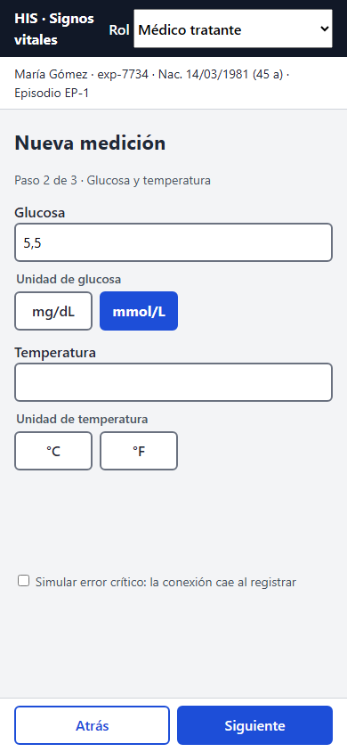 |
| 3. Confirmación con paciente y conversión | 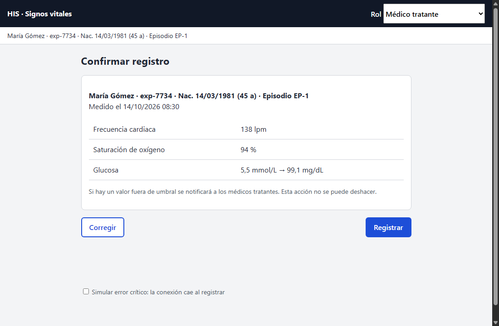 | 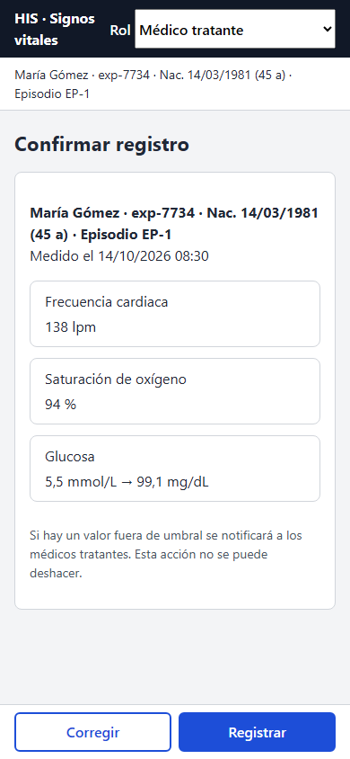 |
| 4. Resultado: alerta crítica | 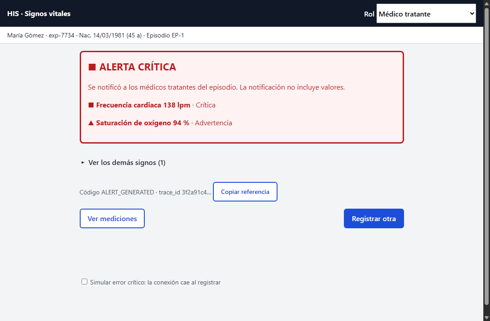 | 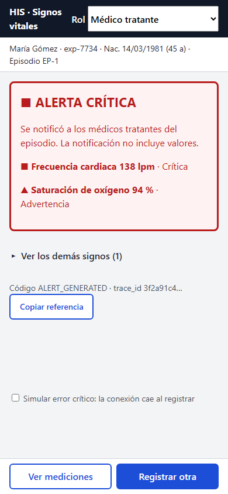 |
| 5. Paciente sin perfil: no evaluado | 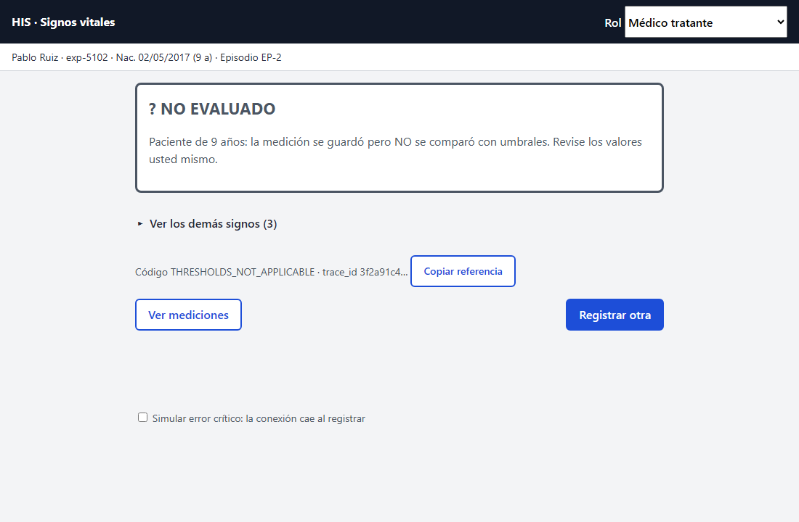 | 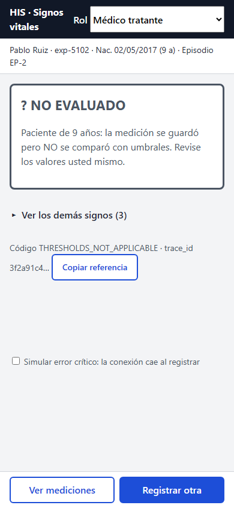 |

## Error crítico: la conexión cae al registrar un valor crítico

Es el peor fallo del flujo: el médico cree que el equipo fue avisado de una alerta crítica y no lo fue. Toca las cinco áreas: **signos vitales** (medición que puede no existir), **unidades** (la glucosa se convirtió de mmol/L), **umbrales** (el valor es crítico), **valores anormales** (FC 138) y **alertas clínicas** (la notificación no está confirmada).

| Pantalla | Desktop | Móvil |
|---|---|---|
| Error: no sabemos si se guardó | 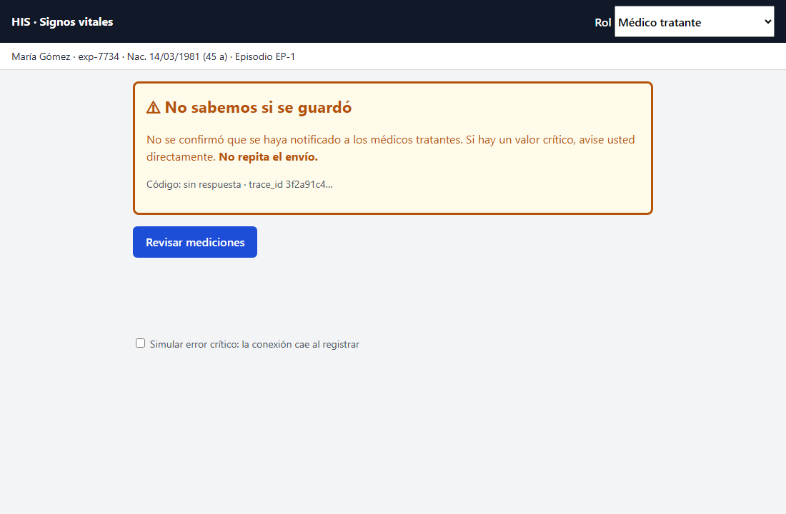 | 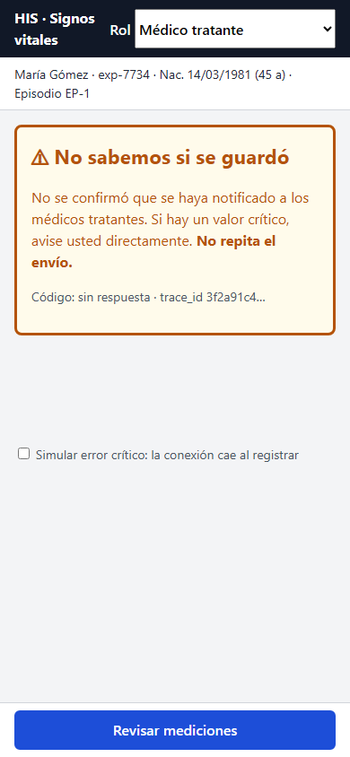 |
| Revisión: la medición no existe | 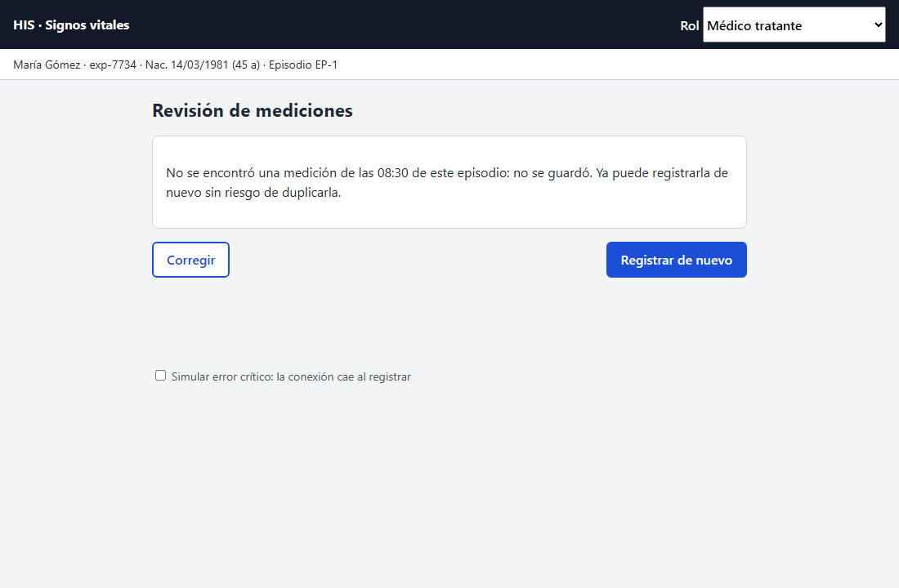 | 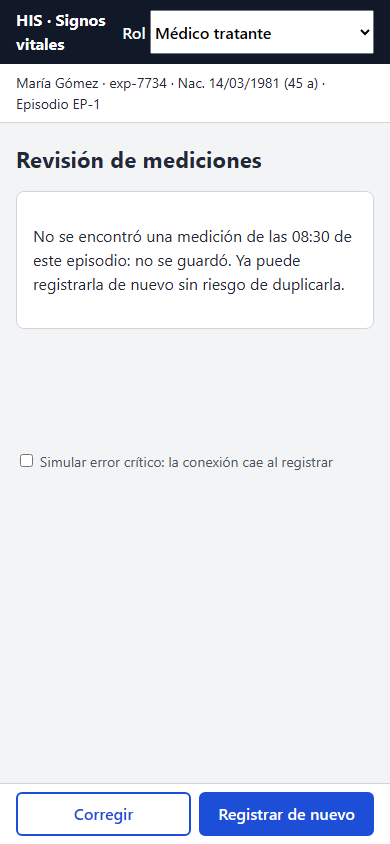 |
| Misma pantalla, rol enfermería | 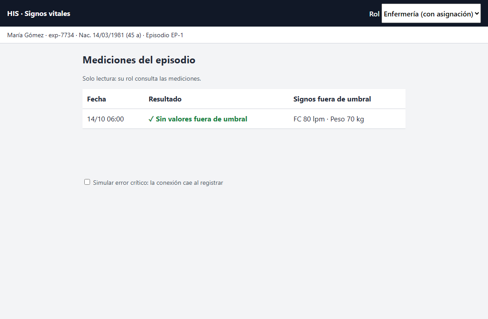 | 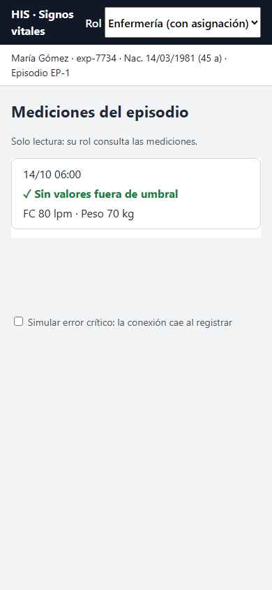 |

**Decisiones del error**

- El mensaje dice qué no se sabe («No se confirmó que se haya notificado a los médicos tratantes»), qué hacer («Si hay un valor crítico, avise usted directamente») y qué no hacer («No repita el envío»).
- Es un `role="alert"`: el lector de pantalla lo anuncia sin mover el foco, que pasa al título.
- Muestra el código `sin respuesta` y el `trace_id` en 14 px para que soporte lo ubique.
- **No se reintenta solo.** La única acción es «Revisar mediciones»; solo si no encuentra la medición se ofrece «Registrar de nuevo». Es la verificación que, con `Idempotency-Key`, haría el servidor.
- Lo escrito se conserva en memoria; no se guarda nada en el navegador.

## Consistencia de roles y estados

| Aspecto | Médico tratante | Enfermería |
|---|---|---|
| Mediciones del episodio | «Nueva medición» | «Solo lectura: su rol consulta las mediciones» |
| Captura, confirmación y resultado | Disponibles | No se ofrecen ni se alcanzan por la URL (vuelve a las mediciones) |
| Resultado | Alerta, advertencia, sin alerta o no evaluado | Lo ve en la tarjeta de la lista |

Los estados llevan siempre texto y símbolo, nunca solo color: «■ Crítica», «▲ Advertencia», «✓ Sin valores fuera de umbral» y «? No evaluado».

## Accesibilidad

| Criterio | Cómo se resuelve |
|---|---|
| Teclado | Todo es `<a>`, `<button>`, `<input>`, `
` o `<select>`; sin controles hechos con `
` |
| Foco | Contorno de 3 px (`:focus-visible`); al cambiar de pantalla el foco va al título; tras un error de validación, al primer campo con problema |
| Contraste | Medido con la fórmula WCAG: texto `#1f2937` 13.34:1, rojo `#b91c1c` sobre su fondo 5.91:1, ámbar `#b45309` 4.84:1, verde `#15803d` 4.79:1, gris `#4b5563` 6.87:1, borde `#6b7280` 4.83:1 (B-06) |
| Etiquetas | `<label>` visible por campo con su unidad; la unidad es un `fieldset`/`legend` de radios (B-01, B-07) |
| Unidades | Sin valor por defecto: «Elija la unidad.» Aviso suave si 5,5 está en mg/dL. Cambiar la unidad recalcula el aviso (B-01) |
| Números | Coma o punto: `5,5` y `5.5` valen 5,5; `1.234,5` se rechaza (B-02) |
| Mensajes | `role="alert"` para la alerta crítica y los errores; `role="status"` para el resto (B-04) |
| Prevención | La confirmación repite al paciente (B-03); un valor imposible no se repite en el mensaje |
| Objetivos táctiles | Botones y controles de 44 px mínimo; barra de acción inferior con `safe-area-inset-bottom` |
| Saltar al contenido | Enlace «Saltar al contenido» como primer elemento |

**Prueba funcional.** Se ejecutó en Chrome (390 × 844) el recorrido completo con un guion temporal (no incluido): captura en tres pasos, «Elija la unidad», aviso de 5,5 en mg/dL, conversión a 99,1 mg/dL en la confirmación, alerta crítica con `role="alert"`, lista con la nueva medición, FC 1380 rechazada sin repetir el valor, `1.234,5` rechazado, `138,5` aceptado, error simulado, revisión, nuevo registro y rol enfermería sin «Nueva medición». Las 16 comprobaciones pasaron. Las capturas son de Chrome con 1100 × 720 y 390 × 844.

## Límites del prototipo

- Los datos son de ejemplo y viven en memoria; recargar los borra. Es intencional: no se guarda dato clínico en el navegador.
- No hay llamadas al servidor: el evaluador de umbrales replica las bandas de `adulto-2026.1` y los errores se simulan.
- La advertencia de unidad y los umbrales son propuestas sin validar con un responsable clínico.
- No se revisó con lector de pantalla ni con axe. Las correcciones P1 de fecha (B-09), pérdida de la medición por sesión vencida (B-08) y el reflujo a 320 px con zoom no se prototiparon.
- «Revisar mediciones» no consulta un endpoint: el de lista es propuesta de la Semana 5.

## Archivos

- [Prototipo](./prototipo.html) y [capturas](./capturas/)
- [Declaración de uso de IA](./DECLARACION_IA.md)
