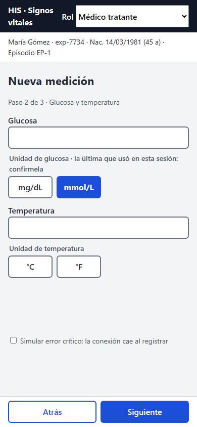
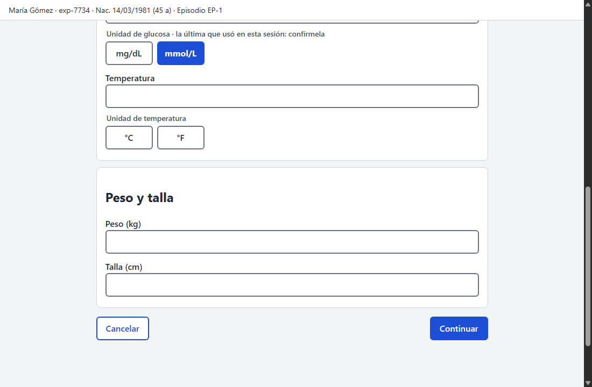

# Respuesta al cambio solicitado (Semana 12)

## El pedido

> «Urgencias mide la glucosa siempre con glucómetros en mmol/L. Que la unidad **quede preseleccionada** para no tocar el selector en cada medición. En el móvil cada toque cuenta.»

Es un cambio plausible: pide ahorrar pasos y toca justo el punto más peligroso del flujo. Cruza signos vitales, **unidades** (mmol/L frente a mg/dL), **umbrales** (se evalúan en mg/dL), **valores anormales** (una unidad mal leída inventa una alerta crítica) y **alertas clínicas** (se notifica a los tratantes).

## Decisión

**Se acepta el objetivo (menos toques) y se rechaza una unidad por defecto silenciosa.** Aceptado en parte: se recuerda la **última unidad usada dentro de la sesión**, marcada como sugerencia.

| Razón | Evidencia |
|---|---|
| Una unidad asumida es el error que ya midió el cambio práctico: glucosa 5,5 mmol/L leída como mg/dL da una **alerta crítica falsa** | [Semana 6](../semana-06/cambio-practico.md); demo de la [Semana 7](../semana-07/README.md) |
| La corrección B-01 de la Semana 9 prohíbe la unidad por defecto | [Backlog B-01](../semana-09/backlog.md) (P0) |
| Entre turnos, dispositivos o personas, «urgencias usa mmol/L» deja de ser cierto: otra persona hereda una unidad que no es la de su equipo | Riesgo de sesión compartida; por eso la memoria dura solo la sesión |
| Con la sugerencia visible y la confirmación con conversión, se ahorra el toque sin asumir | Prototipo, `?ultima#/episodio` |

## Qué se implementó en el prototipo

- La **primera** captura de la sesión no preselecciona nada: hay que elegir (B-01 intacto).
- Tras registrar, la unidad usada de glucosa y temperatura se guarda **solo en memoria** de la página.
- En la captura siguiente esa unidad aparece marcada y el título del grupo dice «la última que usó en esta sesión: confírmela».
- Al cambiar la unidad, la sugerencia desaparece.
- La confirmación sigue mostrando «5,5 mmol/L → 99,1 mg/dL» y el aviso suave sigue activo.
- Recargar la página borra la unidad recordada (no se usa `localStorage`).

 

## Qué se rechaza y qué queda propuesto

| Alternativa | Veredicto |
|---|---|
| Unidad por defecto fija (mmol/L) para todos | **Rechazada.** Reabre el error de B-01 para quien use otro equipo |
| Recordarla entre sesiones o dispositivos (`localStorage`, perfil del usuario) | **Rechazada por ahora.** Es una preferencia persistente que se hereda sin que nadie la confirme; además `vital_signs` no guarda la unidad original |
| Unidad por defecto por **servicio** (urgencias = mmol/L), configurada por el hospital | **Propuesta.** Es una decisión de configuración con responsable clínico, no de pantalla; requiere acordar dónde vive y quién la cambia |

## Impacto por área

| Área | Cambio | Esfuerzo |
|---|---|---|
| **UX** | Una sugerencia en el título del grupo y la unidad marcada | S |
| **Componentes** | `MeasurementField` recibe `suggestedUnit` y lo muestra; el store `signosVitales` guarda la última unidad **en memoria** y la limpia al cerrar sesión | S |
| **Accesibilidad** | El texto de la sugerencia es parte del `legend`, así que el lector de pantalla la anuncia al llegar al grupo | S |
| **Móvil** | Un toque menos por medición; la unidad marcada tiene el mismo tamaño táctil de 44 px | — |
| **Contrato (S5)** | **Ninguno**: la API sigue recibiendo la unidad explícita en cada medición | — |
| **Dominio** | **Ninguno**: `Measurement`, `Unit`, reglas y evaluador no cambian | — |
| **Base de datos** | **Ninguno**: no hay entidad nueva ni columna de unidad | — |

## Qué no cambia

La unidad sin valor por defecto en la primera captura, la conversión visible antes de enviar, el aviso suave, la unidad canónica con la que se evalúa y el principio de que el servidor es la autoridad.

## Criterios verificables

- En una sesión nueva, glucosa sin unidad elegida: «Siguiente» muestra «Elija la unidad.» y no avanza.
- Tras registrar con `mmol/L` y pulsar «Registrar otra», la glucosa aparece con `mmol/L` marcada y el texto «la última que usó en esta sesión: confírmela».
- Cambiar a `mg/dL` hace desaparecer el texto y el aviso suave se comporta como siempre.
- Recargar la página vuelve a la primera captura sin unidad preseleccionada.
- `grep -cE "localStorage|sessionStorage|indexedDB" docs/signos-vitales/semana-11/prototipo.html` devuelve `0`.

## Riesgos

| Riesgo | Mitigación |
|---|---|
| La persona confirma sin mirar la sugerencia | La conversión sigue en la confirmación y el aviso suave detecta un valor raro para la unidad |
| Turno nuevo en el mismo dispositivo con la sesión abierta | La unidad se borra al cerrar sesión; el aviso de sesión que vence (B-08) acorta la ventana |
| La sugerencia se lee como «valor por defecto» | El texto dice «la última que usó… confírmela» y no se marca en la primera captura |
| Se pierde la unidad original al guardar el valor canónico | Propuesta de guardarla en la auditoría H8 (Semana 6), pendiente con Javier |
