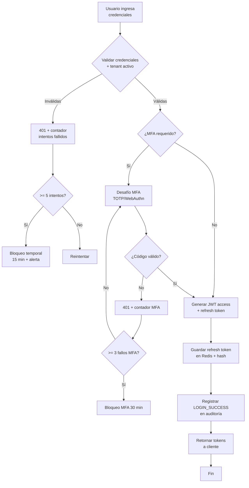

# Narrativa de Alcance: Alta de Usuario por Tenant, Autenticación Segura y Revocación de Sesión

## 1. Delimitación del Proceso

| Atributo        | Descripción                                                             |
|-----------------|-------------------------------------------------------------------------|
| **Proceso**     | Alta de usuario por tenant, autenticación segura y revocación de sesión |
| **Código**      | GUT-001                                                                 |
| **Versión**     | 1.0                                                                     |
| **Fecha**       | 2026-10-18                                                              |
| **Responsable** | Cindy (Arquitecto de Software)                                          |

### Actores Principales
| Actor                                      | Tipo       | Descripción                                                 |
|--------------------------------------------|------------|-------------------------------------------------------------|
| **Administrador de Tenant**                | Primario   | Crea, modifica y desactiva usuarios dentro de su tenant     |
| **Super Administrador (Platform Admin)**   | Primario   | Gestiona tenants, roles globales, configuración MFA global  |
| **Usuario Final (Clínico/Admin)**          | Secundario | Inicia sesión, usa MFA, solicita revocación de sesión       |
| **Sistema de Autenticación (AuthZ/AuthN)** | Sistema    | Emite/valida JWT, gestiona tokens, MFA, refresh, revocación |
| **Servicio de Tenants**                    | Sistema    | Valida tenant activo, límites de usuarios, aislamiento      |
| **Redis / Token Store**                    | Sistema    | Almacena refresh tokens, blocklist, sesiones activas        |
| **Servicio de Auditoría**                  | Sistema    | Registra eventos de seguridad inmutables                    |

### Objetivo Principal
Implementar **gestión de identidad multi-tenant con aislamiento estricto**, autenticación robusta (JWT RS256 + MFA opcional/obligatorio) y **revocación inmediata de sesiones** (logout único, expiración, admin force-revoke), garantizando trazabilidad completa y cumplimiento de políticas de seguridad (OWASP AuthN, NIST 800-63B).

---

## 2. Flujo de Trabajo (Happy Paths)

### 2.1 Alta de Usuario por Tenant
```mermaid
flowchart TD
    A[Admin Tenant inicia\ncreación de usuario] --> B{Validar permisos\nadmin_tenant}
    B -->|No| C[403 Forbidden]
    B -->|Sí| D[Validar tenant\nactivo y con cupo]
    D -->|Tenant inactivo/sin cupo| E[400 Bad Request]
    D -->|OK| F[Crear usuario:\nemail, nombre, roles[],\nmfa_required, tenant_id]
    F --> G[Generar password temporal\n+ enlace activación]
    G --> H[Enviar email\nactivación]
    H --> I[Registrar en auditoría\nUSER_CREATED]
    I --> J[Fin]
```

### 2.2 Autenticación Segura (Login + MFA)


### 2.3 Revocación / Invalidación de Sesión
```mermaid
flowchart TD
    A[Solicitud revocación:\n- Usuario: logout\n- Admin: force-revoke\n- Sistema: expiry/breach] --> B{Validar solicitante\ntiene permiso}
    B -->|No| C[403]
    B -->|Sí| D[Identificar tokens\na revocar:\n- access (blocklist)\n- refresh (delete Redis)]
    D --> E[Añadir access token\na blocklist Redis\n(TTL = exp restante)]
    E --> F[Eliminar refresh token\nde Redis]
    F --> G[Invalidar sesiones\nrelacionadas (SSO)]
    G --> H[Registrar REVOKE_SESSION\nen auditoría]
    H --> I[Notificar a\nservicios conectados\n(vía webhook/evento)]
    I --> J[Fin]
```

---

## 3. Excepciones y Caminos Alternativos

| Código     | Escenario                       | Detección               | Respuesta                                     | Auditoría             |
|------------|---------------------------------|-------------------------|-----------------------------------------------|-----------------------|
| **EXC-01** | Credenciales inválidas          | Login fallido           | 401, incrementar contador, lockout 5 intentos | LOGIN_FAILED          |
| **EXC-02** | Cuenta bloqueada (lockout)      | Contador >= 5           | 423 Locked, 15 min, email admin               | ACCOUNT_LOCKED        |
| **EXC-03** | Tenant inactivo/suspendido      | Validación tenant       | 403 Tenant Inactive                           | TENANT_INACTIVE       |
| **EXC-04** | Tenant sin cupo usuarios        | Validación límites      | 400 Tenant Quota Exceeded                     | TENANT_QUOTA_EXCEEDED |
| **EXC-05** | MFA código inválido             | Verificación TOTP       | 401, contador MFA, lockout 3 fallos           | MFA_FAILED            |
| **EXC-06** | MFA bloqueado                   | 3 fallos MFA            | 423 MFA Locked, 30 min                        | MFA_LOCKED            |
| **EXC-07** | Access token expirado           | Validación JWT exp      | 401 Token Expired                             | TOKEN_EXPIRED         |
| **EXC-08** | Refresh token inválido/expirado | Lookup Redis            | 401 Refresh Revoked, forzar login             | REFRESH_INVALID       |
| **EXC-09** | Access token en blocklist       | Validación blocklist    | 401 Token Revoked                             | TOKEN_REVOKED         |
| **EXC-10** | Cross-tenant access attempt     | tenant_id mismatch      | 403, alerta seguridad                         | CROSS_TENANT_ATTEMPT  |
| **EXC-11** | Usuario desactivado             | user.is_active=false    | 403 Account Disabled                          | ACCOUNT_DISABLED      |
| **EXC-12** | Contraseña expirada             | policy.password_expired | 400 Password Expired, forzar cambio           | PASSWORD_EXPIRED      |

---

## 4. Reglas de Negocio

| ID        | Regla                                        | Descripción                                                                                       |
|-----------|----------------------------------------------|---------------------------------------------------------------------------------------------------|
| **RN-01** | **Aislamiento Multi-tenant Estricto**        | Todo query incluye `tenant_id`. RLS en BD. Cross-tenant = 403 + alerta.                           |
| **RN-02** | **RBAC por Tenant**                          | Roles: `TENANT_ADMIN`, `MEDICO`, `ENFERMERO`, `PACIENTE`, `AUDITOR`. Heredados de roles globales. |
| **RN-03** | **MFA Adaptativo**                           | `mfa_required` por rol/tenant/política. `TENANT_ADMIN` y `AUDITOR` siempre MFA.                   |
| **RN-04** | **JWT RS256 + JWKS Rotation**                | Access token 15 min, Refresh token 7 días (rotación). Claves rotadas cada 24h.                    |
| **RN-05** | **Refresh Token Rotation + Reuse Detection** | Cada uso genera nuevo refresh + invalida anterior. Reuse = revocación total + alerta.             |
| **RN-06** | **Blocklist Access Tokens (Redis)**          | Revocación inmediata: access token → blocklist con TTL = exp restante.                            |
| **RN-07** | **Sesión Única / Múltiple Configurable**     | Política `single_session_per_user` por tenant. Login nuevo revoca anterior si habilitado.         |
| **RN-08** | **Force-Revoke por Admin**                   | `TENANT_ADMIN` y `PLATFORM_ADMIN` pueden revocar todas las sesiones de un usuario.                |
| **RN-09** | **Password Policy + Breach Check**           | Min 12 chars, complejidad, historial 5, check HaveIBeenPwned API.                                 |
| **RN-10** | **Auditoría Inmutable de Seguridad**         | Eventos: LOGIN, LOGOUT, MFA, REVOKE, LOCKOUT, CREATE/UPDATE/DELETE_USER. Hash chain.              |
| **RN-11** | **Account Lockout Progressivo**              | 5 fallos → 15 min, 10 → 1h, 20 → 24h + notificación admin.                                        |
| **RN-12** | **Session Idle Timeout**                     | 15 min inactividad → refresh silencioso si actividad reciente, sino logout.                       |
| **RN-13** | **Device Fingerprinting**                    | Registrar device_id, IP, User-Agent. Alertar en nuevo dispositivo (opcional).                     |
| **RN-14** | **Just-in-Time Provisioning (SSO)**          | SAML/OIDC: crear usuario auto si no existe + asignar rol por claim mapping.                       |

---

## 5. Matriz de Trazabilidad (Coherencia entre Diagramas)

| Requisito / Regla                  | Caso de Uso (UC)    | Actividad (Act)        | Secuencia (Seq)        | Verificación |
|------------------------------------|---------------------|------------------------|------------------------|--------------|
| **RN-01** Aislamiento Multi-tenant | UC-01, UC-02, UC-03 | Act-02, Act-05, Act-08 | Seq-02, Seq-05, Seq-08 | ✅            |
| **RN-02** RBAC por Tenant          | UC-01, UC-04        | Act-03, Act-06         | Seq-03, Seq-06         | ✅            |
| **RN-03** MFA Adaptativo           | UC-02               | Act-07, Act-08         | Seq-04, Seq-05         | ✅            |
| **RN-04** JWT RS256 + Rotation     | UC-02               | Act-09                 | Seq-06                 | ✅            |
| **RN-05** Refresh Rotation         | UC-02, UC-05        | Act-10, Act-11         | Seq-07                 | ✅            |
| **RN-06** Blocklist Access         | UC-03, UC-05        | Act-12, Act-13         | Seq-08, Seq-09         | ✅            |
| **RN-07** Single Session           | UC-02               | Act-14 (alt)           | Seq-10 (alt)           | ✅            |
| **RN-08** Force-Revoke Admin       | UC-03               | Act-15                 | Seq-11                 | ✅            |
| **RN-09** Password Policy          | UC-01, UC-06        | Act-04, Act-16         | Seq-12                 | ✅            |
| **RN-10** Auditoría Inmutable      | UC-04 (include)     | Act-17, Act-18         | Seq-13                 | ✅            |
| **RN-11** Lockout Progressivo      | UC-02               | Act-19, Act-20         | Seq-14                 | ✅            |
| **RN-12** Idle Timeout             | UC-05               | Act-21                 | Seq-15                 | ✅            |
| **RN-13** Device Fingerprint       | UC-02               | Act-22                 | Seq-16                 | ✅            |
| **RN-14** JIT Provisioning         | UC-07 (extend)      | Act-23 (alt)           | Seq-17 (alt)           | ✅            |

### Correspondencia de Elementos
| Elemento             | Caso de Uso                          | Actividad                   | Secuencia                      |
|----------------------|--------------------------------------|-----------------------------|--------------------------------|
| **Admin Tenant**     | `actor AdminTenant`                  | `swimlane AdminTenant`      | `participant AdminUI`          |
| **Usuario Final**    | `actor Usuario`                      | `swimlane Usuario`          | `participant ClientUI`         |
| **AuthZ Service**    | `actor AuthZ`                        | `swimlane AuthZ`            | `participant AuthController`   |
| **Tenant Service**   | `actor TenantSvc`                    | `swimlane TenantSvc`        | `participant TenantMiddleware` |
| **Redis/TokenStore** | —                                    | `partition Redis`           | `participant TokenRepository`  |
| **DB Usuarios**      | —                                    | `partition DB`              | `participant UserDB`           |
| **Audit Log**        | `<<include>> AuditarEventoSeguridad` | `action RegistrarAuditoria` | `participant AuditLog`         |

---

## 6. Supuestos y Restricciones

| Tipo            | Descripción                                                         |
|-----------------|---------------------------------------------------------------------|
| **Técnico**     | API REST + JWT RS256, Redis Cluster para tokens, PostgreSQL con RLS |
| **Técnico**     | MFA: TOTP (RFC 6238) + WebAuthn (FIDO2) opcional                    |
| **Técnico**     | JWKS endpoint público para validación distribuida                   |
| **Operativo**   | Disponibilidad Auth 99.99% (crítico para todo el sistema)           |
| **Seguridad**   | TLS 1.3 obligatorio, HSTS, CSP estricto, SameSite=Strict cookies    |
| **Compliance**  | OWASP ASVS Level 2, NIST 800-63B AAL2, ISO 27001 A.9                |
| **Performance** | Login p95 < 300ms, validación token p99 < 50ms, revocación < 100ms  |

---

## 7. Glosario

| Término              | Definición                                                                                         |
|----------------------|----------------------------------------------------------------------------------------------------|
| **Tenant**           | Entidad organizacional aislada (hospital, red, clínica) con sus propios usuarios, roles, políticas |
| **Access Token**     | JWT short-lived (15 min) firmado RS256, válido para autorización en APIs                           |
| **Refresh Token**    | Token opaco largo (7 días) almacenado en Redis con hash, rotación en cada uso                      |
| **Blocklist**        | Conjunto en Redis de JTI (JWT ID) revocados antes de expiración, TTL = tiempo restante             |
| **MFA**              | Multi-Factor Authentication: algo que sabes (password) + algo que tienes (TOTP/WebAuthn)           |
| **JIT Provisioning** | Just-in-Time: creación automática de usuario en primer login SSO (SAML/OIDC)                       |
| **Reuse Detection**  | Detección de reutilización de refresh token (indica compromiso) → revocación total                 |
| **Force-Revoke**     | Revocación administrativa de todas las sesiones de un usuario por seguridad                        |
