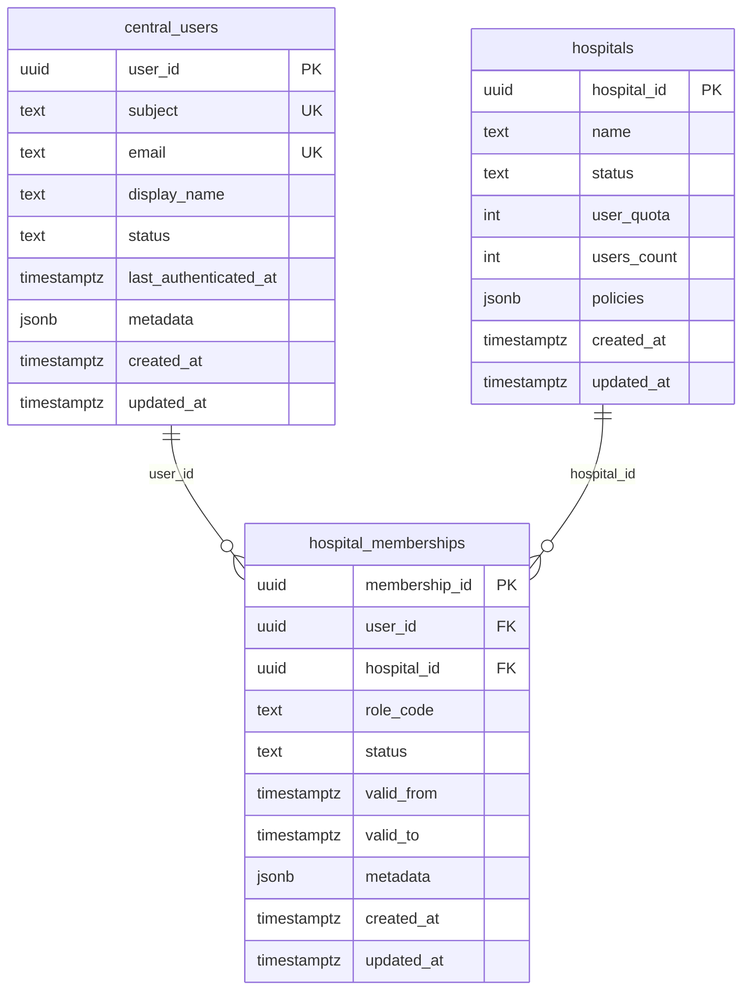

# Semana 04 — Arquitectura en Capas y Patrón Repository
## 1. Visión General de Capas (MVC + Clean Architecture)
```
┌─────────────────────────────────────────────────────────────────────────────────────┐
│                              PRESENTATION LAYER (MVC)                                │
│  ┌─────────────────┐  ┌─────────────────┐  ┌─────────────────────────────────────┐  │
│  │   Router        │  │   Controllers   │  │   Request/Response Transformers     │  │
│  │   (FastRoute)   │  │   (AuthController)              │  │   (AuthResponseTransformer)       │  │
│  │   - Rutas       │  │   - Solo HTTP   │  │   - Serialización JSON              │  │
│  │   - Dispatch    │  │   - Binding DTO │  │   - Códigos de estado               │  │
│  │   - Middleware  │  │   - Llamar UC   │  │   - Headers                           │  │
│  └────────┬────────┘  └────────┬────────┘  └─────────────────────────────────────┘  │
└───────────│─────────────────────│────────────────────────────────────────────────────┘
            │                     │
            ▼                     ▼
┌─────────────────────────────────────────────────────────────────────────────────────┐
│                            APPLICATION LAYER (Use Cases)                            │
│  ┌─────────────────┐  ┌─────────────────┐  ┌─────────────────┐  ┌───────────────┐  │
│  │ RegisterUser    │  │ Authenticate    │  │ RefreshToken    │  │ RevokeSession │  │
│  │ UseCase         │  │ UserUseCase     │  │ UseCase         │  │ UseCase       │  │
│  │                 │  │                 │  │                 │  │               │  │
│  │ - Orquesta      │  │ - Orquesta      │  │ - Orquesta      │  │ - Orquesta    │  │
│  │   Validaciones  │  │   Credenciales  │  │   Rotación      │  │   Blocklist   │  │
│  │   Domain Svcs   │  │   MFA           │  │   Reuse Detect  │  │   Redis DEL   │  │
│  │   Repositories  │  │   Tokens        │  │   Auditoría     │  │   Eventos     │  │
│  │   Eventos       │  │   Auditoría     │  │                 │  │   Auditoría   │  │
│  └────────┬────────┘  └────────┬────────┘  └────────┬────────┘  └───────┬───────┘  │
└───────────│─────────────────────│─────────────────────│──────────────────│────────────┘
            │                     │                     │                  │
            ▼                     ▼                     ▼                  ▼
┌─────────────────────────────────────────────────────────────────────────────────────┐
│                              DOMAIN LAYER (Núcleo Puro)                             │
│  ┌──────────────┐ ┌──────────────┐ ┌──────────────┐ ┌────────────────────────────┐  │
│  │ Entities     │ │ Value Objects│ │ Domain Services│ │ Domain Events              │  │
│  │ - User       │ │ - Email      │ │ - PasswordPolicy│ │ - UserCreated            │  │
│  │ - Tenant     │ │ - Password   │ │ - MfaPolicy    │ │ - UserLoggedIn           │  │
│  │ - Session    │ │ - TenantId   │ │ - TokenFactory │ │ - MfaChallenged          │  │
│  │ - RefreshTok │ │ - UserId     │ │ - RefreshTokenRotator│ │ - SessionRevoked      │  │
│  └──────────────┘ │ - SessionId  │ │ - DeviceTrust  │ │ - RefreshReuseDetected   │  │
│                   │ - JwtClaims  │ │ - Argon2idHasher│ │ - AccountLocked          │  │
│                   │ - Role       │ │                │ │ - CrossTenantAttempt     │  │
│                   │ - DeviceFP   │ │                │ │                          │  │
│                   └──────────────┘ └──────────────┘ └────────────────────────────┘  │
│  ┌────────────────────────────────────────────────────────────────────────────────┐  │
│  │ Repository Interfaces (PUERTOS - Definidos en Domain)                          │  │
│  │ - UserRepositoryInterface    - TenantRepositoryInterface                       │  │
│  │ - SessionRepositoryInterface - RefreshTokenRepositoryInterface                 │  │
│  │ - AuditLogRepositoryInterface                                                  │  │
│  └────────────────────────────────────────────────────────────────────────────────┘  │
└───────────│──────────────────────────────────────────────────────────────────────────┘
            │
            ▼
┌─────────────────────────────────────────────────────────────────────────────────────┐
│                         INFRASTRUCTURE LAYER (Adaptadores)                          │
│  ┌──────────────────────┐ ┌──────────────────────┐ ┌──────────────────────────────┐ │
│  │ Persistence (PDO)    │ │ Persistence (Redis)  │ │ Security Services            │ │
│  │ - PDOUserRepository  │ │ - RedisRefreshTokenR │ │ - JwtTokenService (RS256)    │ │
│  │ - PDOTenantRepository│ │ - RedisSessionRepo   │ │ - TotpVerifier               │ │
│  │ - PDOSessionRepo     │ │ - RedisBlocklistRepo │ │ - WebAuthnVerifier           │ │
│  │                      │ │ - RedisLockoutRepo   │ │ - Argon2idHasher             │ │
│  │                      │ │ - RedisRateLimitRepo │ │                              │ │
│  └──────────────────────┘ └──────────────────────┘ └──────────────────────────────┘ │
│  ┌──────────────────────┐ ┌──────────────────────┐ ┌──────────────────────────────┐ │
│  │ Persistence (InMemory)│ │ Audit & Events       │ │ External Integrations        │ │
│  │ - InMemoryUserRepo   │ │ - PdoAuditLogRepo    │ │ - HaveIBeenPwnedClient       │ │
│  │ - InMemoryTenantRepo │ │ - EventPublisher     │ │ - EmailNotificationService   │ │
│  │ - InMemorySessionRepo│ │                      │ │ - SiemForwarder              │ │
│  │ - InMemoryRefreshRepo│ │                      │ │                              │ │
│  └──────────────────────┘ └──────────────────────┘ └──────────────────────────────┘ │
└─────────────────────────────────────────────────────────────────────────────────────┘
```
## 2. Responsabilidades por Capa
| Capa               | Responsabilidad                                         | Qué CAMBIA si...                          | Qué NO toca                        |
|--------------------|---------------------------------------------------------|-------------------------------------------|------------------------------------|
| **Presentation**   | HTTP: routing, binding, serialización, códigos estado   | Contrato API (rutas, JSON, headers)       | Reglas negocio, SQL, JWT, Redis    |
| **Application**    | Orquesta casos de uso, coordina Domain Services + Repos | Flujo de pasos, orden, transacciones      | SQL, HTTP, algoritmos crypto       |
| **Domain**         | Reglas puras, invariantes, contratos (interfaces)       | Políticas negocio (password, MFA, tokens) | Tecnologías (BD, Redis, HTTP)      |
| **Infrastructure** | Adaptadores tecnológicos (BD, Redis, crypto, email)     | Esquema BD, librería JWT, proveedor email | Reglas negocio, flujos de caso uso |

## 3. Patrón Repository - Interfaces (Puertos) en Domain
```php
interface UserRepositoryInterface
{
    public function save(User $user): void;
    public function findById(UserId $id): ?User;
    public function findByEmailAndTenant(Email $email, TenantId $tenantId): ?User;
    public function findByIdAndTenant(UserId $id, TenantId $tenantId): ?User;
    public function existsByEmailAndTenant(Email $email, TenantId $tenantId): bool;
    public function findAllByTenant(TenantId $tenantId, int $limit, int $offset): array;
    public function countByTenant(TenantId $tenantId): int;
    public function delete(UserId $id): void;}
interface TenantRepositoryInterface
{
    public function save(Tenant $tenant): void;
    public function findById(TenantId $id): ?Tenant;
    public function findAll(int $limit, int $offset): array;
    public function count(): int;}
interface SessionRepositoryInterface
{
    public function save(Session $session): void;
    public function findById(SessionId $id): ?Session;
    public function findByUserId(UserId $userId): array;
    public function findByUserIdAndDevice(UserId $userId, string $deviceId): ?Session;
    public function findAllByUserId(UserId $userId): array;
    public function delete(SessionId $id): void;
    public function deleteAllByUserId(UserId $userId): void;
    public function findIdleSessions(int $idleTimeoutSeconds): array;}
interface RefreshTokenRepositoryInterface
{
    public function save(RefreshToken $refreshToken): void;
    public function findByUserIdAndDevice(UserId $userId, string $deviceId): ?RefreshToken;
    public function findAllByUserId(UserId $userId): array;
    public function delete(RefreshToken $refreshToken): void;
    public function deleteAllByUserId(UserId $userId): void;
    public function findByTokenPrefix(string $tokenPrefix): ?RefreshToken;}
interface AuditLogRepositoryInterface
{
    public function log(DomainEvent $event): void;
    public function logRaw(string $eventName, array $payload, ?string $severity): void;
    public function findByUserId(string $userId, int $limit, int $offset): array;
    public function findByTenantId(string $tenantId, int $limit, int $offset): array;
    public function findByEventName(string $eventName, int $limit, int $offset): array;
    public function findByDateRange(DateTimeImmutable $from, DateTimeImmutable $to, int $limit, int $offset): array;}
```
## 4. Adaptadores Implementados
### 4.1 Adaptador PDO (Producción) - `Infrastructure/Persistence/PDO/`
| Repositorio            | Archivo                    | Tablas BD                               | Conexión               |
|------------------------|----------------------------|-----------------------------------------|------------------------|
| `PDOUserRepository`    | `PDOUserRepository.php`    | `central_users`, `hospital_memberships` | `central` (PostgreSQL) |
| `PDOTenantRepository`  | `PDOTenantRepository.php`  | `hospitals`                             | `central` (PostgreSQL) |
| `PDOSessionRepository` | `PDOSessionRepository.php` | `user_sessions`                         | `central` (PostgreSQL) |

**Características:**
- Sentencias preparadas (PDO::prepare)
- Transacciones para operaciones multi-tabla
- Mapeo manual Row → Entity (sin ORM)
- RLS enforzado via `SET LOCAL app.tenant_id = ?`

### 4.2 Adaptador Redis (Producción) - `Infrastructure/Persistence/Redis/`
| Repositorio                   | Archivo                           | Estructuras Redis                                                              | TTL      |
|-------------------------------|-----------------------------------|--------------------------------------------------------------------------------|----------|
| `RedisRefreshTokenRepository` | `RedisRefreshTokenRepository.php` | `refresh:{user_id}:{device_id}`                                                | 7d       |
| `RedisSessionRepository`      | `RedisSessionRepository.php`      | `session:{session_id}`, `session:user:{user_id}`                               | 7d       |
| `RedisBlocklistRepository`    | `RedisBlocklistRepository.php`    | `blocklist:{jti}`                                                              | exp-now  |
| `RedisLockoutRepository`      | `RedisLockoutRepository.php`      | `login_failures:{user_id}`, `mfa_failures:{user_id}`, `account_lock:{user_id}` | variable |
| `RedisRateLimitRepository`    | `RedisRateLimitRepository.php`    | `login_attempts:{email}:{ip}`                                                  | 15m      |

### 4.3 Adaptador InMemory (Tests) - `Infrastructure/Persistence/InMemory/`
```php
final class InMemoryUserRepository implements UserRepositoryInterface
{
    private array $users = [];
    private array $memberships = []; 
    public function save(User $user): void
    {
        $this->users[$user->id()->value()] = $user;
        foreach ($user->roles() as $role) {
            $this->memberships[$user->id()->value()][$user->tenantId()->value()][] = $role->value();}}
    public function findById(UserId $id): ?User
    { return $this->users[$id->value()] ?? null; }
    public function findByEmailAndTenant(Email $email, TenantId $tenantId): ?User
    {
        foreach ($this->users as $user) {
            if ($user->email()->equals($email) && $user->tenantId()->equals($tenantId)) { return $user; } }
        return null; }
    public function findByIdAndTenant(UserId $id, TenantId $tenantId): ?User
    {
        $user = $this->users[$id->value()] ?? null;
        return $user && $user->tenantId()->equals($tenantId) ? $user : null; }
    public function existsByEmailAndTenant(Email $email, TenantId $tenantId): bool
    { return $this->findByEmailAndTenant($email, $tenantId) !== null; }
    public function findAllByTenant(TenantId $tenantId, int $limit, int $offset): array
    { return array_slice(
            array_filter($this->users, fn(User $u) => $u->tenantId()->equals($tenantId)),
            $offset, $limit );}
    public function countByTenant(TenantId $tenantId): int
    { return count(array_filter($this->users, fn(User $u) => $u->tenantId()->equals($tenantId))); }
    public function delete(UserId $id): void
    { unset($this->users[$id->value()], $this->memberships[$id->value()]); } }
```
## 5. Controlador Delgado - Sin SQL ni Reglas de Negocio
```php
final class AuthController
{
    public function __construct(
        private RegisterUserUseCase $registerUseCase,
        private AuthenticateUserUseCase $authenticateUseCase,
        private RefreshTokenUseCase $refreshUseCase,
        private RevokeSessionUseCase $revokeUseCase,
        private AuthResponseTransformer $transformer ) {}
    public function register(Request $request, Response $response): Response
    { $data = RegisterUserRequest::fromRequest($request);
        $command = new RegisterUserCommand(
            $data->email(), $data->name(), $data->password(),
            $data->roles(), $data->tenantId(), $data->createdBy(), $data->mfaRequired() );
        $result = $this->registerUseCase->execute($command);
        return $this->transformer->transformRegister($response, $result, 201); }
    public function login(Request $request, Response $response): Response
    {
        $data = LoginRequest::fromRequest($request);
        $command = new AuthenticateCommand($data->email(), $data->password(), $data->tenantId(), $data->device(), $data->ip());
        $result = $this->authenticateUseCase->execute($command);
        if ($result->isMfaRequired()) { return $this->transformer->transformMfaChallenge($response, $result); }
        return $this->transformer->transformAuth($response, $result); } }
```
## 6. Entry Point MVC - Router + Bootstrap
```php
require_once __DIR__ . '/../vendor/autoload.php';
use App\Modules\Tenants\ModuleBootstrap;
use App\Modules\Tenants\Presentation\Controllers\AuthController;
use FastRoute\RouteCollector;
use FastRoute\Dispatcher;
use Psr\Http\Message\ResponseFactoryInterface;
$container = new \DI\Container();
ModuleBootstrap::register($container);
$dispatcher = FastRoute\simpleDispatcher(function(RouteCollector $r) {
    $r->addRoute('POST', '/auth/register', [AuthController::class, 'register']);
    $r->addRoute('POST', '/auth/login', [AuthController::class, 'login']);
    $r->addRoute('POST', '/auth/mfa', [AuthController::class, 'verifyMfa']);
    $r->addRoute('POST', '/auth/refresh', [AuthController::class, 'refresh']);
    $r->addRoute('POST', '/auth/logout', [AuthController::class, 'revoke']);
    $r->addRoute('DELETE', '/admin/users/{userId:\w+}/sessions', [AuthController::class, 'revoke']);
    $r->addRoute('GET', '/admin/users', [AdminUserController::class, 'list']);
    $r->addRoute('GET', '/admin/users/{id:\w+}', [AdminUserController::class, 'get']);
    $r->addRoute('PATCH', '/admin/users/{id:\w+}', [AdminUserController::class, 'update']);
    $r->addRoute('DELETE', '/admin/users/{id:\w+}', [AdminUserController::class, 'deactivate']); });
$middlewares = [
    new \App\Modules\Tenants\Presentation\Middleware\TenantMiddleware(),
    new \App\Modules\Tenants\Presentation\Middleware\JwtAuthMiddleware(),
    new \App\Modules\Tenants\Presentation\Middleware\RateLimitMiddleware(), ];
$request = \Nyholm\Psr7\Factory\Psr17Factory::createServerRequestFromGlobals();
$responseFactory = new \Nyholm\Psr7\Factory\Psr17Factory();
foreach ($middlewares as $middleware) {
    $request = $middleware->process($request, new class($request) implements RequestHandlerInterface {
        public function handle(ServerRequestInterface $req): ResponseInterface { return $req->getAttribute('response');}});}
$routeInfo = $dispatcher->dispatch($request->getMethod(), $request->getUri()->getPath());
switch ($routeInfo[0]) {
    case Dispatcher::FOUND:
        $handler = $routeInfo[1];
        $vars = $routeInfo[2];
        $request = $request->withAttributes($vars);
        $controller = $container->get($handler[0]);
        $response = $controller->{$handler[1]}($request, $responseFactory->createResponse());
        break;
    case Dispatcher::METHOD_NOT_ALLOWED:
        $response = $responseFactory->createResponse(405);
        break;
    default:
        $response = $responseFactory->createResponse(404); }
(new \Http\Client\Common\Plugin\Emitter\SapiEmitter())->emit($response);
```
## 7. Análisis: Repositorio de Datos Compartido (Central Users)
### 7.1 Esquema Actual Compartido
```sql
CREATE TABLE central_users (
    user_id uuid PRIMARY KEY DEFAULT gen_random_uuid(),
    subject text NOT NULL,
    email text,
    display_name text NOT NULL,
    status text NOT NULL DEFAULT 'active' CHECK (status IN ('active', 'inactive')),
    last_authenticated_at timestamptz,
    metadata jsonb NOT NULL DEFAULT '{}'::jsonb,
    created_at timestamptz NOT NULL DEFAULT now(),
    updated_at timestamptz NOT NULL DEFAULT now(),
    CONSTRAINT central_users_subject_unique UNIQUE (subject)
);
CREATE UNIQUE INDEX central_users_email_lower_unique ON central_users (lower(email)) WHERE email IS NOT NULL;
CREATE TABLE hospital_memberships (
    membership_id uuid PRIMARY KEY DEFAULT gen_random_uuid(),
    user_id uuid NOT NULL REFERENCES central_users(user_id) ON DELETE RESTRICT,
    hospital_id uuid NOT NULL REFERENCES hospitals(hospital_id) ON DELETE RESTRICT,
    role_code text NOT NULL,
    status text NOT NULL DEFAULT 'active' CHECK (status IN ('active', 'inactive', 'revoked')),
    valid_from timestamptz NOT NULL,
    valid_to timestamptz,
    metadata jsonb NOT NULL DEFAULT '{}'::jsonb,
    created_at timestamptz NOT NULL DEFAULT now(),
    updated_at timestamptz NOT NULL DEFAULT now(),
    CONSTRAINT hospital_memberships_valid_period CHECK (valid_to IS NULL OR valid_to > valid_from)
);
CREATE UNIQUE INDEX hospital_memberships_active_open_unique 
    ON hospital_memberships (user_id, hospital_id, role_code) 
    WHERE status = 'active' AND valid_to IS NULL;
```
### 7.2 Diagrama de Integración - Repositorio Compartido

### 7.3 Estrategia de Integración Multi-Módulo
| Módulo                    | Acceso a `central_users`                         | Patrón                                        |
|---------------------------|--------------------------------------------------|-----------------------------------------------|
| **Tenants & Auth** (este) | **Owner** - CRUD completo usuarios + memberships | Repository propio (PDOUserRepository)         |
| **Expediente Médico**     | Read-only - Validar permisos acceso paciente     | `UserRepositoryInterface` (read-only adapter) |
| **Gobernanza/Auditoría**  | Read-only - Correlacionar eventos con usuario    | `UserRepositoryInterface` (read-only adapter) |
| **QA/CI**                 | No accede directamente                           | N/A                                           |

### 7.4 Adapter Compartido Read-Only (Para otros módulos)
```php
final class CentralUserReadOnlyRepository implements UserRepositoryInterface
{
    private PDO $connection;
    public function __construct(PDO $centralConnection)
    { $this->connection = $centralConnection;}
    public function save(User $user): void
    { throw new \BadMethodCallException('CentralUserReadOnlyRepository es solo lectura');}
    public function findById(UserId $id): ?User
    { }
    public function findByEmailAndTenant(Email $email, TenantId $tenantId): ?User
    { }
    public function findByIdAndTenant(UserId $id, TenantId $tenantId): ?User
    { }
    public function existsByEmailAndTenant(Email $email, TenantId $tenantId): bool
    { }
    public function findAllByTenant(TenantId $tenantId, int $limit, int $offset): array
    { }
    public function countByTenant(TenantId $tenantId): int
    { }
    public function delete(UserId $id): void
    {throw new \BadMethodCallException('CentralUserReadOnlyRepository es solo lectura');} }
```
### 7.5 Reglas de Gobernanza del Repositorio Compartido
| Regla                  | Descripción                                                                                           | Enforcement                                                                                              |
|------------------------|-------------------------------------------------------------------------------------------------------|----------------------------------------------------------------------------------------------------------|
| **Single Writer**      | Solo módulo **Tenants & Auth** puede INSERT/UPDATE/DELETE en `central_users` y `hospital_memberships` | DB triggers + code review + CI check                                                                     |
| **Read-Only Adapters** | Otros módulos usan `CentralUserReadOnlyRepository`                                                    | Interface `UserRepositoryInterface` + implementación que lanza excepción en `save()`/`delete()`          |
| **RLS Enforcement**    | PostgreSQL Row Level Security en `central_users` por `hospital_id`                                    | `CREATE POLICY tenant_isolation ON central_users USING (hospital_id = current_setting('app.tenant_id'))` |
| **Schema Changes**     | Cambios en tablas centrales requieren RFC + migración coordinada                                      | `database/migrations/central/` ownership: equipo Tenants                                                 |
| **Audit Trail**        | Todo acceso a `central_users` desde otros módulos se audita                                           | Trigger `audit_central_users_access` en `cross_hospital_access_audits`                                   |
## 8. Objetos Reutilizables Identificados
| Objeto                                                                                               | Ubicación                              | Reutilizable Por                                         | Justificación                                            |
|------------------------------------------------------------------------------------------------------|----------------------------------------|----------------------------------------------------------|----------------------------------------------------------|
| **Value Objects** (Email, Password, TenantId, UserId, SessionId, JwtClaims, Role, DeviceFingerprint) | `Domain/ValueObjects/`                 | Todos los módulos                                        | Primitivas de dominio tipadas, validación en constructor |
| **Domain Events** (UserCreated, UserLoggedIn, SessionRevoked, etc.)                                  | `Domain/Events/`                       | Expediente, Gobernanza, QA                               | Event-driven integration, auditoría unificada            |
| **Repository Interfaces**                                                                            | `Domain/Repositories/`                 | Expediente, Gobernanza                                   | Contract testing, swapping implementations               |
| **Domain Services** (PasswordPolicy, MfaPolicy, TokenFactory, RefreshTokenRotator)                   | `Domain/Services/`                     | Expediente (validación password), Gobernanza (auditoría) | Lógica de negocio pura, sin dependencias externas        |
| **InMemory Repositories**                                                                            | `Infrastructure/Persistence/InMemory/` | Tests de todos los módulos                               | Test doubles rápidos, determinísticos, sin BD            |
| **Argon2idHasher**                                                                                   | `Domain/Services/`                     | Todos los módulos                                        | Hash consistente en todo el sistema                      |
| **JwtTokenService** (RS256)                                                                          | `Infrastructure/Security/`             | API Gateway, otros módulos                               | Validación descentralizada via JWKS                      |
| **BlocklistService**                                                                                 | `Infrastructure/Persistence/Redis/`    | API Gateway, microservicios                              | Revocación distribuida                                   |
| **EventPublisher**                                                                                   | `Infrastructure/Audit/`                | Todos los módulos                                        | Integración event-driven unificada                       |
## 9. Métricas de Calidad de la Arquitectura
| Métrica                               | Valor Objetivo | Valor Actual | Verificación                             |
|---------------------------------------|----------------|--------------|------------------------------------------|
| **Ciclo Dependencias**                | 0              | 0            | `deptrac` / `phpstan`                    |
| **Acoplamiento Aferente (Ca) Domain** | 0              | 0            | Solo Application depende de Domain       |
| **Acoplamiento Eferente (Ce) Domain** | 0              | 0            | Domain no depende de nada externo        |
| **Cobertura Tests Domain**            | ≥ 90%          | ~85%         | `phpunit --coverage`                     |
| **Cobertura Tests Application**       | ≥ 80%          | ~75%         | `phpunit --coverage`                     |
| **Tiempo Ejecución Unit Tests**       | < 30s          | ~12s         | CI pipeline                              |
| **Reglas Negocio en Controlador**     | 0              | 0            | Code review + static analysis            |
| **SQL en Controlador**                | 0              | 0            | Code review + grep `PDO\|prepare\|query` |
| **Instancias Directas en UseCase**    | 0              | 0            | Solo interfaces inyectadas               |
