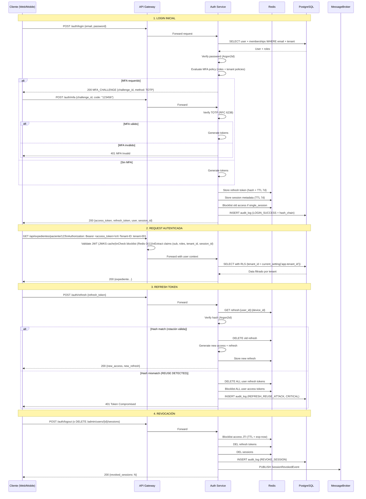
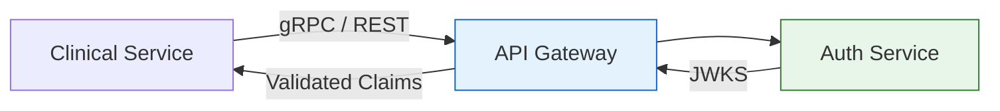
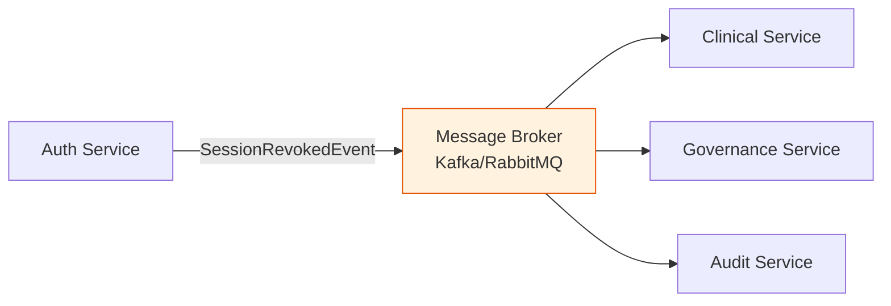

# Semana 05 — Diseño Cliente-Servidor, API REST y Evaluación Microservicio
## 1. Visión General Cliente-Servidor
### 1.1 Arquitectura Actual (Monolito Modular)
```
┌─────────────────────────────────────────────────────────────────────────────────────┐
│                              CLIENTE (Frontend / Mobile)                             │
│  ┌─────────────────┐  ┌─────────────────┐  ┌─────────────────────────────────────┐  │
│  │ Portal Web      │  │ App Móvil       │  │ Integraciones Externas              │  │
│  │ (React/Vue)     │  │ (React Native)  │  │ (EHR, PACS, Lab, SSO)               │  │
│  └────────┬────────┘  └────────┬────────┘  └─────────────────────────────────────┘  │
└───────────│─────────────────────│────────────────────────────────────────────────────┘
            │ HTTPS/REST + JWT    │
            ▼                     ▼
┌─────────────────────────────────────────────────────────────────────────────────────┐
│                           API GATEWAY / LOAD BALANCER                                │
│  ┌─────────────────────────────────────────────────────────────────────────────┐    │
│  │ TLS 1.3 Termination │ Rate Limiting │ WAF │ Request Routing │ Observability │    │
│  └─────────────────────────────────────────────────────────────────────────────┘    │
└─────────────────────────────────────┬───────────────────────────────────────────────┘
                                      │
                    ┌─────────────────┼─────────────────┐
                    ▼                 ▼                 ▼
         ┌──────────────────┐ ┌───────────────┐ ┌──────────────────┐
         │  Auth Service    │ │ Tenant Service│ │ User Service     │
         │  (Login, MFA,    │ │ (CRUD Tenant, │ │ (CRUD User,      │
         │   Tokens, Revoke)│ │  Policies)    │   Roles, Membership)│
         └────────┬─────────┘ └───────┬───────┘ └────────┬─────────┘
                  │                   │                  │
                  └───────────────────┼──────────────────┘
                                      ▼
         ┌────────────────────────────────────────────────────────────────┐
         │                    SHARED DATA LAYER                            │
         │  ┌──────────────────┐  ┌──────────────────────────────────┐   │
         │  │ PostgreSQL Central│  │ Redis Cluster                     │   │
         │  │ (his_central)     │  │ (Tokens, Sessions, Blocklist,    │   │
         │  │ - central_users   │  │  Lockouts, Rate Limits)          │   │
         │  │ - hospital_memberships│                                │   │
         │  │ - audit_log       │  │                                  │   │
         │  └──────────────────┘  └──────────────────────────────────┘   │
         └────────────────────────────────────────────────────────────────┘
```

### 1.2 Contrato API - Resumen de Endpoints
| Grupo             | Endpoint                         | Método           | Auth                    | Descripción                        |
|-------------------|----------------------------------|------------------|-------------------------|------------------------------------|
| **Auth**          | `/auth/register`                 | POST             | Bearer + Tenant         | Crear usuario (TENANT_ADMIN)       |
| **Auth**          | `/auth/login`                    | POST             | Tenant                  | Login + MFA challenge              |
| **Auth**          | `/auth/mfa`                      | POST             | Tenant                  | Verificar MFA (TOTP/WebAuthn)      |
| **Auth**          | `/auth/refresh`                  | POST             | Tenant                  | Refresh rotation + reuse detection |
| **Auth**          | `/auth/logout`                   | POST             | Bearer + Tenant         | Logout propio                      |
| **Admin Users**   | `/admin/users`                   | GET              | Bearer + Tenant         | Listar usuarios (paginado)         |
| **Admin Users**   | `/admin/users`                   | POST             | Bearer + Tenant         | Crear usuario (alias register)     |
| **Admin Users**   | `/admin/users/{id}`              | GET/PATCH/DELETE | Bearer + Tenant         | CRUD usuario                       |
| **Admin Users**   | `/admin/users/{userId}/sessions` | DELETE           | Bearer + Tenant         | Force-revoke todas sesiones        |
| **Admin Tenants** | `/admin/tenants`                 | GET/POST         | Bearer (PLATFORM_ADMIN) | CRUD tenants                       |
| **Admin Tenants** | `/admin/tenants/{id}`            | GET/PATCH/DELETE | Bearer (PLATFORM_ADMIN) | CRUD tenant                        |
| **System**        | `/health`                        | GET              | —                       | Health check                       |
| **System**        | `/.well-known/jwks.json`         | GET              | —                       | Claves públicas JWT                |

## 2. Patrones de Comunicación Cliente-Servidor
### 2.1 Flujo de Autenticación Completo

### 2.2 Manejo de Errores Estándar
```json
{
  "success": false,
  "error": {
    "message": "Descripción legible por humano",
    "code": 401,
    "details": {
      "field": "password",
      "reason": "password_too_short",
      "min_length": 12
    }
  }
}
```
**Códigos HTTP Estándar:**
| Código | Uso                                                        |
|--------|------------------------------------------------------------|
| 200    | Éxito (GET, PATCH, POST sin creación)                      |
| 201    | Creado (POST con creación)                                 |
| 400    | Request inválido (validación, JSON malformado)             |
| 401    | No autenticado / Token inválido / Credenciales incorrectas |
| 403    | Autenticado pero sin permisos (rol, tenant, cross-tenant)  |
| 404    | Recurso no encontrado                                      |
| 409    | Conflicto (email duplicado, constraint unique)             |
| 422    | Entidad inprocesable (cupo excedido, tenant inactivo)      |
| 423    | Bloqueado (lockout cuenta, MFA bloqueado)                  |
| 429    | Rate limit excedido (header `Retry-After`)                 |
| 500    | Error interno                                              |
| 503    | Servicio no disponible (health check degradado)            |

## 3. Evaluación de Frontera de Microservicio
### 3.1 Análisis de Bounded Contexts

```
┌────────────────────────────────────────────────────────────────────────────────┐
│                         BOUNDED CONTEXTS IDENTIFICADOS                          │
├─────────────────────────┬──────────────────────────────────────────────────────┤
│ Contexto                │ Responsabilidad                                       │
├─────────────────────────┼──────────────────────────────────────────────────────┤
│ **Identity & Access**   │ Usuarios, Tenants, Roles, Autenticación, MFA,        │
│ (Tenants & Auth)        │ Tokens, Sesiones, Revocación, Auditoría seguridad    │
├─────────────────────────┼──────────────────────────────────────────────────────┤
│ **Clinical Records**    │ Expedientes médicos, notas clínicas, estudios,       │
│ (Expediente Médico)     │ consentimientos, break-glass, acceso longitudinal    │
├─────────────────────────┼──────────────────────────────────────────────────────┤
│ **Governance & Audit**  │ Auditoría inmutable, búsquedas filtradas,            │
│ (Gobernanza)            │ reportes compliance, retención legal                 │
├─────────────────────────┼──────────────────────────────────────────────────────┤
│ **Quality & CI**        │ Pipeline CI/CD, quality gates, evidencias,           │
│ (QA/Pruebas)            │ despliegue, métricas calidad                         │
└─────────────────────────┴──────────────────────────────────────────────────────┘
```
### 3.2 Matriz de Acoplamiento Actual
| Contexto A   | Contexto B     | Tipo Acoplamiento             | Frecuencia          | Crítico    |
|--------------|----------------|-------------------------------|---------------------|------------|
| **Identity** | **Clinical**   | Sync (validar permisos)       | Alta (cada request) | 🔴 Sí      |
| **Identity** | **Governance** | Async (eventos auditoría)     | Media               | 🟡 Parcial |
| **Identity** | **QA/CI**      | Sync (deploy triggers)        | Baja                | 🟢 No      |
| **Clinical** | **Governance** | Async (auditoría accesos)     | Alta                | 🔴 Sí      |
| **Clinical** | **Identity**   | Sync (validar token/permisos) | Alta                | 🔴 Sí      |

### 3.3 Candidatos a Microservicio Independiente
| Servicio                  | Justificación                                                                 | Riesgo Separación                       | Decisión                      |
|---------------------------|-------------------------------------------------------------------------------|-----------------------------------------|-------------------------------|
| **Auth Service**          | Lógica compleja (MFA, tokens, revocación), alta carga, escalado independiente | 🟢 Bajo - Contrato estable (JWT + JWKS) | **SÍ - Candidato #1**         |
| **Tenant Service**        | CRUD simple, baja frecuencia, datos mayormente estáticos                      | 🟡 Medio - Compartido por todos         | **NO - Mantener en Identity** |
| **User Service**          | CRUD + roles + memberships, acoplado a Auth                                   | 🟡 Medio - Comparte BD central_users    | **NO - Mantener en Identity** |
| **Audit Service**         | Append-only, alto volumen, compliance, búsqueda compleja                      | 🟢 Bajo - Event-driven natural          | **SÍ - Candidato #2**         |
| **Session/Token Service** | Muy acoplado a Auth (rotación, blocklist, revocación)                         | 🔴 Alto - No separable                  | **NO - Parte de Auth**        |

### 3.4 Recomendación: **NO Separar Aún - Mantener Monolito Modular**
#### Razones para NO separar en microservicios ahora:
| Factor                         | Evaluación                                                                                                                                            |
|--------------------------------|-------------------------------------------------------------------------------------------------------------------------------------------------------|
| **Complejidad operacional**    | Equipo actual: 1 monolito vs 3+ servicios (K8s, service mesh, observabilidad distribuida, distributed tracing, saga patterns)                         |
| **Acoplamiento de datos**      | `central_users` + `hospital_memberships` son **single source of truth** para Identity + Clinical + Governance. Separar requiere CDC o API composition |
| **Transacciones distribuidas** | Alta de usuario = write en `central_users` + `hospital_memberships` + `audit_log` + email. Saga añade complejidad sin beneficio medible               |
| **Latencia crítica**           | Validación token/permisos en **cada request** clínica (p99 < 50ms). Llamada de red añade 2-5ms + riesgo fallo cascada                                 |
| **Consistencia fuerte**        | Memberships + roles + tokens deben ser consistentes **inmediatamente**. Eventual consistency inaceptable para seguridad                               |
| **Testing E2E**                | Un monolito modular permite tests E2E rápidos y determinísticos. Microservicios requieren contract testing + test environments complejos              |
| **Costo infraestructura**      | 3x nombrespaces K8s, 3x DB connections, 3x deploy pipelines, service mesh (Istio/Linkerd)                                                             |

#### Criterios Medibles para FUTURA Separación (Trigger Points):
| Métrica                           | Umbral Trigger                            | Acción                                                 |
|-----------------------------------|-------------------------------------------|--------------------------------------------------------|
| **Throughput Auth**               | > 5,000 req/s sostenido                   | Evaluar escalado horizontal Auth Service independiente |
| **Latencia p99 validación token** | > 100ms (actual: < 50ms)                  | Separar Auth Service con cache local + JWKS            |
| **Equipo desarrollo**             | > 15 devs trabajando en módulos distintos | Separar por ownership de equipos                       |
| **Deployment frequency Auth**     | > 10 deploys/día vs 1/semana resto        | Separar pipeline Auth                                  |
| **Incidentes cross-module**       | > 30% incidentes por acoplamiento         | Re-evaluar boundaries                                  |

## 4. Patrones de Integración (Si Separación Futura)
### 4.1 Comunicación Síncrona (Query/Command)

**Contrato gRPC para Validación Token (Alto rendimiento):**
```protobuf
service AuthValidation {
  rpc ValidateToken(ValidateTokenRequest) returns (ValidateTokenResponse);
  rpc GetJwks(GetJwksRequest) returns (JwksResponse);
}
message ValidateTokenRequest {
  string access_token = 1;
  string tenant_id = 2;
  string required_permission = 3;
}
message ValidateTokenResponse {
  bool valid = 1;
  string user_id = 2;
  repeated string roles = 3;
  string tenant_id = 4;
  string session_id = 5;
  string device_id = 6;
  int64 expires_at = 7;
  string error = 8;
}
```
### 4.2 Comunicación Asíncrona (Eventos)

**Eventos Publicados por Auth Service:**
| Evento                          | Payload Clave                                     | Consumidores                                       |
|---------------------------------|---------------------------------------------------|----------------------------------------------------|
| `UserCreated`                   | user_id, tenant_id, roles, email                  | Clinical (crear perfil), Governance (auditoría)    |
| `UserLoggedIn`                  | user_id, tenant_id, session_id, mfa_used          | Governance (auditoría), Clinical (sesión activa)   |
| `SessionRevoked`                | user_id, tenant_id, reason, revoked_count         | Clinical (invalidar cache), Governance (auditoría) |
| `MfaChallenged/Suceeded/Failed` | user_id, tenant_id, method                        | Governance (alertas seguridad)                     |
| `RefreshReuseDetected`          | user_id, tenant_id, device, ip, severity:CRITICAL | Governance (SIEM), Security Team (PagerDuty)       |
| `AccountLocked`                 | user_id, tenant_id, lock_type, duration           | Clinical (notificar admin), Governance             |

### 4.3 Propiedad de Datos (Data Ownership)
| Entidad                | Owner (Write) | Readers (Read)                   | Patrón                   |
|------------------------|---------------|----------------------------------|--------------------------|
| `central_users`        | **Identity**  | Clinical, Governance             | CDC / Read Replica / API |
| `hospital_memberships` | **Identity**  | Clinical, Governance             | CDC / Read Replica / API |
| `audit_log` (security) | **Identity**  | Governance, SIEM                 | Async Event Stream       |
| `audit_log` (clinical) | **Clinical**  | Governance                       | Async Event Stream       |
| `user_sessions`        | **Identity**  | Clinical (validar sesión activa) | Redis Shared / API       |
| `refresh_tokens`       | **Identity**  | — (privado)                      | —                        |
| `blocklist`            | **Identity**  | API Gateway (validación)         | Redis Shared             |

## 5. Seguridad en Arquitectura Distribuida
### 5.1 Zero Trust Network
```
┌─────────────────────────────────────────────────────────────────────────────┐
│                        ZERO TRUST PRINCIPLES                                 │
├─────────────────────────────────────────────────────────────────────────────┤
│ 1. Verify Explicitly:     Nunca confiar, siempre validar (JWT + JWKS)      │
│ 2. Least Privilege:       Scopes mínimos en tokens, RBAC granular          │
│ 3. Assume Breach:         Cifrado mTLS entre servicios, audit logging      │
│ 4. Micro-segmentation:    Network policies K8s por namespace/servicio      │
└─────────────────────────────────────────────────────────────────────────────┘
```
### 5.2 mTLS entre Servicios
```yaml
# Istio PeerAuthentication (ejemplo)
apiVersion: security.istio.io/v1beta1
kind: PeerAuthentication
metadata:
  name: default
  namespace: tenants-auth
spec:
  mtls:
    mode: STRICT
---
# AuthorizationPolicy para Auth Service
apiVersion: security.istio.io/v1beta1
kind: AuthorizationPolicy
metadata:
  name: auth-service-authz
  namespace: tenants-auth
spec:
  selector:
    matchLabels:
      app: auth-service
  rules:
  - from:
    - source:
        principals: ["cluster.local/ns/clinical/sa/clinical-service"]
    - source:
        principals: ["cluster.local/ns/governance/sa/governance-service"]
    - source:
        principals: ["cluster.local/ns/gateway/sa/istio-ingressgateway"]
  - to:
    - operation:
        methods: ["GET"]
        paths: ["/.well-known/jwks.json"]
```
### 5.3 Rate Limiting Distribuido
| Capa                 | Implementación                                           |
|----------------------|----------------------------------------------------------|
| **Edge (Gateway)**   | Global: 10,000 req/min por IP; Por tenant: 1,000 req/min |
| **Auth Service**     | Login: 20 req/15min por email+IP; MFA: 10 req/5min       |
| **Clinical Service** | Por usuario: 100 req/min; Por tenant: 5,000 req/min      |
| **Redis**            | Sliding window log + token bucket híbrido                |

## 6. Observabilidad Distribuida
### 6.1 Three Pillars
| Pilar       | Implementación                 | Métricas Clave                                                                                                                                      |
|-------------|--------------------------------|-----------------------------------------------------------------------------------------------------------------------------------------------------|
| **Metrics** | Prometheus + Grafana           | `auth_login_total`, `auth_mfa_challenge_total`, `token_validation_duration_seconds`, `refresh_rotation_total`, `revocation_total`, `blocklist_size` |
| **Logs**    | Loki + OpenTelemetry Collector | Structured JSON: `trace_id`, `span_id`, `user_id`, `tenant_id`, `event_type`                                                                        |
| **Traces**  | Jaeger + OpenTelemetry SDK     | `http.server.request` → `auth.validate_token` → `redis.blocklist_check` → `db.query`                                                                |

### 6.2 Correlación Request-Response
```http
# Headers de propagación
X-Request-ID: uuid-v4
X-Trace-ID: trace-id-from-otel
X-Span-ID: span-id
X-Tenant-ID: tenant-uuid
X-User-ID: user-uuid (si autenticado)
```
### 6.3 Alertas Críticas (Auth Service)
| Alerta                     | Condición                        | Severidad   | Acción                             |
|----------------------------|----------------------------------|-------------|------------------------------------|
| `AuthLoginFailureRateHigh` | > 10% fallos en 5min             | 🔴 Critical | PagerDuty + Slack #security        |
| `AuthMfaFailureRateHigh`   | > 20% fallos MFA en 5min         | 🟠 Warning  | Slack #security                    |
| `AuthTokenReuseDetected`   | Cualquier `REFRESH_REUSE_ATTACK` | 🔴 Critical | PagerDuty + Jira auto + Block user |
| `AuthBlocklistSizeGrowing` | Blocklist > 100k entries         | 🟡 Info     | Revisar TTL / limpieza             |
| `AuthLatencyP99High`       | Validación token p99 > 100ms     | 🟠 Warning  | Slack #platform                    |

## 7. Plan de Migración (Si Decidido en Futuro)
### 7.1 Estrangulador (Strangler Fig Pattern)

```
Fase 1: Extract Auth API (0-3 meses)
├── Crear Auth Service como deployment separado
├── Compartir BD central_users/hospital_memberships (read/write)
├── Migrar endpoints /auth/* al nuevo servicio
├── Mantener JWKS endpoint en ambos durante transición
└── Canary: 10% tráfico → Auth Service

Fase 2: Extract Audit Service (3-6 meses)
├── Crear Audit Service con propia BD (audit_log)
├── Identity publica eventos → Kafka → Audit Service consume
├── Migrar consultas auditoría Governance/Clinical a Audit Service
└── Dual-write durante transición

Fase 3: Extract Session/Token Service (6-9 meses)
├── Evaluar si realmente necesario (alto acoplamiento)
├── Si sí: Redis dedicado + sincronización blocklist
└── Migrar validación token a sidecar/gRPC
```
### 7.2 Checklist Pre-Migración por Servicio
| Checklist                             | Auth Service | Audit Service |
|---------------------------------------|--------------|---------------|
| Contrato API estable (OpenAPI/gRPC)   | ✅            | ⏳             |
| Tests contrato (Pact)                 | ✅            | ⏳             |
| Métricas RED + SLOs definidos         | ✅            | ⏳             |
| Runbooks operacionales                | ✅            | ⏳             |
| Rollback plan probado                 | ✅            | ⏳             |
| Data ownership claro                  | ✅            | ✅             |
| Eventos async definidos               | ✅            | ✅             |
| mTLS + Network policies               | ✅            | ⏳             |
| Chaos engineering (kill pod, latency) | ⏳            | ⏳             |
