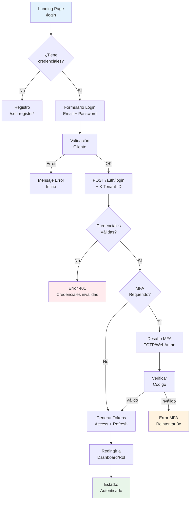
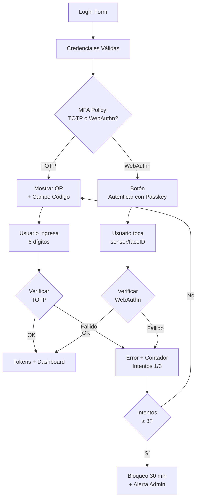
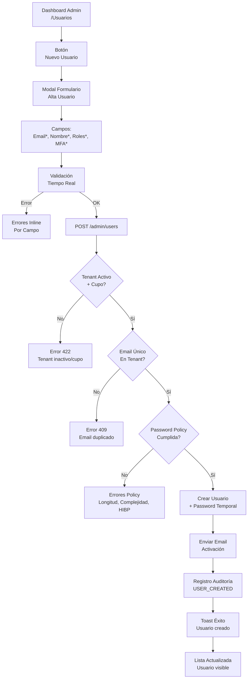
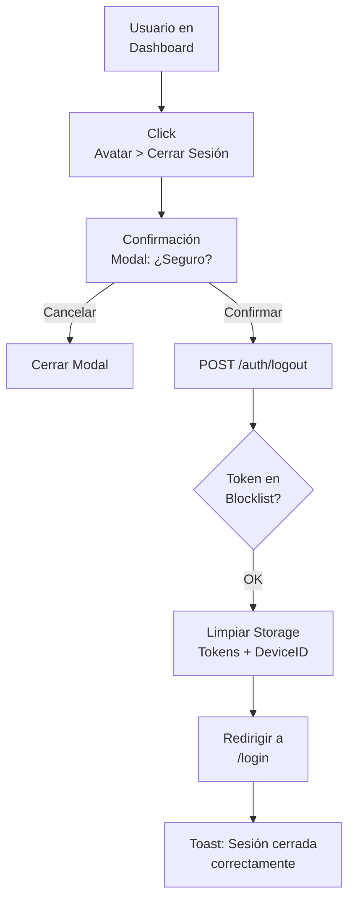
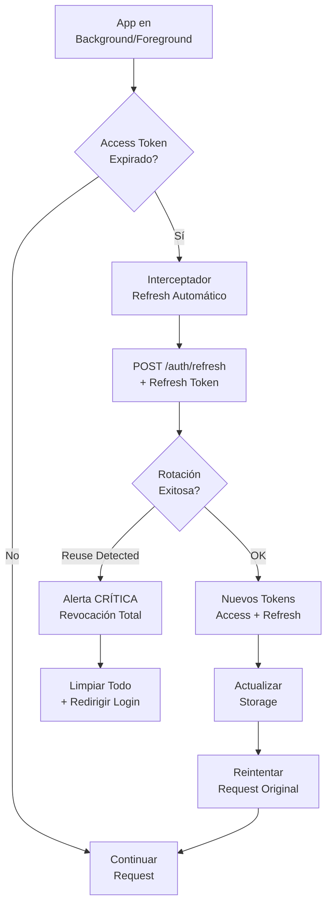

# Semana 08 — Diseño de Experiencia de Usuario (UX)
**Módulo:** Gestión de usuarios, tenants y endurecimiento de autenticación  
**Flujo:** «Alta de usuario por tenant, autenticación segura y revocación de sesión»  
**Versión:** 1.0 | **Fecha:** 2026-10-18

> Documento dividido en dos archivos: este (personas, flujos, errores, ayuda, privacidad, KPIs) y
> [`ux-wireframes-accesibilidad.md`](ux-wireframes-accesibilidad.md) (6 wireframes anotados y accesibilidad WCAG 2.1 AA).

---

## 1. Actores y Roles (User Personas)

| Persona                  | Rol Técnico    | Objetivos Principales                                                  | Nivel Técnico | Contexto de Uso                      |
|--------------------------|----------------|------------------------------------------------------------------------|---------------|--------------------------------------|
| **Dra. María González**  | `MEDICO`       | Acceso rápido a expedientes, login sin fricción, MFA solo si requerido | Media         | Consultorio, guardia, móvil          |
| **Lic. Carlos Ruiz**     | `ENFERMERO`    | Login rápido, signos vitales, administración medicamentos              | Media-Baja    | Estación enfermería, tablet bedside  |
| **Dra. Ana Torres**      | `TENANT_ADMIN` | Gestión usuarios, configuración MFA, auditoría, revocación sesiones    | Alta          | Oficina, desktop, múltiples sesiones |
| **Dr. Roberto Silva**    | `AUDITOR`      | Consulta logs auditoría, filtrado avanzado, exportación, compliance    | Alta          | Oficina, auditorías programadas      |
| **María Paz (Paciente)** | `PACIENTE`     | Ver su historial, citas, medicación, resultados                        | Baja          | Portal web, app móvil, casa          |

---

## 2. User Flows por Rol

### 2.1 Flow: Login Estándar (MEDICO, ENFERMERO, PACIENTE)



**Estados de Pantalla:**
| Paso | Pantalla           | Estado                  | Mensaje/Feedback                                                        |
|------|--------------------|-------------------------|-------------------------------------------------------------------------|
| 1    | Login Form         | **Vacío**               | Placeholders: "Email institucional", "Contraseña"                       |
| 2    | Validación         | **Carga**               | Spinner "Validando credenciales..."                                     |
| 3    | Error Credenciales | **Error Recuperable**   | "Credenciales inválidas. Intento 2 de 5" + enlace "¿Olvidó contraseña?" |
| 4    | MFA Challenge      | **Carga + Interacción** | "Ingrese código de 6 dígitos" + QR TOTP / Botón WebAuthn                |
| 5    | Error MFA          | **Error Recuperable**   | "Código inválido. Intento 2 de 3" + "Reenviar código"                   |
| 6    | Bloqueo MFA        | **Error Bloqueante**    | "Demasiados intentos. Intente en 30 minutos" + contacto soporte         |
| 7    | Éxito              | **Éxito**               | Toast "Bienvenida, Dra. González" + redirección automática              |

---

### 2.2 Flow: Login con MFA Obligatorio (TENANT_ADMIN, AUDITOR)



**Diferencias clave vs Flow Estándar:**
- MFA **siempre requerido** (no opcional)
- WebAuthn como **opción primaria** para admins (más seguro)
- Lockout MFA **independiente** de lockout login (30 min vs 15 min/1h/24h)
- Alerta automática a Admin de Seguridad en bloqueo MFA

---

### 2.3 Flow: Alta de Usuario por Admin (TENANT_ADMIN)



**Validaciones Tiempo Real (Client-Side + Server-Side):**
| Campo  | Validación                                   | Mensaje Error                             |
|--------|----------------------------------------------|-------------------------------------------|
| Email  | Formato + Dominio permitido                  | "Use email institucional (@hospital.com)" |
| Nombre | 2-100 chars, sin números                     | "Solo letras y espacios"                  |
| Roles  | Mínimo 1, máx 5, permitidos en tenant        | "Rol no disponible en este tenant"        |
| MFA    | Checkbox (forzado para TENANT_ADMIN/AUDITOR) | "MFA obligatorio para este rol"           |

---

### 2.4 Flow: Revocación de Sesión (Logout / Force-Revoke)

#### 2.4.1 Logout Propio (Usuario)



#### 2.4.2 Force-Revoke por Admin (TENANT_ADMIN)

```mermaid
flowchart TD
    A[Admin >\nUsuarios > Usuario] --> B[Botón\nRevocar Sesiones]
    B --> C[Modal Confirmación\n⚠️ Revocará TODAS las sesiones]
    C -->|Cancelar| D[Cerrar]
    C -->|Confirmar| E[DELETE /admin/users/{id}/sessions]
    E --> F{Permisos\nTENANT_ADMIN?}
    F -->|No| G[Error 403]
    F -->|Sí| H[Revocación:\nBlocklist + DEL Redis]
    H --> I[Evento\nSessionRevokedEvent]
    I --> J[Toast: N sesiones\nrevocadas]
    J --> K[Logs Auditoría\nREVOKE_SESSION force_revoke]
```

---

### 2.5 Flow: Refresh Token Automático (Background)



**Estados Usuario (Invisibles):**
- **Silencioso**: Spinner mínimo 200ms si request en curso
- **Error Reuse**: Modal crítico "Actividad sospechosa detectada. Por seguridad, inicie sesión nuevamente."
- **Expiración Total**: Redirección suave a login con mensaje "Su sesión ha expirado"

---

## 3. Manejo de Errores y Estados

### 3.1 Taxonomía de Errores (Por Recuperabilidad)

| Tipo                       | Código                          | Ejemplo                                          | Acción Usuario                             | UI Pattern                                                     |
|----------------------------|---------------------------------|--------------------------------------------------|--------------------------------------------|----------------------------------------------------------------|
| **Recuperable Inmediato**  | 400, 401, 409                   | Credenciales inválidas, email duplicado          | Reintentar con corrección                  | Inline error + ayuda contextual                                |
| **Recuperable con Acción** | 403, 423                        | Cuenta bloqueada, MFA bloqueado, tenant inactivo | Esperar / Contactar admin / Cambiar tenant | Modal informativo + acción (esperar, contactar, cambiar)       |
| **Recuperable con Ayuda**  | 400 (policy)                    | Password débil, HIBP detectado                   | Corregir input                             | Inline + medidor fortaleza + explicación                       |
| **Crítico/Seguridad**      | 401 (reuse), 403 (cross-tenant) | Reuse detection, cross-tenant attempt            | Ninguna (bloqueo automático)               | Modal crítico + redirección login + alerta admin               |
| **Sistema**                | 500, 503                        | DB down, Redis down, Auth service down           | Reintentar luego                           | Página error amigable + "Equipo notificado" + retry automático |

### 3.2 Patrones de Feedback por Estado

| Estado                | Visual                            | Texto                                       | Acciones Disponibles                     |
|-----------------------|-----------------------------------|---------------------------------------------|------------------------------------------|
| **Vacío**             | Inputs limpios, placeholders      | "Ingrese su email institucional"            | Escribir, Tab, Enter                     |
| **Carga**             | Spinner en botón, inputs disabled | "Validando credenciales..."                 | Ninguna (ESC cancela)                    |
| **Éxito**             | Toast verde + checkmark           | "Bienvenida, Dra. González"                 | Auto-redirect (2s)                       |
| **Error Validación**  | Borde rojo, icono ⚠️, texto rojo  | "Email formato inválido"                    | Corregir, reintentar                     |
| **Error Servidor**    | Toast rojo + icono 🔴             | "Credenciales inválidas. Intento 2/5"       | Reintentar, "¿Olvidó?", Cambiar tenant   |
| **Bloqueo**           | Modal ámbar/rojo + reloj ⏱️       | "Cuenta bloqueada 15 min. Intento 5/5"      | Esperar, Contactar admin, Cambiar tenant |
| **Crítico Seguridad** | Modal rojo + escudo 🛡️           | "Actividad sospechosa. Sesiones revocadas." | Solo "Iniciar sesión de nuevo"           |

---

## 4. Ayuda Contextual y Onboarding

### 4.1 Tooltips y Ayuda Inline

| Elemento                   | Tooltip (Hover/Focus)                                             | Ayuda Extendida (Click ❓)                                                                                                              |
|----------------------------|-------------------------------------------------------------------|----------------------------------------------------------------------------------------------------------------------------------------|
| **Campo Email**            | "Use su email institucional @hospital.com"                        | "Solo se permiten dominios autorizados por su tenant. Contacte a su admin si necesita agregar dominios."                               |
| **Campo Password**         | "Mín 12 chars, mayúscula, minúscula, número, símbolo"             | "Su contraseña se verifica contra bases de datos de filtraciones (HaveIBeenPwned). No se almacena ni transmite en claro."              |
| **Checkbox MFA**           | "Requerido para roles TENANT_ADMIN/AUDITOR"                       | "La autenticación de doble factor añade una capa de seguridad. Use apps como Google Authenticator, Authy o Passkeys (FaceID/TouchID)." |
| **Botón Revocar Sesiones** | "Cierra TODAS las sesiones del usuario en todos los dispositivos" | "Úselo si sospecha compromiso de credenciales, cambio de rol, o dispositivo perdido. El usuario deberá loguearse nuevamente."          |
| **Selector Tenant**        | "Su organización: Hospital Central (HCH-001)"                     | "Si pertenece a múltiples hospitales/redes, seleccione aquí. Solo verá datos del tenant seleccionado."                                 |

### 4.2 Onboarding Primer Login (Usuario Nuevo)

```
Paso 1: Email Activación
┌─────────────────────────────────────────┐
│  📧 Revise su email                     │
│  ─────────────────────────────────────  │
│  Hemos enviado credenciales temporales  │
│  a dra.nueva@hospital.com               │
│                                         │
│  [ Reenviar email ]  [ No llegó? ]      │
└─────────────────────────────────────────┘

Paso 2: Login con Credenciales Temporales
┌─────────────────────────────────────────┐
│  🔐 Primer Acceso                       │
│  ─────────────────────────────────────  │
│  Use la contraseña temporal del email   │
│  Deberá cambiarla inmediatamente        │
│                                         │
│  [ Continuar al Login ]                 │
└─────────────────────────────────────────┘

Paso 3: Cambio Contraseña Obligatorio
┌─────────────────────────────────────────┐
│  🔐 Establecer Nueva Contraseña         │
│  ─────────────────────────────────────  │
│  Contraseña actual: [temporal____]      │
│  Nueva contraseña: [____________] 🟢    │
│  Confirmar: [____________]              │
│                                         │
│  [ GUARDAR ]                            │
└─────────────────────────────────────────┘

Paso 4: Configuración MFA (Si Requerido)
┌─────────────────────────────────────────┐
│  🔐 Configure Autenticación Doble Factor│
│  ─────────────────────────────────────  │
│  [ Configurar TOTP ]  [ Configurar Passkey ]│
│  [ Omitir (si no requerido por rol) ]   │
└─────────────────────────────────────────┘

Paso 5: Dashboard - Tour Guiado
┌─────────────────────────────────────────┐
│  ✨ Bienvenida al Sistema               │
│  ─────────────────────────────────────  │
│  [ Tour: Expedientes ] [ Tour: Citas ]  │
│  [ Tour: Configuración ] [ Saltar ]     │
└─────────────────────────────────────────┘
```

---

## 5. Protección de Datos y Privacidad (Por Rol)

### 5.1 Matriz de Visibilidad de Datos

| Dato                        | MEDICO             | ENFERMERO          | TENANT_ADMIN       | AUDITOR       | PACIENTE  |
|-----------------------------|--------------------|--------------------|--------------------|---------------|-----------|
| **Expediente Completo**     | ✅ R/W              | ✅ R (signos/notas) | ✅ R (auditoría)    | ✅ R           | ✅ Resumen |
| **Notas Psiquiátricas**     | ✅ (consentimiento) | ❌                  | ❌                  | ✅ (auditoría) | ❌         |
| **Notas Internas Médicos**  | ✅                  | ❌                  | ❌                  | ✅ (auditoría) | ❌         |
| **Auditoría Sistema**       | ❌                  | ❌                  | ✅ (solo su tenant) | ✅ (global)    | ❌         |
| **Gestión Usuarios**        | ❌                  | ❌                  | ✅ CRUD             | ❌             | ❌         |
| **Config Tenant/Políticas** | ❌                  | ❌                  | ✅ R/W              | ❌             | ❌         |
| **Logs Seguridad**          | ❌                  | ❌                  | ❌                  | ✅ (filtrado)  | ❌         |
| **Métricas Uso**            | ❌                  | ❌                  | ✅ Dashboard        | ✅ Reports     | ❌         |

### 5.2 Consentimiento Dinámico (Break-Glass)

```
┌─────────────────────────────────────────────────────────────────┐
│  ⚠️ ACCESO DE EMERGENCIA (BREAK-GLASS)                         │
│  ─────────────────────────────────────────────────────────────  │
│                                                                 │
│  ⚠️ Está accediendo a información sensible SIN consentimiento  │
│  del paciente. Esta acción:                                     │
│                                                                 │
│  • 🔴 Genera alerta AUTOMÁTICA al Comité de Ética              │
│  • 🔴 Queda registrada en AUDITORÍA INMUTABLE (CRÍTICO)       │
│  • 🔴 Requiere JUSTIFICACIÓN OBLIGATORIA                       │
│  • 🔴 Acceso TEMPORAL (máx 1 hora) - Solo LECTURA             │
│                                                                 │
│  Justificación *:                                               │
│  ┌─────────────────────────────────────────────────────────┐   │
│  │ Paciente en paro cardíaco. Necesito alergias y meds.    │   │
│  └─────────────────────────────────────────────────────────┘   │
│                                                                 │
│  [ CANCELAR ]          [ ACCEDER (BREAK-GLASS) ]  ← Danger     │
│                                                                 │
│  ⚖️ Ley 26.529 Art. 13 - Acceso de emergencia                 │
└─────────────────────────────────────────────────────────────────┘
```

---

## 6. Responsive Breakpoints (Preview Semana 10)

| Breakpoint  | Ancho      | Login                                           | Admin                                 | Auditoría                            | Paciente                            |
|-------------|------------|-------------------------------------------------|---------------------------------------|--------------------------------------|-------------------------------------|
| **Mobile**  | 320-480px  | Stack vertical, inputs 100%, botones full-width | Cards apiladas, menú hamburguesa      | Tabla → Cards, filtros colapsables   | Cards apiladas, navegación inferior |
| **Tablet**  | 481-768px  | Centrado 400px max, side-by-side labels         | 2 columnas, sidebar colapsable        | Tabla responsive (scroll horizontal) | 2 columnas grid                     |
| **Desktop** | 769-1024px | Centrado 400px, layout estándar                 | Layout completo sidebar fija          | Tabla completa, filtros visibles     | 3-4 columnas grid                   |
| **Wide**    | 1025px+    | Centrado 400px, max-width                       | Dashboard completo, paneles laterales | Tabla ancha, panel detalle lateral   | 4 columnas, sidebar fija            |

---

## 7. Métricas UX Objetivo (KPIs)

| Métrica                          | Objetivo         | Medición                                          |
|----------------------------------|------------------|---------------------------------------------------|
| **Tiempo Login (p50)**           | < 15s            | Analytics: timestamp login_start → dashboard_load |
| **Tasa Éxito Login**             | > 98%            | (logins_exitosos / intentos_totales)              |
| **Tasa Éxito MFA (1er intento)** | > 95%            | (mfa_success_1er_intento / mfa_challenges)        |
| **Tasa Abandono Login**          | < 2%             | (usuarios_inician_no_completan / inician)         |
| **Tiempo Admin Alta Usuario**    | < 60s            | Timestamp abrir_modal → toast_éxito               |
| **Tasa Error Force-Revoke**      | 0%               | (errores_403/404 / total_force_revoke)            |
| **Satisfacción (NPS)**           | > 50             | Encuesta trimestral post-login                    |
| **Accesibilidad (axe-core)**     | 0 violaciones AA | CI pipeline automatizado                          |

---

## 8. Entregables Semana 08

| Archivo                          | Tipo       | Descripción                                                                                                                         |
|----------------------------------|------------|-------------------------------------------------------------------------------------------------------------------------------------|
| `ux-user-flows.md`               | Markdown   | **Este documento**: personas, 5 user flows (Mermaid), errores y estados, ayuda contextual, matriz de visibilidad, responsive y KPIs |
| `ux-wireframes-accesibilidad.md` | Markdown   | 6 wireframes anotados + accesibilidad WCAG 2.1 AA (checklist e implementación técnica)                                              |
| `wireframes/`                    | Directorio | **6 wireframes** en formato draw.io / Figma / Markdown ASCII                                                                        |
| `ux-accessibility-checklist.md`  | Markdown   | Checklist WCAG 2.1 AA detallado por pantalla                                                                                        |
| `ux-error-patterns.md`           | Markdown   | Taxonomía errores, patrones feedback, microcopy                                                                                     |
