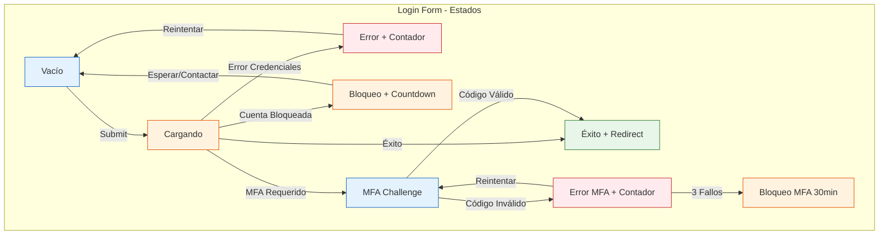

# Wireframe 01: Login Form
## Estado: VACÍO (Initial)
```
┌─────────────────────────────────────────────────────────────────────────────┐
│  🏥 SISTEMA HOSPITALARIO INTEGRADO                                          │
│  ─────────────────────────────────────────────────────────────────────────  │
│                    ┌─────────────────────────────────────────┐              │
│                    │  🔐 Iniciar Sesión                      │              │
│                    │  ┌───────────────────────────────────┐  │              │
│                    │  │ Email institucional          👤   │  │              │
│                    │  │ [________________________________]  │  │              │
│                    │  └───────────────────────────────────┘  │              │
│                    │  ┌───────────────────────────────────┐  │              │
│                    │  │ Contraseña                  👁️   │  │              │
│                    │  │ [________________________________]  │  │              │
│                    │  └───────────────────────────────────┘  │              │
│                    │  [☐ Recordarme en este dispositivo (30 días)]          │
│                    │  ┌───────────────────────────────────┐  │              │
│                    │  │        [ INICIAR SESIÓN ]         │  │  ← .btn-primary│
│                    │  └───────────────────────────────────┘  │              │
│                    │  ┌───────────────────────────────────┐  │              │
│                    │  │ ¿Olvidó su contraseña? | ¿Problemas con MFA?  │  │
│                    │  └───────────────────────────────────┘  │              │
│                    │  ℹ️ Tenant: Hospital Central (HCH-001)  │              │
│                    └─────────────────────────────────────────┘              │
└─────────────────────────────────────────────────────────────────────────────┘
Interacciones:
- Tab: Email → Password → Checkbox → Button → Links
- Enter: Submit form
- Focus: Outline 3px #1976D2 en elemento activo
- Password toggle: 👁️ muestra/oculta texto plano
```
## Estado: CARGA (Submitting)
```
┌─────────────────────────────────────────────────────────────────────────────┐
│  🏥 SISTEMA HOSPITALARIO INTEGRADO                                          │
│  ─────────────────────────────────────────────────────────────────────────  │
│                    ┌─────────────────────────────────────────┐              │
│                    │  🔐 Iniciar Sesión                      │              │
│                    │  ┌───────────────────────────────────┐  │              │
│                    │  │ Email institucional          👤   │  │  (disabled)    │
│                    │  │ [dra.gonzalez@hospital.com_______]  │  │              │
│                    │  └───────────────────────────────────┘  │              │
│                    │  ┌───────────────────────────────────┐  │              │
│                    │  │ Contraseña                  👁️   │  │  (disabled)    │
                    │  │ [●●●●●●●●●●●●●●●●________________]  │  │              │
│                    │  └───────────────────────────────────┘  │              │
│                    │  [☑ Recordarme...]  (disabled)                      │
│                    │  ┌───────────────────────────────────┐  │              │
│                    │  │    [ ⏳ Validando credenciales... ] │  │  ← .btn-primary│
│                    │  │    [ ████████░░░░░░░░░░ ]          │  │    .loading    │
│                    │  ℹ️ Tenant: Hospital Central (HCH-001)  │              │
│                    └─────────────────────────────────────────┘              │
└─────────────────────────────────────────────────────────────────────────────┘
Estados:
- Inputs: disabled=true, cursor: not-allowed
- Button: disabled=true, spinner + texto "Validando..."
- Progress bar: Animación indeterminada
- ARIA: aria-busy="true" en form, aria-live="polite" en status
```
## Estado: ERROR - Credenciales Inválidas
```
┌─────────────────────────────────────────────────────────────────────────────┐
│  🏥 SISTEMA HOSPITALARIO INTEGRADO                                          │
│  ─────────────────────────────────────────────────────────────────────────  │
│                    ┌─────────────────────────────────────────┐              │
│                    │  🔐 Iniciar Sesión                      │              │
│                    │  ┌───────────────────────────────────┐  │              │
│                    │  │ Email institucional          👤   │  │              │
│                    │  │ [dra.gonzalez@hospital.com_______]  │  │              │
│                    │  └───────────────────────────────────┘  │              │
│                    │  ┌───────────────────────────────────┐  │              │
│                    │  │ Contraseña                  👁️   │  │              │
│                    │  │ [●●●●●●●●●●●●●●●●________________]  │  │  .error      │
│                    │  └───────────────────────────────────┘  │   border:#C62828│
│                    │  ⚠️ Credenciales inválidas. Intento 2/5 │  │   .error-msg  │
│                    │  [☐ Recordarme...]                                           │
│                    │  ┌───────────────────────────────────┐  │              │
│                    │  │        [ INICIAR SESIÓN ]         │  │  ← .btn-primary│
│                    │  └───────────────────────────────────┘  │              │
│                    │  ┌───────────────────────────────────┐  │              │
│                    │  │ ¿Olvidó su contraseña? | ¿Problemas con MFA?  │  │
│                    │  └───────────────────────────────────┘  │              │
│                    │  🔴 Toast: Credenciales inválidas. Intento 2/5      │              │
│                    │     [ Reintentar ] [ ¿Olvidó? ] [ Cambiar Tenant ]  │              │
│                    │  ℹ️ Tenant: Hospital Central (HCH-001)  │              │
│                    └─────────────────────────────────────────┘              │
└─────────────────────────────────────────────────────────────────────────────┘
Accesibilidad:
- aria-invalid="true" en input password
- aria-describedby="password-error" apuntando a mensaje error
- Toast: role="alert" aria-live="assertive"
- Focus: Regresa a input password tras cerrar toast
```
## Estado: ERROR - Cuenta Bloqueada (Lockout Progresivo)
```
┌─────────────────────────────────────────────────────────────────────────────┐
│  🏥 SISTEMA HOSPITALARIO INTEGRADO                                          │
│  ─────────────────────────────────────────────────────────────────────────  │
│                    ┌─────────────────────────────────────────┐              │
│                    │  🔐 Iniciar Sesión                      │              │
│                    │  ┌───────────────────────────────────┐  │              │
│                    │  │ Email institucional          👤   │  │  (disabled)    │
│                    │  │ [dra.gonzalez@hospital.com_______]  │  │              │
│                    │  └───────────────────────────────────┘  │              │
│                    │  ┌───────────────────────────────────┐  │              │
│                    │  │ Contraseña                  👁️   │  │  (disabled)    │
│                    │  │ [●●●●●●●●●●●●●●●●________________]  │  │              │
│                    │  └───────────────────────────────────┘  │              │
│                    │  ┌───────────────────────────────────┐  │              │
│                    │  │        [ INICIAR SESIÓN ]         │  │  (disabled)    │
│                    │  └───────────────────────────────────┘  │              │
│                    │  ⚠️ Cuenta bloqueada 15 minutos         │              │
│                    │     Intento 5 de 5                      │              │
│                    │     ⏱️ Desbloqueo automático en: 14:52  │              │
│                    │  ┌───────────────────────────────────┐  │              │
│                    │  │  [ Contactar Administrador ]      │  │  ← .btn-secondary│
│                    │  └───────────────────────────────────┘  │              │
│                    │  🔴 Modal: Cuenta bloqueada por seguridad           │              │
│                    │     ⏱️ 14:51 restantes                     │              │
│                    │     [ Esperar desbloqueo ] [ Contactar Soporte ]   │              │
│                    │  ℹ️ Tenant: Hospital Central (HCH-001)              │              │
│                    └─────────────────────────────────────────┘              │
└─────────────────────────────────────────────────────────────────────────────┘
```
## Estado: ÉXITO (Redirect)
```
┌─────────────────────────────────────────────────────────────────────────────┐
│  🏥 SISTEMA HOSPITALARIO INTEGRADO                                          │
│  ─────────────────────────────────────────────────────────────────────────  │
│                    ┌─────────────────────────────────────────┐              │
│                    │  🔐 Iniciar Sesión                      │              │
│                    │  ✅ Toast: Bienvenida, Dra. González    │              │
│                    │     Redirigiendo al dashboard...        │              │
│                    │     [ ████████████████████ ] 100%       │              │
│                    │  ℹ️ Tenant: Hospital Central (HCH-001)  │              │
│                    └─────────────────────────────────────────┘              │
└─────────────────────────────────────────────────────────────────────────────┘
Comportamiento:
- Toast verde: role="status" aria-live="polite"
- Auto-redirect tras 2 segundos
- Progress bar: Animación 0→100% en 2s
- Si JS deshabilitado: Meta refresh + noscript link
```
## Responsive: Mobile (320px)
```
┌─────────────────────────────────────┐
│  🏥 SISTEMA HOSPITALARIO            │
│  ─────────────────────────────────  │
│  ┌───────────────────────────────┐  │
│  │  🔐 Iniciar Sesión            │  │
│  │  Email institucional    👤    │  │
│  │  [_________________________]  │  │  ← 100% width
│  │  Contraseña             👁️    │  │
│  │  [_________________________]  │  │
│  │  [☐ Recordarme 30 días]       │  │
│  │  [ INICIAR SESIÓN ]           │  │  ← 100% width
│  │  ¿Olvidó? | ¿MFA?             │  │
│  │  ℹ️ Tenant: HCH-001           │  │
│  └───────────────────────────────┘  │
└─────────────────────────────────────┘
Cambios Mobile:
- Form: 100% width, padding 16px
- Button: 100% width, min-height 48px (touch target)
- Inputs: font-size 16px (evita zoom iOS)
- Padding: 16px lados, 24px vertical
- Toast: bottom fixed, 100% width
```
## Mermaid para draw.io/Figma

