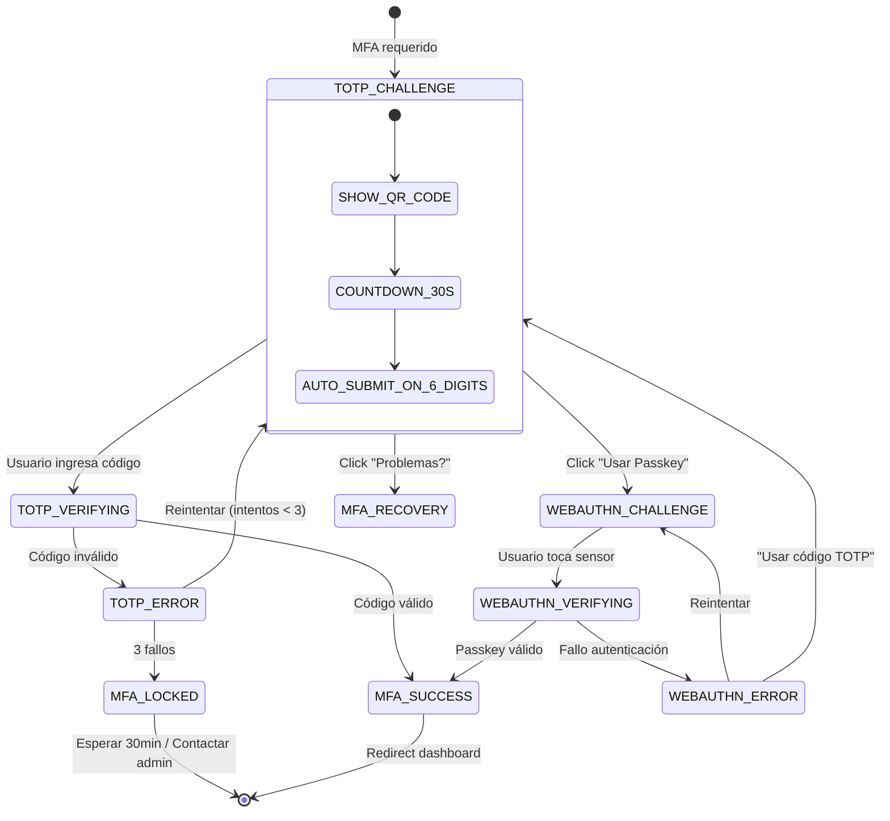

# Wireframe 02: MFA Challenge (TOTP + WebAuthn)
## Estado: DESAFÍO TOTP (Challenge Generado)
```
┌─────────────────────────────────────────────────────────────────────────────┐
│  🔐 Autenticación de Doble Factor Requerida                                │
│  ─────────────────────────────────────────────────────────────────────────  │
│   ┌─────────────────────────────────────────────────────────────────────┐   │
│   │  📱 Método: Aplicación Autenticadora (TOTP)                        │   │
│   │  1. Abra su app (Google Authenticator, Authy, Microsoft Auth)     │   │
│   │  2. Ingrese el código de 6 dígitos que muestra la app             │   │
│   │  ┌─────────────────────────────────────────────────────────────┐   │   │
│   │  │  Código: [ 1 ][ 2 ][ 3 ][ 4 ][ 5 ][ 6 ]  ◄ Auto-focus      │   │   │
│   │  │  │  │  │  │  │  │                                           │   │   │
│   │  └─────────────────────────────────────────────────────────────┘   │   │
│   │  ⏱️ Código expira en: 25 segundos  ████████████░░░░░░░░░░░░░░░░  │   │
│   │  ┌─────────────────────────────────────────────────────────────┐   │   │
│   │  │              [ VERIFICAR CÓDIGO ]                           │   │   │
│   │  └─────────────────────────────────────────────────────────────┘   │   │
│   │  ─────────────────────────────────────────────────────────────     │   │
│   │  🔑 ¿Prefiere Passkey?                                             │   │
│   │  [ Usar FaceID / TouchID / Llave de seguridad ]  ← .btn-secondary  │   │
│   │  ❓ ¿Problemas?  [ No tengo acceso a la app ]  ← Link a /mfa-recovery│   │
│   └─────────────────────────────────────────────────────────────────────┘   │
└─────────────────────────────────────────────────────────────────────────────┘
Detalles Técnicos:
- Input: type="text" inputmode="numeric" pattern="[0-9]*" maxlength="6" autocomplete="one-time-code"
- Auto-advance: JavaScript mueve focus al siguiente input al escribir dígito
- Pegar: Permitido, auto-distribuye dígitos en 6 inputs
- Countdown: Actualiza cada segundo, color cambia a warning < 10s
- ARIA: aria-live="polite" en countdown, role="alert" en errores
```
## Estado: VERIFICANDO (Loading)
```
┌─────────────────────────────────────────────────────────────────────────────┐
│  🔐 Autenticación de Doble Factor Requerida                                │
│  ─────────────────────────────────────────────────────────────────────────  │
│   ┌─────────────────────────────────────────────────────────────────────┐   │
│   │  📱 Método: Aplicación Autenticadora (TOTP)                        │   │
│   │  ⏳ Verificando código...                                           │   │
│   │     [ ████████░░░░░░░░░░░░░░░░ ]                                   │   │
│   │  ┌─────────────────────────────────────────────────────────────┐   │   │
│   │  │           [ ⏳ Verificando... ]        (disabled)           │   │   │
│   │  └─────────────────────────────────────────────────────────────┘   │   │
│   │  ⏱️ Tiempo restante: 18 segundos  ████████░░░░░░░░░░░░░░░░░░░░  │   │
│   └─────────────────────────────────────────────────────────────────────┘   │
└─────────────────────────────────────────────────────────────────────────────┘
```

## Estado: ERROR - Código Inválido
```
┌─────────────────────────────────────────────────────────────────────────────┐
│  🔐 Autenticación de Doble Factor Requerida                                │
│  ─────────────────────────────────────────────────────────────────────────  │
│   ┌─────────────────────────────────────────────────────────────────────┐   │
│   │  📱 Método: Aplicación Autenticadora (TOTP)                        │   │
│   │  ❌ Código inválido. Intento 2 de 3                                │   │
│   │     ┌─────────────────────────────────────────────────────────┐   │   │
│   │     │  Código: [ 1 ][ 2 ][ 3 ][ 4 ][ 5 ][ 6 ]  ❌ .error      │   │   │
│   │     └─────────────────────────────────────────────────────────┘   │   │
│   │  ⏱️ Código expira en: 12 segundos  ██████░░░░░░░░░░░░░░░░░░░░░░  │   │
│   │  ┌─────────────────────────────────────────────────────────────┐   │   │
│   │   │              [ VERIFICAR CÓDIGO ]                           │   │   │
│   │   └─────────────────────────────────────────────────────────────┘   │   │
│   │  [ Reenviar código ]  ← Link a /mfa-resend                          │   │
│   │  ─────────────────────────────────────────────────────────────     │   │
│   │  🔑 ¿Prefiere Passkey?                                             │   │
│   │  [ Usar FaceID / TouchID / Llave de seguridad ]                    │   │
│   │  ❓ ¿Problemas?  [ No tengo acceso a la app ]  ← /mfa-recovery     │   │
│   └─────────────────────────────────────────────────────────────────────┘   │
└─────────────────────────────────────────────────────────────────────────────┘
Toast Error:
🔴 Código inválido. Intento 2 de 3. [ Reenviar código ]
- role="alert" aria-live="assertive"
- Focus: Regresa a primer input código
```
## Estado: BLOQUEO MFA (3 Fallos)
```
┌─────────────────────────────────────────────────────────────────────────────┐
│  🔐 Autenticación de Doble Factor Requerida                                │
│  ─────────────────────────────────────────────────────────────────────────  │
│   ┌─────────────────────────────────────────────────────────────────────┐   │
│   │  🔐 Autenticación de Doble Factor                                  │   │
│   │  🔴 MFA Bloqueado: Demasiados intentos fallidos                    │   │
│   │     Intento 3 de 3                                                  │   │
│   │     ⏱️ Desbloqueo automático en: 29:45                             │   │
│   │     ┌─────────────────────────────────────────────────────────┐   │   │
│   │     │  Código: [ ][ ][ ][ ][ ][ ]  (disabled)                 │   │   │
│   │     └─────────────────────────────────────────────────────────┘   │   │
│   │     [ Verificar Código ] (disabled)                               │   │
│   │     ⚠️ Demasiados intentos fallidos.                             │   │
│   │        Intente nuevamente en 30 minutos.                         │   │
│   │        Se ha notificado a su administrador de seguridad.         │   │
│   │     [ Contactar Administrador ]  ← .btn-secondary                 │   │
│   │     [ Esperar desbloqueo automático ]                             │   │
│   └─────────────────────────────────────────────────────────────────────┘   │
└─────────────────────────────────────────────────────────────────────────────┘
Modal Crítico (Simultáneo):
┌─────────────────────────────────────────────────────────────────────────────┐
│  🛑 MFA BLOQUEADO - ACCIÓN REQUERIDA                                        │
│  ─────────────────────────────────────────────────────────────────────────  │
│  ⚠️ Su MFA ha sido bloqueado por 30 minutos por seguridad.               │
│  Se ha notificado automáticamente a su administrador de seguridad.        │
│  [ Entendido ]  ← Solo acción, focus automático                            │
└─────────────────────────────────────────────────────────────────────────────┘
```
## Estado: WEB AUTHN (Passkey / FaceID / TouchID)
```
┌─────────────────────────────────────────────────────────────────────────────┐
│  🔑 Autenticación con Passkey                                              │
│  ─────────────────────────────────────────────────────────────────────────  │
│   ┌─────────────────────────────────────────────────────────────────────┐   │
│   │  🔐 Toque el sensor de huella / FaceID / Windows Hello / YubiKey   │   │
│   │        ┌─────────────────────────────────────────────────────┐     │   │
│   │        │           [ 👆 Autenticar con Dispositivo ]         │     │   │
│   │        └─────────────────────────────────────────────────────┘     │   │
│   │  Dispositivos registrados:                                         │   │
│   │  ┌─────────────────────────────────────────────────────────────┐   │   │
│   │  │  📱 iPhone 15 Pro (FaceID)          │  Hoy 08:30    [⋮]    │   │   │
│   │  │  💻 MacBook Pro (TouchID)           │  Ayer 14:22   [⋮]    │   │   │
│   │  │  🔐 YubiKey 5C NFC                  │  Semanal      [⋮]    │   │   │
│   │  └─────────────────────────────────────────────────────────────┘   │   │
│   │  [ + Registrar nuevo Passkey ]  ← Abre modal registro             │   │
│   │  ─────────────────────────────────────────────────────────────     │   │
│   │  📱 ¿Prefiere código TOTP?                                         │   │
│   │  [ Usar código de 6 dígitos ]  ← Link a desafío TOTP              │   │
│   └─────────────────────────────────────────────────────────────────────┘   │
└─────────────────────────────────────────────────────────────────────────────┘
Modal Registrar Passkey:
┌─────────────────────────────────────────────────────────────────────────────┐
│  ➕ Registrar Nuevo Passkey                              [×] Cerrar         │
│  ─────────────────────────────────────────────────────────────────────────  │
│  ┌─────────────────────────────────────────────────────────────────────┐   │
│   │  1. Nombre del dispositivo: [ iPhone de María        ]             │   │
│   │  2. Toque [ Registrar ] y use FaceID / TouchID / Llave             │   │
│   │        [ REGISTRAR DISPOSITIVO ]  ← .btn-primary                   │   │
│   │  Dispositivo se guardará para futuros logins sin contraseña        │   │
│   └─────────────────────────────────────────────────────────────────────┘   │
└─────────────────────────────────────────────────────────────────────────────┘
```
## Estado: ÉXITO MFA (Redirect)
```
┌─────────────────────────────────────────────────────────────────────────────┐
│  🔐 Autenticación de Doble Factor                                          │
│  ─────────────────────────────────────────────────────────────────────────  │
│   ┌─────────────────────────────────────────────────────────────────────┐   │
│   │  ✅ Verificación exitosa                                            │   │
│   │     Redirigiendo al dashboard...                                    │   │
│   │     [ ████████████████████ ] 100%                                   │   │
│   └─────────────────────────────────────────────────────────────────────┘   │
└─────────────────────────────────────────────────────────────────────────────┘
```

## Responsive: Mobile (320px)
```
┌─────────────────────────────────────┐
│  🔐 Autenticación 2FA              │
│  ─────────────────────────────────  │
│  📱 App Autenticadora (TOTP)       │
│  1. Abra su app                    │
│  2. Ingrese código 6 dígitos       │
│  Código: [1][2][3][4][5][6]        │
│  ← 6 inputs 100% width cada uno    │
│  ⏱️ Expira en: 25s ████████░░░░░░  │
│  [ VERIFICAR CÓDIGO ]              │
│  ← 100% width                      │
│  ─────────────────────────────────  │
│  🔑 ¿Prefiere Passkey?             │
│  [ Usar FaceID / TouchID ]         │
│  ❓ ¿Problemas?                    │
│  [ No tengo acceso a la app ]      │
└─────────────────────────────────────┘
```
## Mermaid para draw.io/Figma

