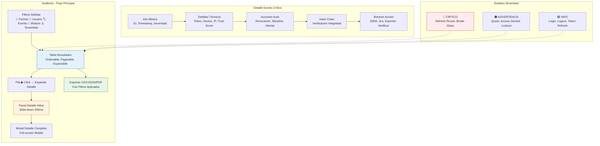

# Wireframe 05: Auditoría - Consulta Logs + Detalle
## Estado: TABLA AUDITORÍA CON FILTROS (Desktop)
```
┌─────────────────────────────────────────────────────────────────────────────┐
│  📋 Auditoría de Movimientos - Hospital Central                    [Exportar]│
│  ─────────────────────────────────────────────────────────────────────────  │
│  🔍 Filtros:  [📅 Desde: 2026-10-01] [📅 Hasta: 2026-10-18] [Limpiar]       │
│               👤 Usuario: [________________________]  🏷️ Evento: [▼ Todos] │
│               🏥 Módulo: [▼ Todos]  ⚠️ Severidad: [▼ Todas] [Aplicar]      │
│  ─────────────────────────────────────────────────────────────────────────  │
│  ┌──┬────────────────────────┬─────────────┬──────────────┬────────┬───────┐│
│  │▶ │ Fecha/Hora             │ Usuario     │ Evento       │ Módulo │ Sev   ││
│  ├──┼────────────────────────┼─────────────┼──────────────┼────────┼───────┤│
│  │▼ │ 2026-10-18 08:30:15    │ dr.silva    │ LOGIN_SUCCESS│ Auth   │ 🟢    ││
│  ├──┼────────────────────────┼─────────────┼──────────────┼────────┼───────┤│
│  │  │ 2026-10-18 09:15:22    │ adm.torres  │ REVOKE_SESS  │ Admin  │ 🟠    ││
│  ├──┼────────────────────────┼─────────────┼──────────────┼────────┼───────┤│
│  │  │ 2026-10-18 10:45:00    │ sys         │ REFRESH_REUSE│ Auth   │ 🔴    ││
│  ├──┼────────────────────────┼─────────────┼──────────────┼────────┼───────┤│
│  │  │ 2026-10-18 11:20:05    │ dra.gonzalez│ MFA_SUCCEEDED│ Auth   │ 🟢    ││
│  ├──┼────────────────────────┼─────────────┼──────────────┼────────┼───────┤│
│  │  │ 2026-10-18 12:05:30    │ lic.ruiz    │ USER_CREATED │ Admin  │ 🟢    ││
│  ├──┼────────────────────────┼─────────────┼──────────────┼────────┼───────┤│
│  │  │ 2026-10-18 13:40:12    │ adm.garcia  │ TENANT_QUOTA │ Admin  │ 🟠    ││
│  ├──┼────────────────────────┼─────────────┼──────────────┼────────┼───────┤│
│  │  │ 2026-10-18 14:22:18    │ dra.gonzalez│ BREAK_GLASS  │ Clin   │ 🔴    ││
│  ├──┼────────────────────────┼─────────────┼──────────────┼────────┼───────┤│
│  │  │ 2026-10-18 15:10:45    │ sys         │ TOKEN_REFRESH│ Auth   │ 🟢    ││
│  ├──┼────────────────────────┼─────────────┼──────────────┼────────┼───────┤│
│  │  │ 2026-10-18 16:30:00    │ enf.martinez│ ACCESS_DENIED│ Clin   │ 🟠    ││
│  └──┴────────────────────────┴─────────────┴──────────────┴────────┴───────┘│
│  ◄ Anterior  1  [2]  [3]  [4]  [5]  ...  [42]  Siguiente ►   [50 por pág] │
│                                                                             │
│  📊 Total: 2,087 eventos  |  🔴 Críticos: 3  |  🟠 Advertencias: 12        │
└─────────────────────────────────────────────────────────────────────────────┘
Interacciones:
- Click fila (▶): Expande panel detalle (slide-down animation 200ms)
- Click header columna: Ordenar ASC/DESC (indicador ▲/▼)
- Shift+Click: Multi-sort
- Drag column: Reordenar columnas
- Right-click header: Menú columnas (mostrar/ocultar, pin/freeze)
- Keyboard: Tab navega filas, Enter expande, Escape colapsa, Flechas navega
- Filtros: Sidebar derecho colapsable (botón 🔍 Filtros)
- Exportar: CSV/PDF/JSON con filtros aplicados
```

## Estado: FILA EXPANDIDA (Detalle Inline)
```
┌─────────────────────────────────────────────────────────────────────────────┐
│  📋 Auditoría de Movimientos - Hospital Central                              │
│  ─────────────────────────────────────────────────────────────────────────  │
│  🔍 Filtros: ...                                                            │
│  ─────────────────────────────────────────────────────────────────────────  │
│  ┌──┬────────────────────────┬─────────────┬──────────────┬────────┬───────┐│
│  │▶ │ 2026-10-18 10:45:00    │ sys         │ REFRESH_REUSE│ Auth   │ 🔴    ││
│  ├──┼────────────────────────┼─────────────┼──────────────┼────────┼───────┤│
│  │  │ ▼ DETALLE DEL EVENTO                                                    ││
│  │  │ ┌─────────────────────────────────────────────────────────────────┐   ││
│  │  │ │  🔴 REFRESH_REUSE_DETECTED - CRÍTICO                            │   ││
│  │  │ │  ─────────────────────────────────────────────────────────────  │   ││
│  │  │ │  📋 Información Básica:                                         │   ││
│  │  │ │  • Event ID: evt_7f8a9b2c-4d1e-4f3a-8b7c-9d0e1f2a3b4c          │   ││
│  │  │ │  • Timestamp: 2026-10-18 10:45:00.123Z                         │   ││
│  │  │ │  • Usuario: sys (service-account)                              │   ││
│  │  │ │  • Tenant: Hospital Central (HCH-001)                          │   ││
│  │  │ │  • IP Origen: 192.168.1.45                                     │   ││
│  │  │ │  • User Agent: Mozilla/5.0 (Windows NT 10.0; Win64; x64)...    │   ││
│  │  │ │  • Device ID: dev_7k9m2n1p                                     │   ││
│  │  │ │  • Severidad: CRÍTICO                                           │   ││
│  │  │ │                                                                 │   ││
│  │  │ │  🔍 Detalles Técnicos:                                          │   ││
│  │  │ │  • Refresh Token Reutilizado: rt_abc123...                     │   ││
│  │  │ │  • Access Token Anterior: jwt_eyJhbGciOiJSUzI1NiIs...          │   ││
│  │  │ │  • Access Token Nuevo (intentado): jwt_eyJhbGciOiJSUzI1NiIs... │   ││
│  │  │ │  • Dispositivo: Chrome 119 / Windows 10 / 192.168.1.45        │   ││
│  │  │ │  • Trust Score: 15/100 (SOSPECHOSO)                           │   ││
│  │  │ │                                                                 │   ││
│  │  │ │  ⚡ Acciones Automáticas Ejecutadas:                            │   ││
│  │  │ │  ✅ Revocación TOTAL de todas las sesiones del usuario         │   ││
│  │  │ │  ✅ Blocklist de todos los Access Tokens (JTI)                 │   ││
│  │  │ │  ✅ Eliminación de todos los Refresh Tokens                    │   ││
│  │  │ │  ✅ Alerta CRÍTICA enviada a SIEM (Splunk)                     │   ││
│  │  │ │  ✅ Ticket Jira auto-creado: SEC-2026-1018-0042               │   ││
│  │  │ │  ✅ Notificación Slack #security-alerts                        │   ││
│  │  │ │  ✅ Notificación Email a Security Team                         │   ││
│  │  │ │                                                                 │   ││
│  │  │ │  🔗 Hash Chain Verificación:                                   │   ││
│  │  │ │  • Hash Anterior: a1b2c3d4e5f6... (verificado ✅)            │   ││
│  │  │ │  • Hash Actual: e5f6g7h8i9j0... (calculado ✅)               │   ││
│  │  │ │  • Integridad: VERIFICADA ✅                                   │   ││
│  │  │ │                                                                 │   ││
│  │  │ │  [ Ver en SIEM ]  [ Crear Incidencia Jira ]  [ Exportar JSON ] │   ││
│  │  │ │  [ Ver Sesiones Revocadas ]  [ Notificar Usuario ]             │   ││
│  │  │ └─────────────────────────────────────────────────────────────────┘   ││
│  ├──┼────────────────────────┼─────────────┼──────────────┼────────┼───────┤│
│  │  │ 2026-10-18 11:20:05    │ dra.gonzalez│ MFA_SUCCEEDED│ Auth   │ 🟢    ││
│  └──┴────────────────────────┴─────────────┴──────────────┴────────┴───────┘│
└─────────────────────────────────────────────────────────────────────────────┘
Animación: Slide-down 200ms ease-out
Accesibilidad: aria-expanded en fila, panel con role="region" aria-labelledby
```

## Estado: DETALLE EVENTO CRÍTICO (Modal/Full-Screen)
```
┌─────────────────────────────────────────────────────────────────────────────┐
│  🔴 REFRESH_REUSE_DETECTED - CRÍTICO                          [×] Cerrar    │
│  ─────────────────────────────────────────────────────────────────────────  │
│  ┌─────────────────────────────────────────────────────────────────────┐   │
│  │  📋 INFORMACIÓN BÁSICA                                              │   │
│  │  ─────────────────────────────────────────────────────────────────  │   │
│  │  • Event ID: evt_7f8a9b2c-4d1e-4f3a-8b7c-9d0e1f2a3b4c             │   │
│  │  • Event Name: REFRESH_REUSE_DETECTED                              │   │
│  │  • Severidad: CRÍTICO                                              │   │
│  │  • Timestamp: 2026-10-18 10:45:00.123Z                            │   │
│  │  • Correlación ID: corr_8f9b0c1d-5e2f-4a4b-9c8d-0e1f2a3b4c5d      │   │
│  └─────────────────────────────────────────────────────────────────────┘   │
│  ┌─────────────────────────────────────────────────────────────────────┐   │
│  │  👤 USUARIO Y TENANT                                                │   │
│  │  ─────────────────────────────────────────────────────────────────  │   │
│  │  • Usuario: sys (service-account)                                  │   │
│  │  • User ID: usr_00000000-0000-0000-0000-000000000000             │   │
│  │  • Tenant: Hospital Central (HCH-001)                              │   │
│  │  • Tenant ID: tnt_00000000-0000-0000-0000-000000000001           │   │
│  │  • Roles: [SYSTEM_SERVICE]                                         │   │
│  └─────────────────────────────────────────────────────────────────────┘   │
│  ┌─────────────────────────────────────────────────────────────────────┐   │
│  │  🔍 DETALLES TÉCNICOS                                               │   │
│  │  ─────────────────────────────────────────────────────────────────  │   │
│  │  • Refresh Token Reutilizado: rt_abc123def456... (primeros 12)    │   │
│  │  • Access Token Original (JTI): jwt_eyJhbGciOiJSUzI1NiIsInR5cCI6 |   │
│  │  • Access Token Nuevo Intentado: jwt_eyJhbGciOiJSUzI1NiIsInR5cCI6 |   │
│  │  • Dispositivo: dev_7k9m2n1p                                       │   │
│  │  • User Agent: Mozilla/5.0 (Windows NT 10.0; Win64; x64)...       │   │
│  │  • IP Origen: 192.168.1.45 (Geolocalización: Madrid, ES)          │   │
│  │  • Trust Score: 15/100 (SOSPECHOSO) - Primer uso desde esta IP    │   │
│  │  • Geolocalización Previa: 192.168.1.100 (Madrid, ES) - 2h atrás  │   │
│  └─────────────────────────────────────────────────────────────────────┘   │
│  ┌─────────────────────────────────────────────────────────────────────┐   │
│  │  ⚡ ACCIONES AUTOMÁTICAS EJECUTADAS                                 │   │
│  │  ─────────────────────────────────────────────────────────────────  │   │
│  │  ✅ Revocación TOTAL de todas las sesiones del usuario (3 sesiones)│   │
│  │  ✅ Blocklist de todos los Access Tokens (3 JTI agregados)         │   │
│  │  ✅ Eliminación de todos los Refresh Tokens (3 eliminados)         │   │
│  │  ✅ Alerta CRÍTICA enviada a SIEM (Splunk) - Index: security-alerts│   │
│  │  ✅ Ticket Jira auto-creado: SEC-2026-1018-0042                   │   │
│  │  ✅ Notificación Slack #security-alerts (@security-team)           │   │
│  │  ✅ Notificación Email a security@hospital.com                     │   │
│  │  ✅ Notificación PagerDuty al on-call security engineer            │   │
│  │  ✅ Log en auditoría inmutable (Hash Chain verificado)             │   │
│  └─────────────────────────────────────────────────────────────────────┘   │
│  ┌─────────────────────────────────────────────────────────────────────┐   │
│  │  🔗 VERIFICACIÓN INTEGRIDAD (Hash Chain)                            │   │
│  │  ─────────────────────────────────────────────────────────────────  │   │
│  │  • Hash Anterior: a1b2c3d4e5f6g7h8... (verificado ✅)             │   │
│  │  • Payload: {...}                                                   │   │
│  │  • Timestamp: 2026-10-18T10:45:00.123Z                             │   │
│  │  • Hash Calculado: SHA256(prev_hash || payload || timestamp)       │   │
│  │  • Hash Actual: e5f6g7h8i9j0k1l2... (calculado ✅)                │   │
│  │  • ✅ INTEGRIDAD VERIFICADA - Sin manipulación detectada           │   │
│  └─────────────────────────────────────────────────────────────────────┘   │
│  ─────────────────────────────────────────────────────────────────────────  │
│  [ Ver en SIEM ]  [ Crear Incidencia Jira ]  [ Exportar JSON ]  [ Cerrar ] │
└─────────────────────────────────────────────────────────────────────────────┘
Botones Acción:
- Ver en SIEM: Abre Splunk/Elastic con query prefiltrado
- Crear Incidencia Jira: Pre-llena campos con datos evento
- Exportar JSON: Descarga payload completo + hash chain
- Notificar Usuario: Envía email al usuario afectado (si aplica)
```
## Estado: EXPORTACIÓN (Modal Opciones)
```
┌─────────────────────────────────────────────────────────────────────────────┐
│  📤 Exportar Resultados de Auditoría                    [×] Cerrar          │
│  ─────────────────────────────────────────────────────────────────────────  │
│  ┌─────────────────────────────────────────────────────────────────────┐   │
│   │  📁 Formato de Exportación                                          │   │
│   │  ┌─────────────────────────────────────────────────────────────┐   │   │
│   │  │  [☑] CSV (Compatible Excel)          → 2,087 filas, ~500 KB  │   │   │
│   │  │  [☐] JSON (Estructurado)             → 2,087 objetos, ~1.2 MB│   │   │
│   │  │  [☐] PDF (Reporte formateado)        → 42 páginas, ~2.1 MB    │   │   │
│   │  │  [☐] JSON Lines (Streaming)          → Para SIEM/Logstash    │   │   │
│   │  └─────────────────────────────────────────────────────────────┘   │   │
│   │  📋 Columnas a Incluir:                                            │   │
│   │  [☑] Timestamp  [☑] Evento  [☑] Usuario  [☑] Tenant  [☑] Módulo  │   │
│   │  [☑] Severidad  [☑] IP  [☑] Device  [☐] Payload Completo  [☑] Hash │   │
│   │                                                                     │   │
│   │  📅 Rango de Fechas:  [2026-10-01] → [2026-10-18]  (Filtros actuales)│   │
│   │  👤 Usuarios: [☑] Todos  [☐] Seleccionar...                        │   │
│   │  🏷️ Eventos: [☑] Todos  [☐] Solo Críticos  [☐] Solo Advertencias │   │
│   │  ⚠️ Severidad: [☑] Todas  [☐] Solo CRÍTICO/ADVERTENCIA            │   │
│   │                                                                     │   │
│   │  🔐 Opciones Avanzadas:                                            │   │
│   │  [☐] Incluir Hash Chain (Verificación integridad)                 │   │
│   │  [☐] Firmar digitalmente (PGP)                                    │   │
│   │  [☐] Comprimir (ZIP)                                               │   │
│   │  [☐] Enviar por email al completar                                 │   │
│   └─────────────────────────────────────────────────────────────────────┘   │
│  ─────────────────────────────────────────────────────────────────────────  │
│  [ Cancelar ]                    [ EXPORTAR ]  ← .btn-primary              │
└─────────────────────────────────────────────────────────────────────────────┘
Progreso Exportación:
┌─────────────────────────────────────────────────────────────────────────────┐
│  📤 Exportando CSV...  [ ████████████░░░░░░░░ ]  65%  1,356/2,087 filas    │
│  ⏱️ Tiempo estimado: 12 segundos restantes                                 │
│  [ Cancelar ]                                                               │
└─────────────────────────────────────────────────────────────────────────────┘
Completado:
┌─────────────────────────────────────────────────────────────────────────────┐
│  ✅ Exportación Completada                                                  │
│  ─────────────────────────────────────────────────────────────────────────  │
│  📁 Archivo: auditoria_2026-10-01_2026-10-18.csv (487 KB)                 │
│  📊 2,087 filas exportadas en 18.3 segundos                                │
│  🔐 Hash SHA256: a1b2c3d4e5f6... (para verificación integridad)           │   │
│                                                                             │
│  [ Descargar ]  [ Enviar por Email ]  [ Copiar Hash ]  [ Cerrar ]         │
└─────────────────────────────────────────────────────────────────────────────┘
```
## Responsive: Mobile (Tabla → Cards)
```
┌─────────────────────────────────────┐
│  📋 Auditoría - HCH          [⚙️]    │
│  ─────────────────────────────────  │
│  🔍 [Filtros ▼]  [Exportar]         │
│  ─────────────────────────────────  │
│  ┌───────────────────────────────┐  │
│  │ 🔴 REFRESH_REUSE_DETECTED     │  │
│  │ ─────────────────────────────  │  │
│  │ 🕐 2026-10-18 10:45:00        │  │
│  │ 👤 sys (service-account)      │  │
│  │ 🏷️ CRÍTICO                     │  │
│  │ 🔍 Ver detalle ▶              │  │
│  └───────────────────────────────┘  │
│  ┌───────────────────────────────┐  │
│  │ 🟢 LOGIN_SUCCESS              │  │
│  │ ─────────────────────────────  │  │
│  │ 🕐 2026-10-18 11:20:05        │  │
│  │ 👤 dra.gonzalez                │  │
│  │ 🏷️ INFO                        │  │
│  │ 🔍 Ver detalle ▶              │  │
│  └───────────────────────────────┘  │
│  ┌───────────────────────────────┐  │
│  │ 🟠 REVOKE_SESSION             │  │
│  │ ─────────────────────────────  │  │
│  │ 🕐 2026-10-18 09:15:22        │  │
│  │ 👤 adm.torres                 │  │
│  │ 🏷️ ADVERTENCIA                │  │
│  │ 🔍 Ver detalle ▶              │  │
│  └───────────────────────────────┘  │
│  ◄ 1 [2] [3] [4] [5] ►   20/pág    │
└─────────────────────────────────────┘
Touch Interactions:
- Tap card: Expande detalle (slide-up)
- Swipe left: Acciones rápidas [Ver en SIEM] [Exportar]
- Long press: Selección múltiple
- Pull to refresh: Actualiza lista
```
## Mermaid para draw.io/Figma

