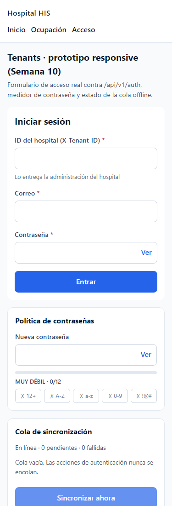
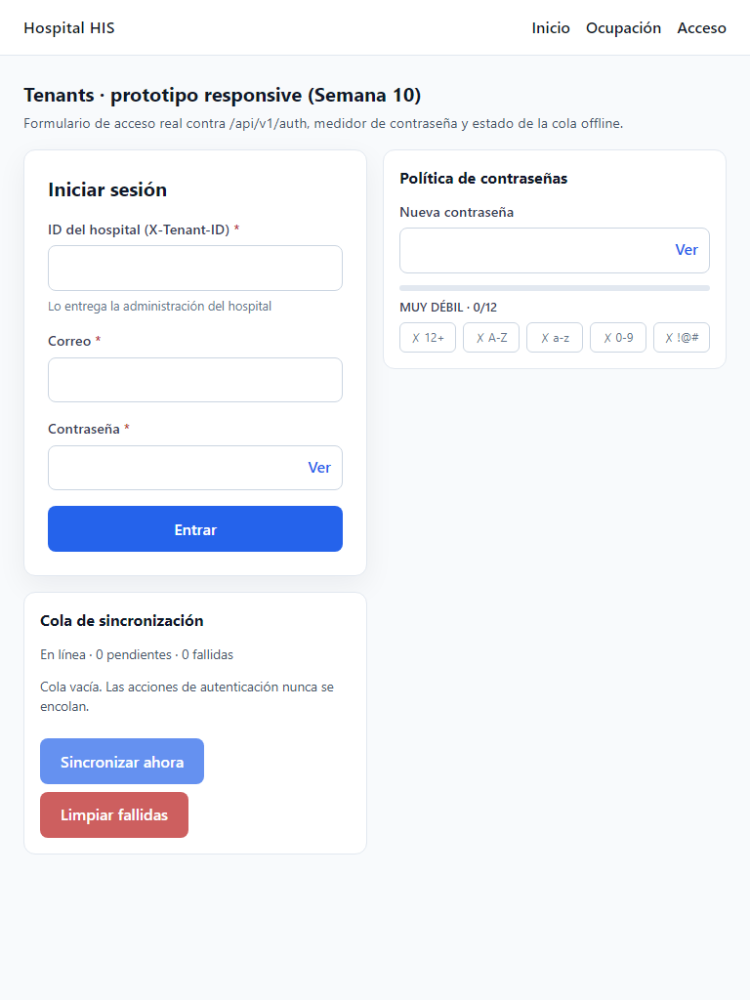
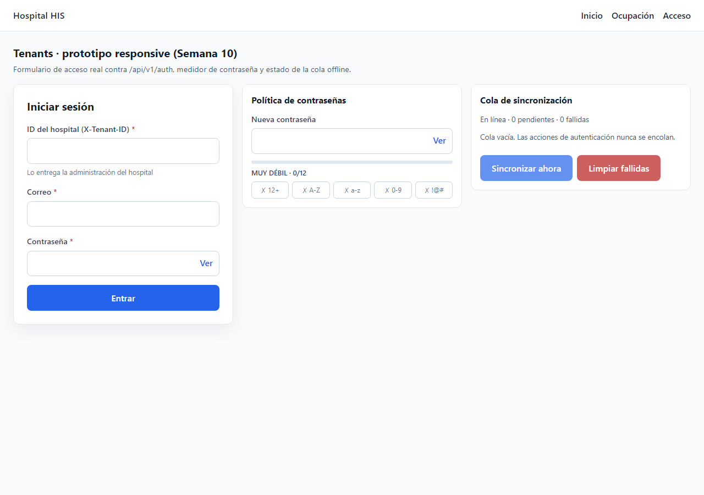

# Semana 10 · Prototipo responsive de Tenants en Vue

Corrección de #365–#367: los componentes React que estaban en `docs/` no compilaban en el stack del
proyecto (Vue 3 + Vite). Se reescribieron como componentes Vue dentro de `resources/js/modules/tenants/`
y se publican en una ruta navegable del SPA.

| Pieza | Archivo | PR |
| --- | --- | --- |
| Reglas puras (fuerza de contraseña, validación de login, bloqueo de doble envío) | `responsive/formRules.js` + `formRules.test.mjs` | #365 |
| Botón táctil que ignora clics durante `loading` | `responsive/BaseButton.vue` | #365 |
| Campo accesible (16 px, 44 px, `aria-describedby`) y medidor de contraseña | `responsive/FormField.vue`, `PasswordStrengthMeter.vue` | #365 |
| Cola offline con política segura + prueba | `offline/offlineQueue.js` + `offlineQueue.test.mjs` | #366 |
| Composable de la cola (envía con la instancia axios de `/api/v1`) | `offline/useOfflineQueue.js` | #366 |
| Formulario de acceso responsive | `responsive/LoginForm.vue` | #366 |
| Indicador offline, panel de cola (solo metadatos) y página del prototipo | `offline/OfflineIndicator.vue`, `PendingActionsPanel.vue`, `pages/ResponsivePrototypePage.vue` | #367 |

## Política offline

- **Nunca se encolan** login, refresh, MFA, logout, revocaciones ni altas o ediciones de usuarios:
  llevan credenciales o tokens y requieren conexión. `register()` rechaza esos tipos.
- Solo se encolan tipos registrados con sus campos permitidos; los demás campos se descartan antes
  de guardarse en `localStorage`, y un campo con nombre sensible (`pass`, `token`, `secret`, `otp`,
  `code`…) no se puede declarar.
- Solo rutas `/api/v1/…`. El Bearer y `X-Tenant-ID` se agregan al enviar, desde la sesión vigente.
- El panel muestra solo metadatos (`describe()`): etiqueta, estado, intentos, fecha y código de error.
- Un 4xx falla de inmediato; un fallo de red se reintenta hasta 3 veces.

## Cómo reproducirlo

```bash
node resources/js/modules/tenants/responsive/formRules.test.mjs
node resources/js/modules/tenants/offline/offlineQueue.test.mjs
npx vite build
SESSION_DRIVER=array CACHE_STORE=array php artisan serve --port=8090
# Abrir http://127.0.0.1:8090/prototipos/tenants-responsive
```

## Evidencia (21/10/2026)

Capturas con Chrome headless. Móvil y tableta se tomaron dentro de un `iframe` del ancho exacto,
porque Chrome headless no reduce la ventana por debajo de ~500 px.

| Móvil 375 px | Tableta 768 px | Escritorio 1280 px |
| --- | --- | --- |
|  |  |  |

- Móvil: una columna, botones a todo el ancho, campos de 44 px y sin desplazamiento horizontal.
- Tableta: dos columnas; escritorio: tres.
- Pruebas: `OK: reglas de formularios responsive de Tenants aprobadas` y
  `OK: política offline segura de Tenants aprobada`. `vite build` termina sin errores.
