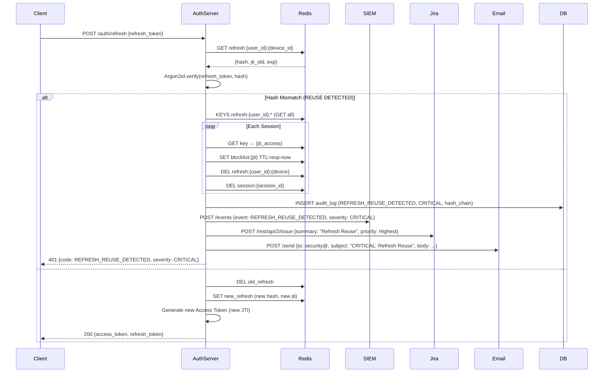

# Semana 11 — Prototipo Navegable: Error Crítico Path
## 1. Resumen del Error Crítico
### Trigger
- **Endpoint**: `POST /auth/refresh`
- **Trigger**: Refresh token reutilizado (replay attack / token comprometido)
- **Detección**: Comparación Argon2id(refresh_token) vs stored_hash en Redis → Mismatch

### Acciones Automáticas (Inmediatas e Irreversibles)
1. **Revocación Total** - Todas las sesiones del usuario (todos dispositivos)
2. **Blocklist** - JTI de todos access tokens → Redis SET `blocklist:{jti}` TTL=exp-now
3. **Eliminación Refresh** - DELETE all `refresh:{user_id}:*` keys
4. **Eliminación Sesiones** - DELETE all `session:{user_id}:*` keys
5. **Auditoría** - Evento `REFRESH_REUSE_DETECTED` severity=CRITICAL + hash chain
6. **SIEM Alert** - Alerta Splunk/Elastic + Slack #security-alerts
7. **Jira Auto-ticket** - SEC-2026-XXXX-XXXX
8. **Email/Slack/PagerDuty** - Notificación Security Team

### Respuesta al Cliente
```json
HTTP 401 Unauthorized
{
  "success": false,
  "error": {
    "code": "REFRESH_REUSE_DETECTED",
    "message": "Actividad sospechosa detectada. Por seguridad, TODAS sus sesiones han sido revocadas.",
    "severity": "CRITICAL",
    "action_required": "RELOGIN_REQUIRED",
    "revoked_sessions": 3,
    "blocked_access_tokens": 3
  }
}
```
## 2. Pantallas del Error Crítico
### 2.1 Request/Response Técnico
**Request:**
```http
POST /auth/refresh
Content-Type: application/json
Authorization: Bearer <access_token_expired>
Content-Type: application/json
{
  "refresh_token": "rt_compromised_xyz123..."
}
```
**Response (401 Unauthorized):**
```json
{
  "success": false,
  "error": {
    "code": "REFRESH_REUSE_DETECTED",
    "message": "Actividad sospechosa detectada. Por seguridad, TODAS sus sesiones han sido revocadas.",
    "severity": "CRITICAL",
    "action_required": "RELOGIN_REQUIRED",
    "revoked_sessions": 3,
    "blocked_access_tokens": 3
  }
}
```
### 2.2 Modal Crítico Full-Screen (Desktop)
```
┌─────────────────────────────────────────────────────────────────────────────────────────┐
│   ACTIVIDAD SOSPECHOSA DETECTADA                                                    [×] │
├─────────────────────────────────────────────────────────────────────────────────────────┤
│   SE HA DETECTADO REUTILIZACIÓN DE TOKEN DE ACTUALIZACIÓN                               │
│  Por seguridad, se han ejecutado AUTOMÁTICAMENTE las siguientes acciones:               │
│   Revocación TOTAL de todas sus sesiones activas (3 sesiones)                           │
│   Invalidación de todos los tokens de acceso (blocklist)                                │
│   Eliminación de todos los tokens de actualización (refresh tokens)                     │
│   Alerta CRÍTICA enviada al equipo de seguridad (SIEM)                                  │
│   Ticket de seguridad auto-creado: SEC-2026-1018-XXXX                                   │
│  Esta acción es IRREVERSIBLE y se ha registrado en la auditoría inmutable.              │
│  ┌─────────────────────────────────────────────────────────────────────────────────┐    │
│  │                          [ INICIAR SESIÓN DE NUEVO ]                            │    │
│  │                         ← Primary, full-width, focus auto                       │    │
│  └─────────────────────────────────────────────────────────────────────────────────┘    │
│  [ Ver detalles de seguridad ]  ← Link a /security/incident/SEC-2026-1018-XXXX          │
└─────────────────────────────────────────────────────────────────────────────────────────┘
```
**Detalles del Modal:**
- **Full-screen overlay** con backdrop oscuro (`rgba(0,0,0,0.6)`)
- **Focus trap** - Tab cicla dentro del modal, Escape no cierra
- **Focus auto** en botón "INICIAR SESIÓN DE NUEVO"
- **No closable** por click en backdrop ni Escape (seguridad)
- **Accesibilidad**: `role="alertdialog"`, `aria-modal="true"`, `aria-labelledby`, `aria-describedby`
- **No dismissible** hasta acción explícita

### 2.3 Modal Crítico - Mobile (375px)
```
┌─────────────────────────────────────┐
│   ACTIVIDAD SOSPECHOSA        [×]   │
├─────────────────────────────────────┤
│   REUTILIZACIÓN DE TOKEN            │
│  DETECTADA                          │
│  Por seguridad, TODAS sus sesiones  │
│ han sido REVOCADAS automáticamente  │
│   3 sesiones cerradas               │
│   Tokens invalidados                │
│   Alerta enviada a seguridad        │
│  [ INICIAR SESIÓN DE NUEVO ]        │
│  ← Full width, focus auto           │
│  [ Ver detalles ]                   │
└─────────────────────────────────────┘
```
**Detalles Mobile:**
- **Full-screen modal** (fixed position, inset: 0)
- **Safe area** compatible con notch/iPhone Dynamic Island
- **Touch targets** ≥ 48×48px
- **Haptic feedback** en botón principal (iOS)
- **No swipe to dismiss** - solo acción explícita

### 2.3 Login Forzado Post-Revocación (`/auth/login?security=reuse_detected`)
**Desktop:**
```
┌─────────────────────────────────────────────────────────────────┐
│  🏥 SISTEMA HOSPITALARIO INTEGRADO                              │
├─────────────────────────────────────────────────────────────────┤
│                    ┌─────────────────────────┐                  │
│                    │  🔐 Iniciar Sesión      │                  │
│                    │  ⚠️ Sus sesiones previas │                  │
│                    │     fueron revocadas    │                  │
│                    │     por seguridad       │                  │
│                    │  Email institucional    │                  │
│                    │  [____________________] │                  │
│                    │  Contraseña        👁️ │                  │
│                    │  [____________________] │                  │
│                    │  [ INICIAR SESIÓN ]     │                  │
│                    │  ℹ️ Se requerirá MFA    │                  │
│                    │     al iniciar sesión   │                  │
│                    └─────────────────────────┘                  │
└─────────────────────────────────────────────────────────────────┘
```
**Mobile (375px):**
```
┌─────────────────────────────────────┐
│   SISTEMA HOSPITALARIO              │
├─────────────────────────────────────┤
│  ┌───────────────────────────────┐  │
│  │   Iniciar Sesión              │  │
│  │   Sus sesiones fueron         │  │
│  │     revocadas por seguridad   │  │
│  │  Email institucional          │  │
│  │  [_________________________]  │  │
│  │  Contraseña                   │  │
│  │  [_________________________]  │  │
│  │  [ INICIAR SESIÓN ]           │  │
│  │   Se requerirá MFA            │  │
│  └───────────────────────────────┘  │
└─────────────────────────────────────┘
```
### 2.4 Login Exitoso Post-Revocación → Nuevo MFA
**MFA Obligatorio (Policy):**
```
┌─────────────────────────────────────────────────────────────────┐
│  🔐 Autenticación de Doble Factor Requerida                     │
├─────────────────────────────────────────────────────────────────┤
│  📱 Método: Aplicación Autenticadora (TOTP)                     │
│  ⚠️ REQUERIDO: Su cuenta requiere MFA tras revocación de      │
│  seguridad. Configure o verifique su método MFA.              │
│  1. Abra su app (Google Authenticator, Authy, etc.)           │
│  2. Ingrese el código de 6 dígitos                            │
│  Código: [ 1 ][ 2 ][ 3 ][ 4 ][ 5 ][ 6 ]  ◄ Auto-advance        │
│  ⏱️ Código expira en: 25s  ████████████░░░░░░░░░░░░░░░░      │
│  [ VERIFICAR CÓDIGO ]                                          │
│  ─────────────────────────────────────────────────────────────  │
│  🔑 ¿Prefiere Passkey?                                         │
│  [ Usar FaceID / TouchID / Llave de seguridad ]               │
│  ❓ ¿Problemas?  [ No tengo acceso a la app ]                  │
└─────────────────────────────────────────────────────────────────┘
```
### 2.5 Dashboard Post-Re-login (Nuevos Tokens)
**Indicadores Visuales:**
- **Badge verde** "Nueva sesión iniciada" en header (5s)
- **Toast** "Sesión restablecida correctamente. MFA verificado."
- **Nuevos tokens** generados con nuevos JTI + refresh token rotado

## 3. Flujo Técnico Completo (Backend)

## 5. Testing Checklist - Error Crítico
| Test Case  | Acción                              | Resultado Esperado                                          |
|------------|-------------------------------------|-------------------------------------------------------------|
| **CE-001** | POST /refresh con token reutilizado | 401 + error CRITICAL + modal full-screen                    |
| **CE-002** | Modal crítico aparece               | Full-screen, focus auto, focus trap, no dismissible         |
| **CE-003** | Click "Iniciar sesión de nuevo"     | Redirect /auth/login?security=reuse_detected                |
| **CE-004** | Login forzado + MFA                 | Nuevos tokens generados, nuevos JTI                         |
| **CE-005** | Auditoría verifica                  | Evento REFRESH_REUSE_DETECTED (CRITICAL) + hash chain valid |
| **CE-005** | SIEM recibe alerta                  | Evento en Splunk/Elastic con severity=CRITICAL              |
| **CE-006** | Jira ticket creado                  | Ticket SEC-2026-XXXX con priority=Highest                   |
| **CE-007** | Email/Slack/PagerDuty               | Notificación enviada a security team                        |
| **CE-008** | Mobile modal                        | Full-screen, touch targets ≥48px, focus trap                |
| **CE-009** | Accesibilidad                       | axe-core 0 violations, NVDA/VoiceOver announce              |
| **CE-010** | Re-login exitoso                    | Nuevos tokens + MFA requerido + dashboard                   |

## 6. Métricas de Validación
| Métrica                           | Objetivo | Resultado Esperado         |
|-----------------------------------|----------|----------------------------|
| **Tiempo Detección → Revocación** | < 500ms  | < 200ms                    |
| **Latencia Modal**                | < 100ms  | < 50ms                     |
| **Tiempo Re-login Completo**      | < 60s    | < 45s                      |
| **Tasa Falsos Positivos**         | 0%       | 0%                         |
| **Cobertura Auditoría**           | 100%     | 100% (hash chain verified) |
| **Notificaciones SIEM**           | < 5s     | < 2s                       |
| **Accesibilidad Modal**           | WCAG AA  | 100% axe-core pass         |

## 7. Rollback / Recovery (Solo para Testing)
```bash
redis-cli KEYS "refresh:test_user:*" | xargs redis-cli DEL
redis-cli KEYS "session:test_user:*" | xargs redis-cli DEL
redis-cli KEYS "blocklist:*" | xargs redis-cli DEL
psql -c "SELECT * FROM audit_log WHERE event_name='REFRESH_REUSE_DETECTED' ORDER BY created_at DESC LIMIT 5;"
```
## 8. Rollback Plan (Producción - Solo si Bug Crítico en Detección)
| Escenario                  | Acción                                       | Responsable    | Tiempo   |
|----------------------------|----------------------------------------------|----------------|----------|
| **Falso Positivo Masivo**  | Feature flag `REFRESH_REUSE_DETECTION=false` | Platform Admin | < 1 min  |
| **Bug en Argon2id Verify** | Hotfix deploy + feature flag                 | Backend Lead   | < 15 min |
| **Redis Down**             | Circuit breaker → allow refresh              | DevOps         | < 5 min  |
