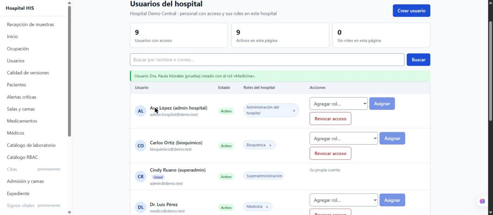

# Semana 16 — Botón «Crear usuario» en `/admin/users` (parte 10)

Pantalla del alta de usuario por tenant sobre `POST /api/v1/admin/users` (parte 9).

## Comportamiento

- El botón **Crear usuario** solo aparece si la sesión tiene `usuarios.crear` en el hospital activo
  (superadmin y admin_hospital); el backend vuelve a comprobarlo.
- Formulario en la misma página: nombre completo, correo, rol inicial y contraseña temporal.
- Validación previa con la misma política del backend (`erroresDeAlta`): 12 caracteres con
  mayúscula, minúscula, número y símbolo; correo válido; rol obligatorio. Cada error se muestra
  junto a su campo (`aria-invalid` + `aria-describedby`).
- El rol superadmin solo se ofrece a un superadmin (`rolesParaAlta`).
- Al crear, la lista se recarga desde el servidor y se anuncia el resultado (`role="status"`);
  `EMAIL_TAKEN` y los demás errores se traducen con `mensajeDeError`.
- La contraseña temporal se borra del formulario al crear o cancelar.

## Evidencia (aplicación levantada con PostgreSQL, datos ficticios)

- Alta desde la pantalla: «Usuarios con acceso» pasa de 8 a 9.
- El usuario nuevo inicia sesión: `POST /api/v1/auth/login` → 200.
- Mismo correo con otras mayúsculas → 409 `EMAIL_TAKEN`.
- admin_hospital intentando crear un superadmin → 403 `SUPERADMIN_REQUIRES_SUPERADMIN`.
- `node resources/js/modules/tenants/hospitalUsers.test.mjs` → `hospitalUsers.test.mjs: OK`.
