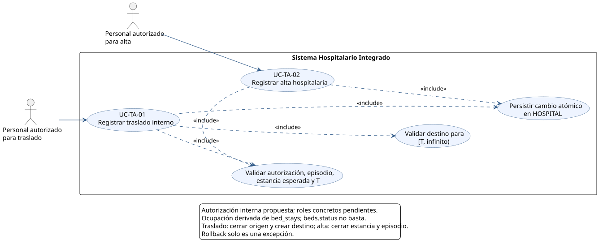
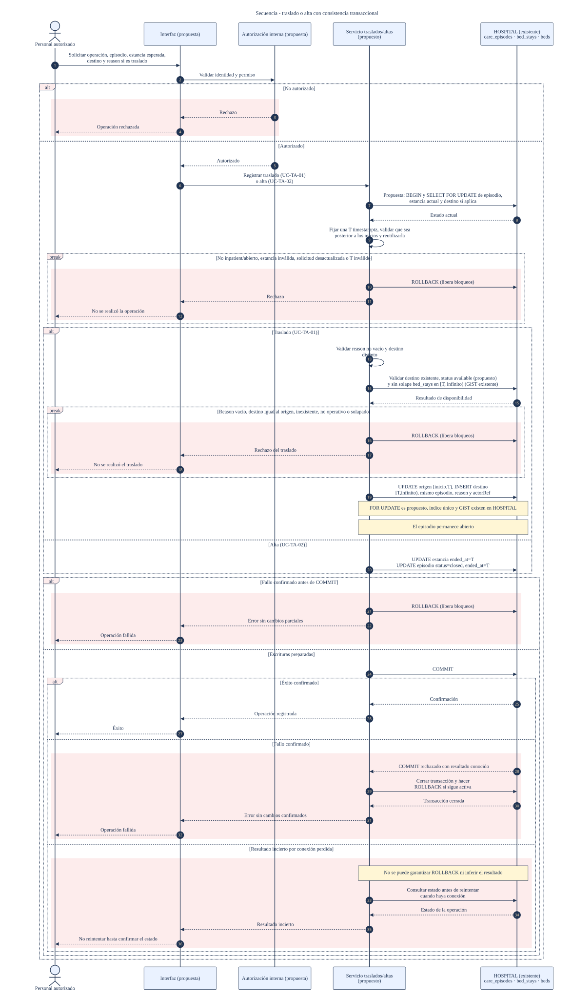

# Traslados, altas y liberación de camas - Semana 1

## Ficha

- **Estudiante:** María Yamilet Lindo Pablo
- **GitHub:** [`Yamilet1235`](https://github.com/Yamilet1235)
- **Identificador ASII:** `ASII-08`
- **Issue:** `#9`
- **Módulo:** ASII-08 - Traslados, altas y liberación de camas
- **Proceso:** traslado o alta del paciente con liberación consistente de cama

## Objetivo

Delimitar actores y modelar `UC-TA-01` y `UC-TA-02`, manteniendo consistentes el estado del episodio y los intervalos de ocupación de cama en la base HOSPITAL.

## Diagramas

### Casos de uso



[Abrir SVG](./01-casos-de-uso.svg) | [Fuente PlantUML](./fuentes/01-casos-de-uso.puml)

### Actividad



[Abrir SVG](./02-actividad.svg) | [Fuente Mermaid](./fuentes/02-actividad.mmd)

### Secuencia



[Abrir SVG](./03-secuencia.svg) | [Fuente Mermaid](./fuentes/03-secuencia.mmd)

## Documentos

- [Narrativa de alcance y trazabilidad](./narrativa-alcance-trazabilidad.md)
- [Declaración de uso de IA](./DECLARACION_IA.md)

## Regeneración

Requisitos: Java con un archivo `plantuml.jar`, Node.js y acceso a `npx`.

Desde la raíz del repositorio:

```bash
java -jar <ruta-a-plantuml.jar> -tsvg docs/traslados-altas/semana-01/fuentes/01-casos-de-uso.puml -o ..
npx -y @mermaid-js/mermaid-cli -i docs/traslados-altas/semana-01/fuentes/02-actividad.mmd -o docs/traslados-altas/semana-01/02-actividad.svg -b transparent
npx -y @mermaid-js/mermaid-cli -i docs/traslados-altas/semana-01/fuentes/03-secuencia.mmd -o docs/traslados-altas/semana-01/03-secuencia.svg -b transparent
```

El futuro PR irá hacia `develop` con `Refs #9`.
