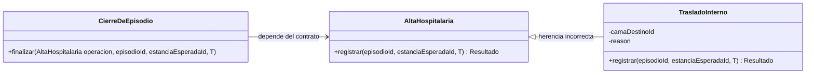
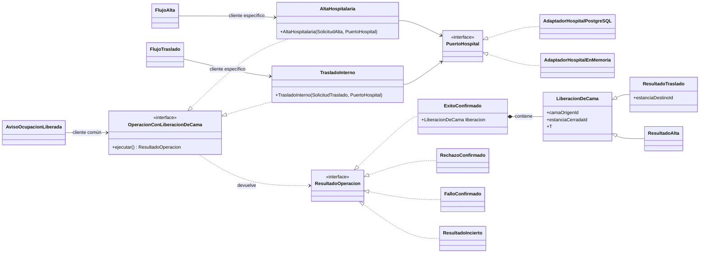

# Aplicación de LSP al flujo de traslado o alta

**Módulo:** `ASII-08` · **Issue:** `Refs #9` · **Requisitos:** [RF/RNF y criterios](./rf-rnf-criterios.md).

## Principio

El principio de sustitución de Liskov (LSP) exige que un cliente que depende de un contrato pueda recibir cualquier implementación de ese contrato sin dejar de funcionar. Una implementación sustituible no puede pedir más que el contrato (precondiciones más fuertes) ni garantizar menos o algo distinto (postcondiciones más débiles o contradictorias), y debe conservar sus invariantes. Compartir el nombre de un método no basta.

## Diseño antes

> **Ejemplo didáctico.** Las clases de esta sección no existen en el repositorio: no hay servicio, modelo ni API de traslados o altas. Se construyen solo para mostrar el incumplimiento.

La idea de partida es que "traslado y alta liberan cama", por lo que `TrasladoInterno` hereda de `AltaHospitalaria` y sobrescribe `registrar()`.

### Contrato que promete `AltaHospitalaria::registrar()`

| Elemento | Contenido del contrato del ejemplo |
|---|---|
| Entrada | Episodio, estancia esperada y `T`. |
| Precondiciones | Episodio `inpatient` y abierto; estancia actual = esperada; `T` posterior al inicio del episodio y de la estancia. |
| Rechazos declarados | `EPISODIO_NO_INPATIENT`, `EPISODIO_NO_ABIERTO`, `SIN_ESTANCIA_ABIERTA`, `ESTANCIA_DESACTUALIZADA`, `T_INVALIDA`, sin cambios persistidos. |
| Postcondiciones ante `ExitoConfirmado` | La estancia esperada termina en `T`; el episodio queda `closed` con `ended_at = T`; el episodio no tiene estancias abiertas. |

### Cómo lo incumple `TrasladoInterno`

**Postcondiciones incompatibles.** Un traslado correcto (RF-TA-06) deja el episodio **abierto** y crea una estancia destino `[T, ∞)` **abierta**. Eso contradice dos postcondiciones de la clase base: "episodio `closed` en `T`" y "sin estancias abiertas". No es un caso particular de alta: si el traslado cumpliera esas postcondiciones, dejaría de ser un traslado.

**Requisitos adicionales.** Para ejecutarse, el traslado necesita datos y condiciones que el contrato base no contiene:

- cama destino y `reason` no vacío (RF-TA-01), que `registrar()` no recibe; quedan como estado interno que el cliente del contrato base no conoce ni puede proporcionar;
- condiciones sobre el destino (RF-TA-05): que exista, sea distinto del origen, no tenga solapes con `[T, ∞)` y, según la decisión propuesta, tenga `status = available`.

Tener cama destino y `reason` como datos específicos en el constructor de `TrasladoInterno` no viola LSP por sí solo. El incumplimiento demostrado aquí son las postcondiciones incompatibles y los rechazos de destino (`DESTINO_*`), que exceden los declarados por el contrato de `AltaHospitalaria`; un cliente escrito contra ese contrato no tiene por qué esperarlos.

### Consecuencia para el cliente

`CierreDeEpisodio::finalizar()` (también didáctico) recibe una `AltaHospitalaria`, llama a `registrar()` y, ante `ExitoConfirmado`, confía en las postcondiciones: informa que el episodio quedó cerrado en `T` y que ya no ocupa ninguna cama.

Si recibe un `TrasladoInterno`, el código compila y la llamada termina con éxito, pero el cliente informa un cierre que no ocurrió: el episodio sigue abierto y ocupa la cama destino. Introducir una comprobación del tipo concreto (`instanceof TrasladoInterno`) sería un parche que acoplaría el cliente a las subclases, no una corrección del contrato. La solución estructural se presentará en el diseño después; la herencia falla en el diseño, no solo en la ejecución.

## Diseño después

> **Diseño propuesto.** Esta sección justifica la sustitución en el diseño; nada está implementado ni probado aquí. La comprobación ejecutable en memoria queda pendiente del PR-2.

En el diseño propuesto, traslado y alta dejan de heredar uno del otro. Ambos implementan un contrato común que solo promete lo que los dos deben cumplir: terminar la ocupación de la cama de origen. Lo que difiere, el estado del episodio y la estancia destino, va en resultados específicos.

### Contrato común `OperacionConLiberacionDeCama::ejecutar()`

`ejecutar()` devuelve `ResultadoOperacion`, exactamente una de estas cuatro variantes: `ExitoConfirmado`, `RechazoConfirmado`, `FalloConfirmado` o `ResultadoIncierto`.

| Elemento | Garantía |
|---|---|
| Construcción | La operación recibe una solicitud ya válida (`SolicitudTraslado` o `SolicitudAlta`); una solicitud incompleta produce `SolicitudInvalida` y nunca llega a existir una operación. |
| Precondiciones | La operación fue construida con una solicitud válida y la autorización ya se concedió. Ninguna otra: el cliente no aporta datos al llamar a `ejecutar()`. |
| Validaciones al ejecutar | Dentro de la transacción, tras bloquear episodio, estancia y, si aplica, destino, se fija **una sola `T`**. Toda condición que depende del estado (episodio, estancia, `T`, destino) que no se cumple produce `RechazoConfirmado`. |
| `ExitoConfirmado` | `COMMIT` confirmado. Contiene una `LiberacionDeCama`, cuyo tipo específico puede ser `ResultadoTraslado` o `ResultadoAlta`: la estancia esperada queda `[inicio, T)` y la cama de origen deja de estar ocupada por el episodio desde `T`. **No promete** el estado del episodio ni que la cama de origen quede `available`, y no modifica `beds.status`. |
| `RechazoConfirmado(código)` | Familia declarada de rechazos: cualquier código implica que no hay cambios persistidos. Cada operación usa los códigos que le corresponden; el cliente común no necesita distinguirlos. |
| `FalloConfirmado(código)` | Solo cuando se sabe que la transacción no se confirmó y quedó cerrada: sin cambios persistidos. |
| `ResultadoIncierto` | Cualquier duda sobre la confirmación, incluida la pérdida de conexión durante `COMMIT`: no se informa éxito, **no** se promete `ROLLBACK` ni ausencia de cambios y se debe consultar el estado antes de reintentar. |
| Invariantes | Como máximo una estancia abierta por episodio; sin solapes de estancias por cama; estancias dentro del período del episodio; estancias finalizadas inmutables; una sola `T` por operación. |

### Resultados específicos

| Operación | Contenido de `ExitoConfirmado` | Garantías añadidas | Restricción |
|---|---|---|---|
| `TrasladoInterno` | `ResultadoTraslado` | Episodio abierto; estancia destino `[T, ∞)` en la cama destino, contigua a la de origen y del mismo episodio. | Nunca cierra el episodio. |
| `AltaHospitalaria` | `ResultadoAlta` | Episodio `closed` con `ended_at = T`; ninguna estancia abierta del episodio. | Nunca crea estancias. |

En cada operación, `ExitoConfirmado.liberacion` contiene el tipo específico indicado. `ResultadoTraslado` y `ResultadoAlta` son una `LiberacionDeCama`: añaden garantías sobre algo que el contrato común deja sin prometer, en lugar de contradecir una promesa.

### Justificación de la sustitución

| Regla de LSP | Antes | Después |
|---|---|---|
| Precondiciones no más fuertes | Los datos específicos del constructor no demuestran por sí solos una precondición más fuerte de `registrar()`; el incumplimiento mostrado por el contrato está en las postcondiciones y los rechazos declarados. | Los datos propios se exigen al construir la solicitud; `ejecutar()` declara la misma precondición para ambas operaciones. Quien construye depende del tipo concreto. |
| Postcondiciones no más débiles | El traslado contradecía "episodio `closed`". | El contrato común no promete el estado del episodio; cada resultado específico lo fija sin contradicción. |
| Rechazos declarados | `DESTINO_*` excedía la lista cerrada de la clase base. | El contrato declara la familia `RechazoConfirmado`; los códigos de destino pertenecen a ella y mantienen su garantía. |
| Invariantes | No estaban separados del cierre del episodio. | Son comunes y las dos operaciones los conservan. |

### Clientes

- **Cliente común: `AvisoOcupacionLiberada`.** En el diseño depende solo de `OperacionConLiberacionDeCama`. Debe atender los cuatro resultados y, ante `ExitoConfirmado`, usar la `LiberacionDeCama` contenida para obtener cama de origen, estancia cerrada y `T`. El contrato le permite tratar igual traslado y alta, sin `instanceof`. No deduce disponibilidad: eso le corresponde al catálogo de camas.
- **Clientes específicos: `FlujoTraslado` y `FlujoAlta`.** Construyen su solicitud, obtienen la autorización y necesitan su resultado propio (estancia destino y episodio abierto, o episodio cerrado). Por eso dependen de `TrasladoInterno` o de `AltaHospitalaria`, no del contrato común. Un cliente como `CierreDeEpisodio` del diseño antes pasa a depender de `AltaHospitalaria` y ya no puede recibir un traslado.

### Responsabilidades y dependencias

| Elemento | Responsabilidad | Depende de |
|---|---|---|
| `SolicitudTraslado` / `SolicitudAlta` | Validar los datos que no dependen del estado. | Nada. |
| `TrasladoInterno` / `AltaHospitalaria` | Validar el estado tras bloquear, fijar `T`, aplicar sus escrituras en orden y traducir el desenlace a uno de los cuatro resultados. | `PuertoHospital`. |
| `PuertoHospital` | Definir el contrato de transacción, bloqueos, lectura del instante y escrituras en HOSPITAL, e informar si el `COMMIT` se confirmó, falló o es incierto. | Nada. |
| Adaptadores PostgreSQL y en memoria | Implementar `PuertoHospital` para producción futura y para la demo del PR-2, respectivamente. | `PuertoHospital`. |
| `AvisoOcupacionLiberada` | Reaccionar a una ocupación terminada. | Solo el contrato común. |
| `FlujoTraslado` / `FlujoAlta` | Construir, autorizar y presentar el resultado específico. | Su operación concreta. |

Las operaciones dependen de una abstracción de persistencia, no de PostgreSQL. Los adaptadores implementan el puerto; el puerto no depende de ellos. La integridad final sigue en HOSPITAL.

### Existente, propuesto y pendiente

| Tipo | Elementos |
|---|---|
| **Existente en las migraciones** (revisión estática) | `bed_stays_open_care_episode_unique`, `bed_stays_bed_active_period_exclusion`, `bed_stays_period_check`, `bed_stays_reason_check`, `care_episodes_status_period_check` y triggers de período e inmutabilidad de `bed_stays`. |
| **Casos existentes en `SchedulingAndBedIntegrityTest`** (no ejecutados en este PR) | Adyacencia permitida y solape rechazado por cama; segunda estancia abierta rechazada para un episodio; estancia fuera del período rechazada al insertar; `beds.status` no sincronizado con la ocupación. No hay casos directos para `bed_stays_reason_check`, `bed_stays_period_check`, `care_episodes_status_period_check` ni para la inmutabilidad de una estancia finalizada. |
| **Propuesto** | Contrato y clases de esta sección, `FOR UPDATE`, una sola `T` tras bloquear, orden cerrar origen antes de crear destino, "episodio `closed` sin estancia abierta" (la base no lo impide) y exigir `available` en el destino (R-TA-01). |
| **Pendiente de integración** | Sincronización de `beds.status` con ASII-06, ASII-07 y ASII-09; roles concretos de autorización. |
