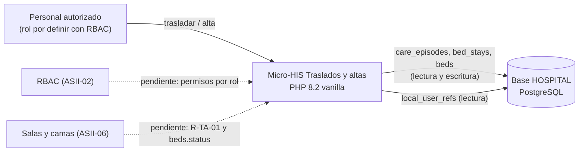
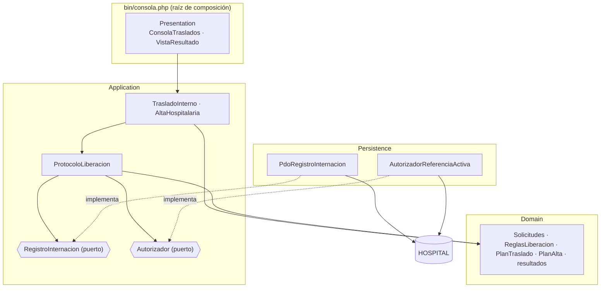
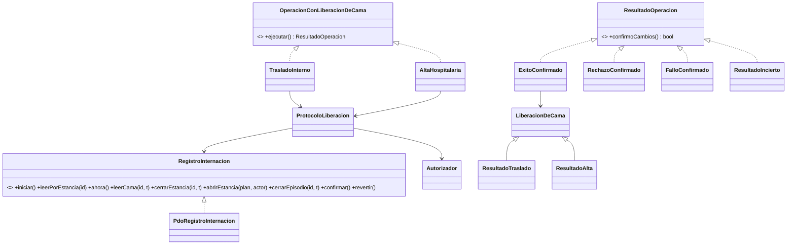

# Arquitectura del micro-HIS — Semana 3

Código: [`micro-his/traslados-altas`](../../../micro-his/traslados-altas/README.md). Los diagramas describen lo **implementado**; lo pendiente se marca así.

## C4 — Contexto

## C4 — Contenedores y componentes

## UML — Clases principales

## Dependencias

| Capa | Depende de | No puede depender de | Verificación |
|---|---|---|---|
| Domain | Nada (solo PHP) | Application, Persistence, Presentation, PDO | `tests/arquitectura.php` |
| Application | Domain | Persistence, Presentation, PDO | `tests/arquitectura.php` |
| Presentation | Application, Domain | Persistence, PDO, SQL | `tests/arquitectura.php` |
| Persistence | Application (puertos), Domain, PDO | Presentation | Revisión; solo la usa la raíz de composición |

Las flechas siguen la inversión de dependencias: Application define `RegistroInternacion` y `Autorizador`, y Persistence los implementa. Cambiar la base o la autorización no toca el dominio ni los casos de uso.

## Decisiones

| Decisión | Motivo | Estado |
|---|---|---|
| Una transacción HOSPITAL por operación, con `FOR UPDATE` sobre el episodio, la estancia abierta y la cama destino | RNF-TA-03 y RNF-TA-04 | Implementada. La reversión ante un error real está probada; la concurrencia con conexiones independientes, todavía no |
| Cerrar el origen antes de abrir el destino | `bed_stays_open_care_episode_unique` (una estancia abierta por episodio) | Implementada y probada con PostgreSQL |
| T con `clock_timestamp()` después de bloquear | Que T no sea anterior a una estancia confirmada mientras se esperaba el bloqueo | Implementada |
| Un COMMIT con un error que no es de las clases 23/25/40 se trata como incierto | No confundir un COMMIT sin respuesta con un rollback | Implementada; probada solo con el doble |
| No modificar `beds.status` | RF-TA-10: liberar la ocupación no declara disponible la cama | Implementada; **acuerdo pendiente** con ASII-06 |
| Exigir `status = available` en el destino | R-TA-01 | **Propuesta** pendiente con ASII-06 |
