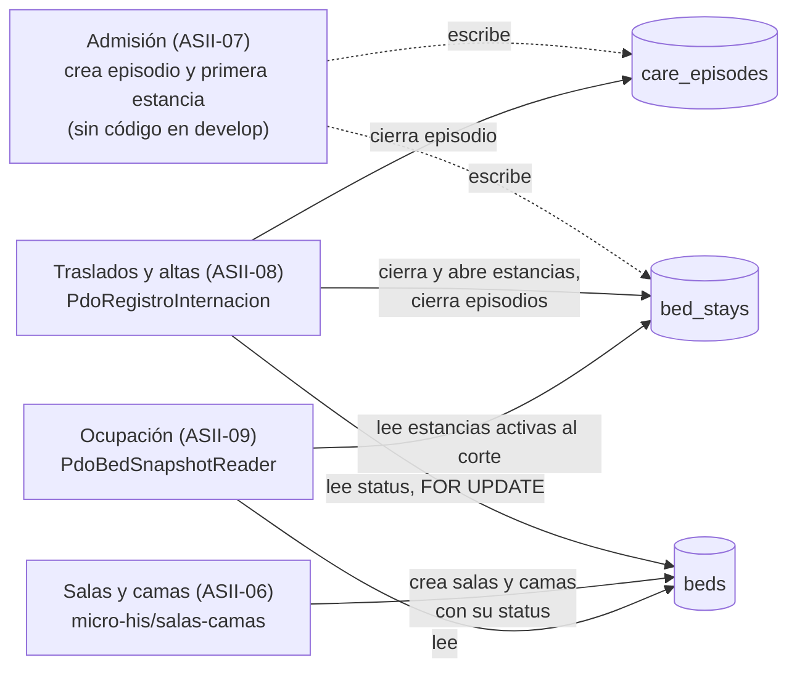

# Integración con el repositorio de datos compartido HOSPITAL

Traslados y altas escribe en tablas que otros módulos crean o leen. Esta sección separa los hechos comprobados en `develop` de las propuestas.

## Hechos comprobados

| Hecho | Fuente |
|---|---|
| Ocupación considera ocupada una cama con una estancia en `[started_at, ended_at)` que cubre el corte; no usa `beds.status` para eso | `micro-his/ocupacion-hospitalaria/src/Persistence/PdoBedSnapshotReader.php` |
| Salas y camas crea salas y camas con su `status` y no lo actualiza por ocupación | `micro-his/salas-camas/src/Application/CatalogService.php` |
| Ningún módulo de `develop` crea episodios ni estancias; ASII-08 no admite pacientes | Búsqueda de escrituras en `micro-his/` |
| HOSPITAL protege los datos compartidos: sin solapes por cama (`EXCLUDE`), una estancia abierta por episodio, estancias finalizadas inmutables y sin borrado | `database/migrations/hospital/2026_08_11_000300_create_scheduling_and_bed_tables.php` |

**Consecuencia comprobable:** un traslado o un alta de ASII-08 cambian lo que informa Ocupación sin coordinación adicional, porque ambos módulos usan el mismo criterio de periodo semiabierto. Que liberar la ocupación no toque `beds.status` (RF-TA-10) es coherente con esa lectura.

## Responsabilidades propuestas (sin acuerdo con los otros módulos)

| Dato | Escritor | Lectores |
|---|---|---|
| Alta de `beds` y `wards`, y su `status` operativo (mantenimiento, inactiva) | ASII-06 | ASII-08 (R-TA-01), ASII-09 |
| Creación del episodio y de la primera estancia | ASII-07 | ASII-08 |
| Cierre y apertura de estancias por traslado, y cierre del episodio por alta | ASII-08 | ASII-09 |

## Pendientes de coordinación

| Tema | Con quién | Acción |
|---|---|---|
| Exigir `beds.status = available` en el destino (R-TA-01) | ASII-06 | Confirmar el significado de `status` frente a la ocupación |
| Quién crea el episodio y la primera estancia | ASII-07 | Acordar el contrato de admisión; hasta entonces, las pruebas usan datos ficticios sembrados |
| Actor de las estancias (`assigned_by_user_ref_id`) | Tenants y RBAC | Mapear el usuario CENTRAL a `local_user_refs` al integrar (semanas 16–17) |
