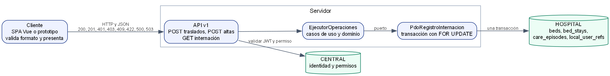
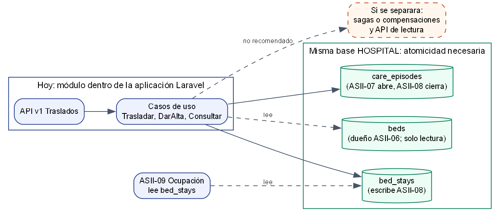

# Cliente-servidor y API — Semana 5

Contrato: [openapi.yaml](./openapi.yaml). Implementación: `micro-his/traslados-altas/public/index.php` y `src/Presentation/HttpTraslados.php` (prototipo, #849).

## Diagrama cliente-servidor

Fuente: [`fuentes/cliente-servidor.dot`](./fuentes/cliente-servidor.dot).

## Propiedades del contrato

| Propiedad | Decisión | Estado |
|---|---|---|
| **Propiedad de datos** | ASII-08 escribe el cierre y la apertura de estancias por traslado y el cierre del episodio por alta. Lee `beds` y `local_user_refs`, que no le pertenecen | Implementado; acuerdos pendientes con ASII-06 y ASII-07 ([Semana 4](../semana-04/repositorio-compartido.md)) |
| **Comunicación** | HTTP/JSON síncrono, una petición por operación. La respuesta solo lleva identificadores (RNF-TA-07) | Prototipo |
| **Seguridad** | Actor obligatorio (401), autorizado antes de la transacción (403) y validado antes de conectar (422). Hoy el actor llega en `X-Actor-Ref`, **no autenticado** | **Insuficiente para producción**: JWT, tenant y RBAC de Laravel en las semanas 16–17 |
| **Resiliencia** | Fallo sin cambios → 503, reintentable. COMMIT sin respuesta → 500 `incierto`, sin `Retry-After` | Implementado y probado con el doble; el incierto real no se puede provocar en local |
| **Recuperación de un incierto** | `GET /estancias/{id}/internacion` indica si la estancia esperada sigue abierta. Si está abierta, la operación no se aplicó; si no, se aplicó | Implementado y probado contra PostgreSQL |
| **Consistencia** | Una sola transacción HOSPITAL con `FOR UPDATE`; T con `clock_timestamp()` después de bloquear; restricciones `EXCLUDE` y de estancia abierta única | Implementado. La concurrencia con conexiones independientes **aún no está probada** |
| **Idempotencia** | Repetir una operación confirmada se rechaza (`ESTANCIA_NO_VIGENTE` o `EPISODIO_NO_ABIERTO`) porque la estancia esperada actúa como condición; no hay claves de idempotencia | Implementado y probado |
| **Observabilidad** | Sin `trace_id` ni bitácora en el prototipo | **Pendiente**: `trace_id` de la API v1 y auditoría CENTRAL al integrar |

## Frontera de microservicio

Fuente: [`fuentes/frontera-microservicio.dot`](./fuentes/frontera-microservicio.dot).

| Criterio | Evaluación |
|---|---|
| Datos | Las tablas son compartidas en la misma base HOSPITAL (`bed_stays` la leen Ocupación y Admisión). Un servicio propio requeriría su base o una API de lectura para los demás |
| Transacción | Traslado y alta necesitan atomicidad con `beds`, `bed_stays` y `care_episodes` en la misma base; separarlos obligaría a sagas o compensaciones |
| Equipo y despliegue | Un único equipo y una sola aplicación Laravel con una base HOSPITAL por hospital |
| Carga | Operaciones puntuales, sin requisitos de escala independientes |

**Decisión:** no dividir el servicio. El micro-HIS se mantiene como módulo de la aplicación con capas y puertos, y se integra en la API v1 de Laravel.

**Migración razonada si algún día se separara:**
1. Exponer de forma estable este contrato desde Laravel (semana 16).
2. Que los lectores (Ocupación) dejen de leer `bed_stays` directamente y usen una API de lectura o eventos.
3. Mover las tablas a la base del servicio.
4. Publicar los cambios de ocupación como eventos idempotentes.

Ninguno de esos pasos se justifica hoy.
