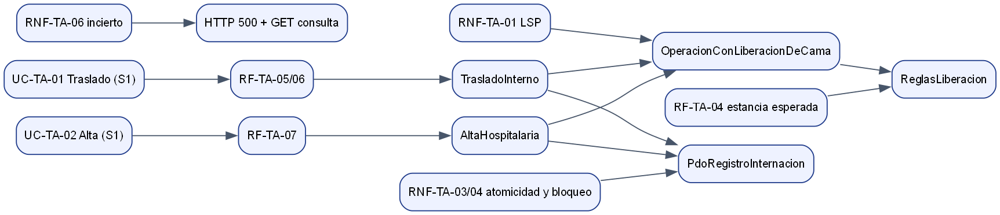

# Primer parcial — Traslados, altas y liberación de camas (ASII-08)

Presentación en 7 diapositivas (Markdown; cada `---` separa una). No se declara ninguna defensa oral ni solicitud del docente.

---

## 1. Problema y alcance

- Proceso: «traslado o alta del paciente con liberación consistente de cama».
- Traslado: cerrar la estancia de origen `[inicio, T)` y abrir la de destino `[T, ∞)` en el **mismo episodio abierto**.
- Alta: cerrar estancia y episodio con **el mismo T**.
- Fuera de alcance: admitir pacientes (ASII-07) y declarar camas disponibles (`beds.status`, ASII-06).

---

## 2. Trazabilidad UML → requisitos → código

---

## 3. LSP (Semana 2 → código)

- Un solo contrato: `ejecutar(): ResultadoOperacion`, con cuatro resultados excluyentes.
- `ProtocoloLiberacion` es el flujo común; cada operación aporta solo su decisión.
- Evidencia: un mismo cliente recibe traslado y alta y ambos cumplen la postcondición, en éxito y en fallo (`tests/alta.php`).

---

## 4. Capas y MVC

- Domain sin dependencias; Application con puertos; Persistence PDO; Presentation (consola y HTTP).
- Controller sin SQL ni reglas, verificado en cada ejecución por `tests/arquitectura.php`.

---

## 5. Repository

- `RegistroInternacion` es el Repository y la unidad de trabajo.
- Dos adaptadores, PDO e InMemory, sujetos a **la misma batería**: 8/8 cada uno.
- La reversión ante un error real (FK) después de la primera escritura está probada con PostgreSQL.

---

## 6. API (prototipo)

- `POST /traslados` 201, `POST /altas` 200, `GET /estancias/{id}/internacion`.
- 409 rechazo, 403 sin permiso, 503 fallo con `Retry-After`, 500 incierto **sin** `Retry-After`.
- Recorrido real con `php -S` sobre PostgreSQL. El actor por cabecera es provisional.

---

## 7. Cambio práctico y pendientes

- Cambio (ejercicio **simulado**, propuesto por la autora): `Retry-After` en el 503 ([detalle](./cambio-practico.md)).
- Pendientes: concurrencia con conexiones independientes, JWT, tenant y RBAC, interfaz, y acuerdos con ASII-06 y ASII-07.
