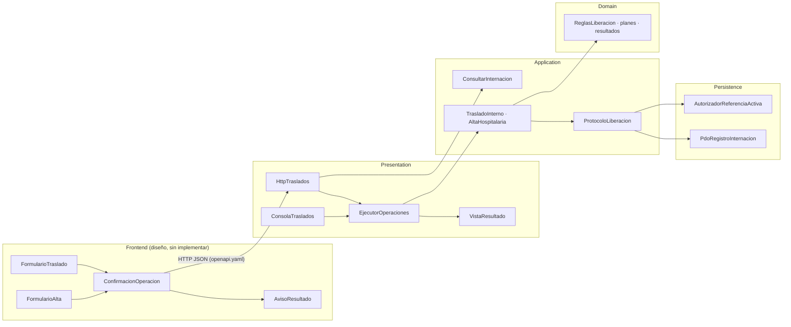

# Componentes y contratos de entrada y salida — Semana 7

El módulo no se amplía: son los mismos traslado, alta y consulta, separados en componentes.

## Backend (implementado)

| Componente | Capa | Entrada | Salida | Errores |
|---|---|---|---|---|
| `HttpTraslados` | Presentation | Método, ruta, `X-Actor-Ref` y JSON | Estado HTTP, cuerpo y cabeceras | 400, 401, 404, 405 y 422, sin tocar HOSPITAL |
| `ConsolaTraslados` | Presentation | argv: `trasladar …` o `alta …` | Código de salida y JSON | 64 sin tocar HOSPITAL |
| `EjecutorOperaciones` | Presentation | Tipo, campos con nombre y actor | `{codigo, cuerpo}` de `VistaResultado` | Campo ausente o no escalar → 64 |
| `VistaResultado` | Presentation | `ResultadoOperacion` | Código y cuerpo con identificadores | — |
| `TrasladoInterno`, `AltaHospitalaria` | Application | Solicitud válida, actor y puertos | Uno de cuatro `ResultadoOperacion` | Nunca lanza por reglas ni por HOSPITAL |
| `ConsultarInternacion` | Application | Actor y estancia | `EstadoInternacion` o `null` | `NoAutorizado`, `FalloPersistencia` |
| `ReglasLiberacion` | Domain | Estado, estancia esperada, T y destino | `Rechazo` o `null` | — |
| `PdoRegistroInternacion` | Persistence | Contrato `RegistroInternacion` | Lecturas con bloqueo y escrituras | `FalloPersistencia`, `ConfirmacionIncierta` |
| `AutorizadorReferenciaActiva` | Persistence | Actor y operación | `bool` (falla cerrada) | — |

## Frontend (diseño; se prototipa en las semanas 8–11 y se integra en la 16)

| Componente | Entrada | Salida | Regla |
|---|---|---|---|
| `FormularioTraslado` | Estancia vigente, camas candidatas | `{estancia_esperada_id, cama_destino_id, motivo}` | Motivo de 1 a 500 caracteres; sin enviar si falta algo |
| `FormularioAlta` | Estancia vigente | `{estancia_esperada_id}` | — |
| `ConfirmacionOperacion` | Resumen de origen, destino y motivo | Confirmar o cancelar | Un solo envío; el botón se bloquea mientras espera |
| `AvisoResultado` | Respuesta HTTP | Mensaje por estado | 201/200 éxito; 409 o 403 rechazo; 503 reintentar; 500 consultar antes de reintentar |

Los nombres y reglas del frontend son una propuesta de la autora; todavía no hay código de interfaz.
