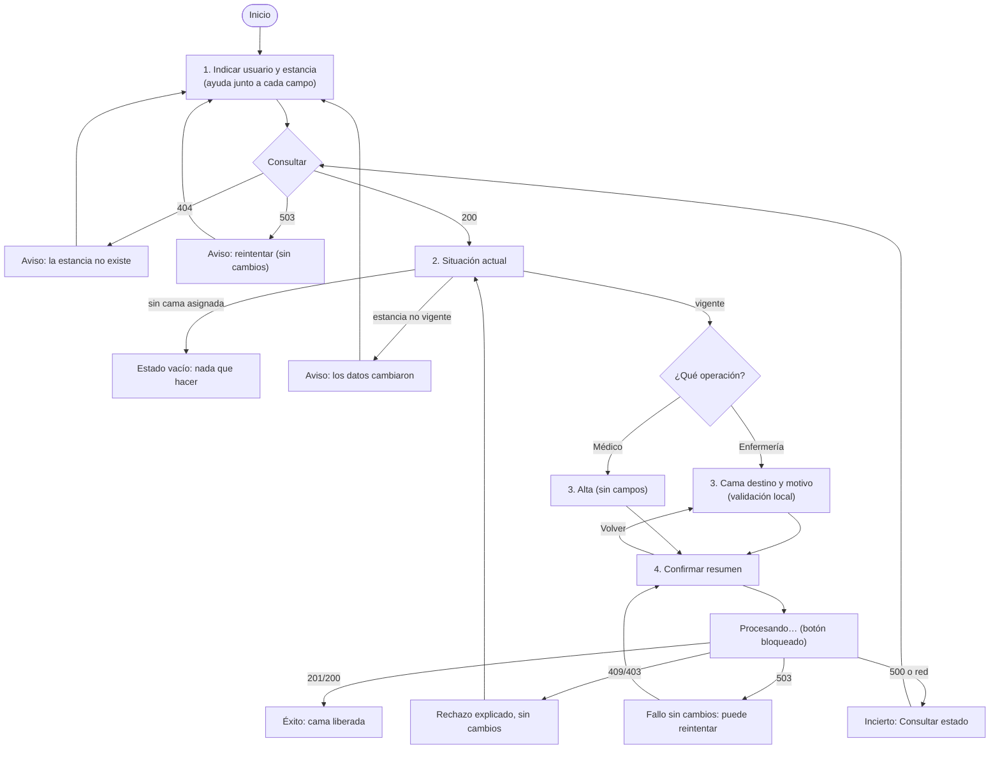

# Flujo de usuario por rol — Semana 8

Los roles concretos que pueden trasladar o dar de alta **no están definidos** en RBAC (RF-TA-03, pendiente con ASII-02). Esta tabla es una propuesta de la autora para diseñar el flujo, no un permiso implementado.

| Rol propuesto | Objetivo | Operaciones |
|---|---|---|
| Enfermería de sala | Mover al paciente a otra cama del hospital | Consultar y trasladar |
| Médico tratante | Cerrar la internación | Consultar y dar de alta |
| Personal sin permiso | — | La API responde 403 y la interfaz lo explica |

## Reglas de interacción

1. No se puede confirmar sin pasar por el resumen; el botón se bloquea mientras procesa, para evitar un doble envío.
2. Solo se ofrecen acciones si la estancia consultada sigue vigente y el episodio está abierto.
3. Un rechazo explica el motivo y no ofrece reintento automático.
4. Un 503 permite reintentar, porque se sabe que no hubo cambios. Un incierto, o una falla de red en el envío, solo permite consultar el estado.
5. La pantalla muestra solo identificadores y estados, nunca datos personales (RNF-TA-07).
