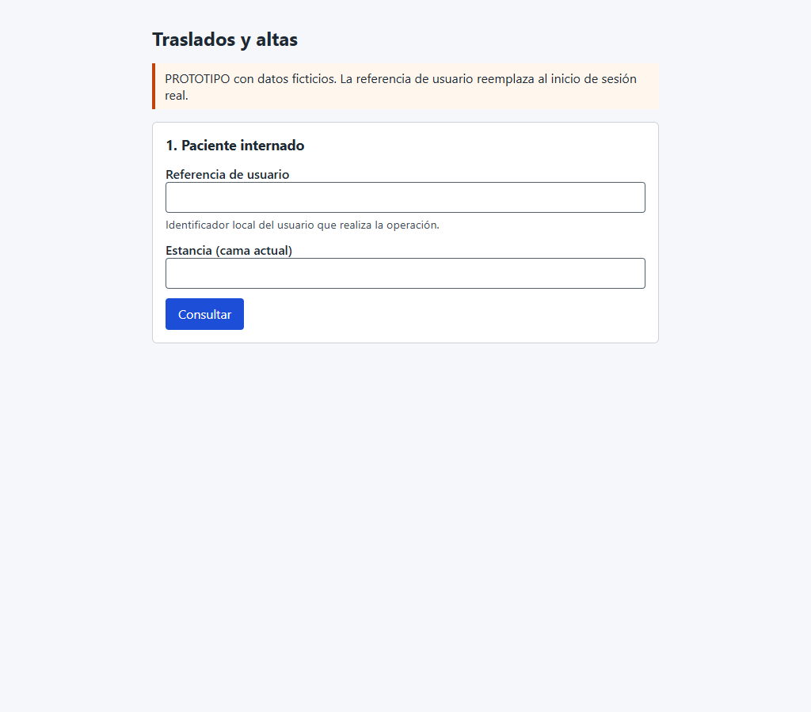
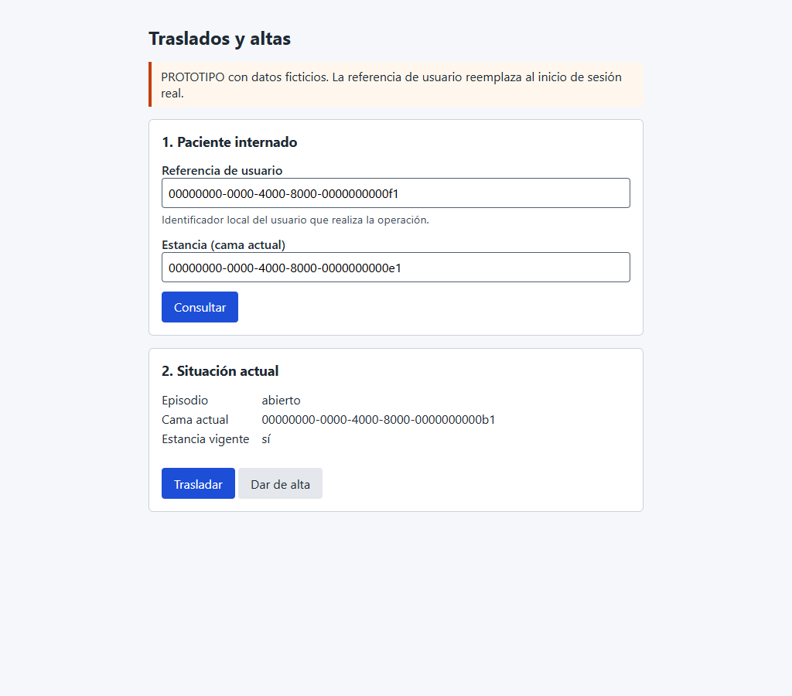
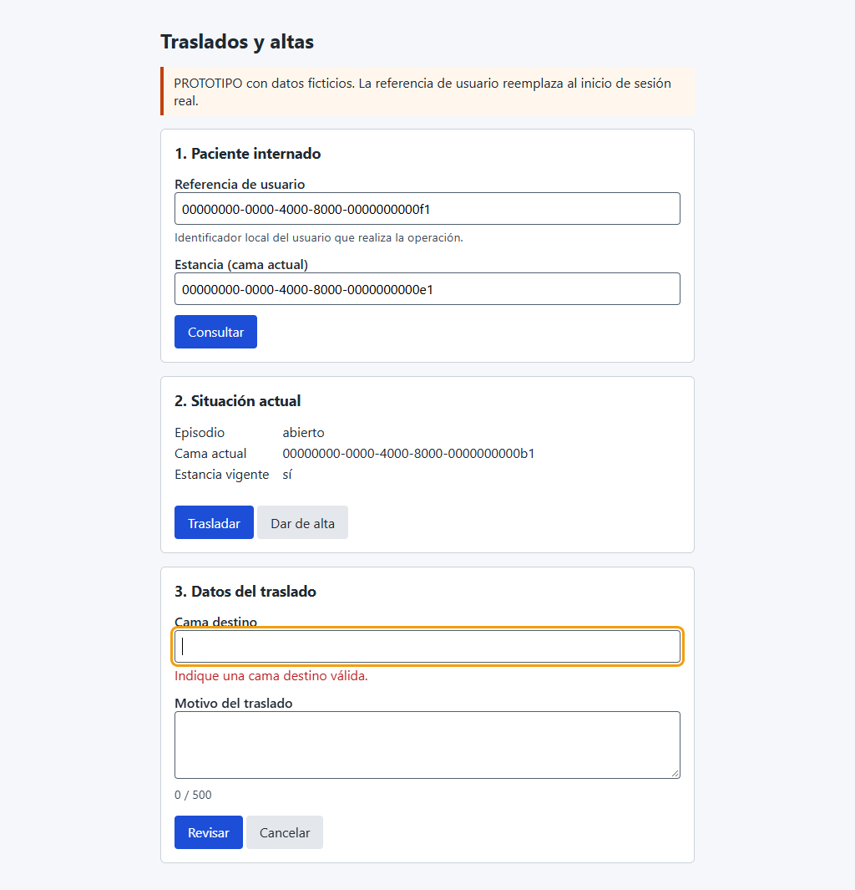
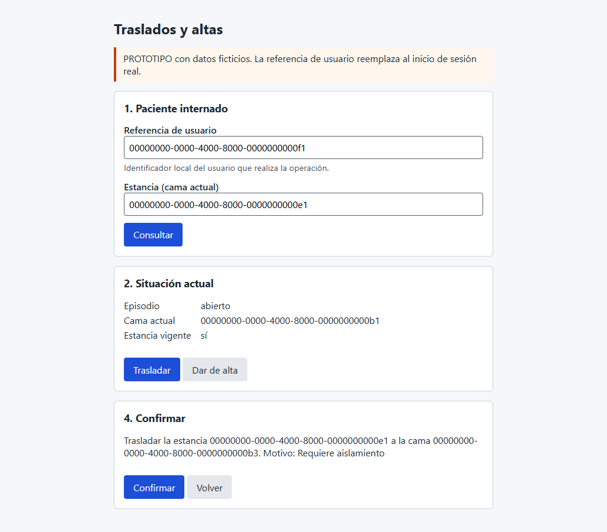
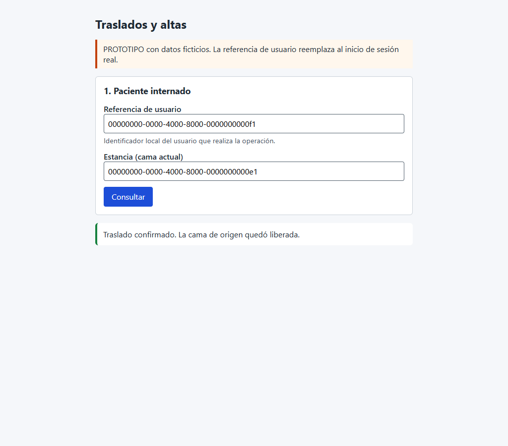

# Wireframes anotados — Semana 8

Son 6 capturas reales del prototipo de baja fidelidad (`micro-his/traslados-altas/public/ui/`) a 1024 px. Se tomaron durante el recorrido [`evidencia/recorrido-ui.mjs`](./evidencia/recorrido-ui.mjs) contra la API real y PostgreSQL con datos ficticios.

## W1 — Inicio y ayuda

- El aviso identifica el prototipo y los datos ficticios.
- Cada campo tiene su etiqueta; la ayuda explica la referencia de usuario.

## W2 — Situación y decisión

- Muestra el episodio, la cama actual y si la estancia sigue vigente.
- Las acciones solo aparecen si se puede operar.
- **Estado vacío**, sin captura: «El episodio no tiene una cama asignada».

## W3 — Validaciones

- La validación local ocurre antes de enviar.
- El error queda junto al campo y asociado con `aria-describedby`.
- El contador de caracteres del motivo indica el máximo de 500.

## W4 — Confirmación

- El resumen muestra origen, destino y motivo; el foco pasa a «Confirmar».
- **Carga**, sin captura: el botón cambia a «Procesando…» y se bloquea.

## W5 — Error recuperable (rechazo)

- Una cama en mantenimiento muestra el motivo en lenguaje claro y aclara que no hubo cambios.
- **Incierto**, sin captura: el mensaje pide consultar y aparece el botón «Consultar estado».

## W6 — Éxito

- Se anuncia en la región `aria-live` solo después de que la API confirma.

## Protección de datos

La interfaz muestra solo identificadores y estados, sin nombres ni datos clínicos. El aviso de prototipo recuerda que la referencia de usuario no es un inicio de sesión real.
