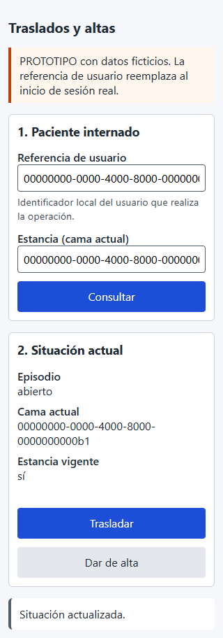
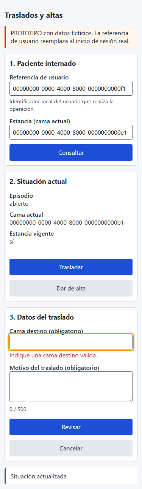
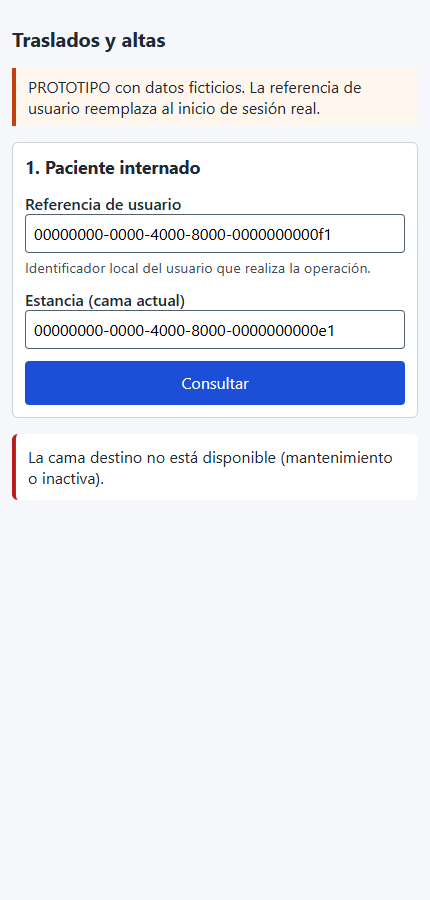
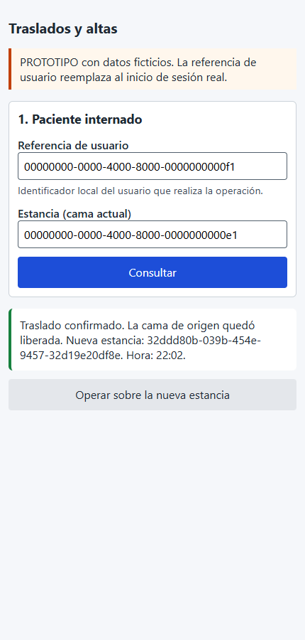
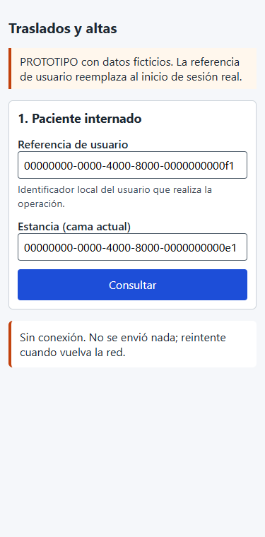
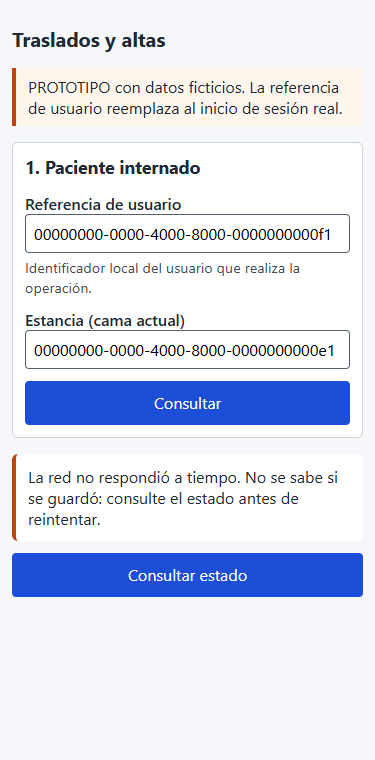

# Adaptación móvil de 320 a 430 px — Semana 10

Objeto: el prototipo `micro-his/traslados-altas/public/ui/` después de #866. Todas las capturas son reales: Chrome 155 sin interfaz, contra la API y PostgreSQL desechable con datos ficticios.

## Breakpoints

| Rango | Regla (`estilos.css`) | Motivo |
|---|---|---|
| Todos | Botones de al menos 44 px de alto; campos con texto de 16 px | Objetivo táctil y sin zoom automático en iOS |
| ≤ 30rem (480 px) | Una columna, botones a todo el ancho, menos relleno y título más chico | Cubre los anchos de 320 a 430 px sin desplazamiento horizontal |
| > 30rem | Contenido centrado de 40rem como máximo | Lectura cómoda en escritorio |

Recorrido completo ([evidencia/recorrido-ui.mjs](./evidencia/recorrido-ui.mjs)): **9/9 a 320, 375 y 430 px**, sin desplazamiento horizontal.

## Pantallas

| Pantalla | Captura | Qué se adapta |
|---|---|---|
| Situación a 320 px |  | Los datos quedan en una columna y «Trasladar» y «Dar de alta» ocupan todo el ancho |
| Validación a 375 px |  | El error queda bajo el campo, con `role=alert` y el foco en el campo |
| Confirmación a 375 px |  | El resumen se ajusta al ancho y «Confirmar» recibe el foco |
| Rechazo a 430 px |  | El motivo se muestra en lenguaje claro |
| Éxito a 430 px |  | Muestra la nueva estancia y la hora, más «Operar sobre la nueva estancia» |

## Escenarios móviles con conexión limitada

[evidencia/movil.mjs](./evidencia/movil.mjs) emula la red con Chrome DevTools a 375 px: **4/4**.

**E1 — La red se corta antes de confirmar**

- La interfaz no envía nada y dice «Sin conexión. No se envió nada»; se puede reintentar.
- Una consulta posterior a la API confirmó que la estancia seguía vigente.

**E2 — Red muy lenta (20 s de latencia)**

- Mientras espera, «Procesando…» se anuncia y el botón queda bloqueado, así que no hay doble envío.
- A los 15 s deja de esperar y lo informa como **incierto**: solo ofrece «Consultar estado».
- Al volver la red, la consulta mostró que **el traslado sí se había confirmado** en el servidor.
- Es el caso que justifica no tratar un tiempo agotado como «sin cambios».

## Navegación, formularios y confirmaciones

- **Navegación:** lineal y por secciones. Tras cada paso el foco va a la nueva sección, de modo que el contenido nuevo queda a la vista sin buscarlo.
- **Formularios:** etiquetas visibles, «(obligatorio)», contador del motivo y errores bajo cada campo.
- **Confirmaciones:** el resumen siempre está antes de enviar, sin doble envío y con «Volver».
- **Recuperación:**
  - el 503 o la falta de red permiten reintentar;
  - un incierto o un tiempo agotado solo permiten consultar;
  - un rechazo explica el motivo.
