# Prototipo navegable — Semana 11

Prototipo: `micro-his/traslados-altas/public/ui/` (#859 y #866), servido con `php -S` junto a la API real. Las capturas se tomaron el 21/10/2026 en Chrome 155 sin interfaz contra PostgreSQL 17.10 desechable sembrado con `database/demo.sql`.

## Mapa de navegación

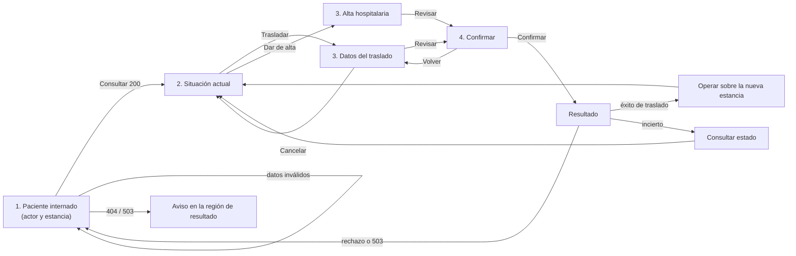

## Camino feliz: traslado (escritorio 1024 px y móvil 375 px)

| Paso | Escritorio | Móvil |
|---|---|---|
| 1. Inicio | 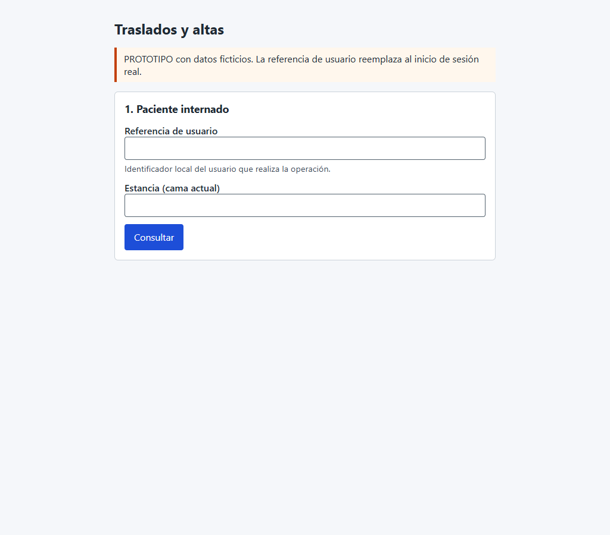 | 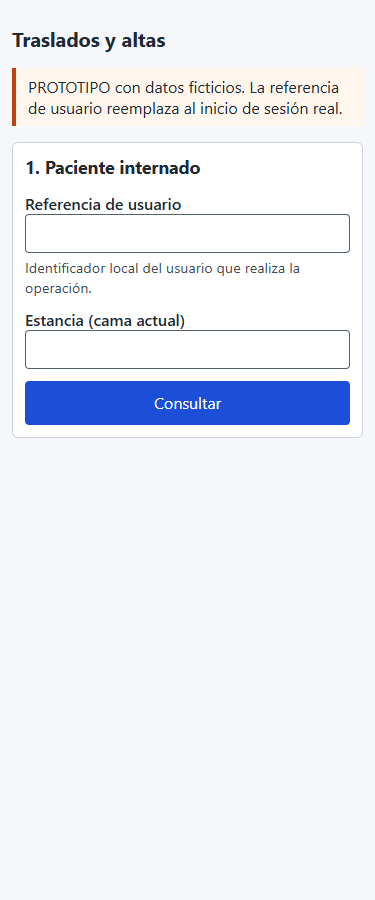 |
| 2. Situación | 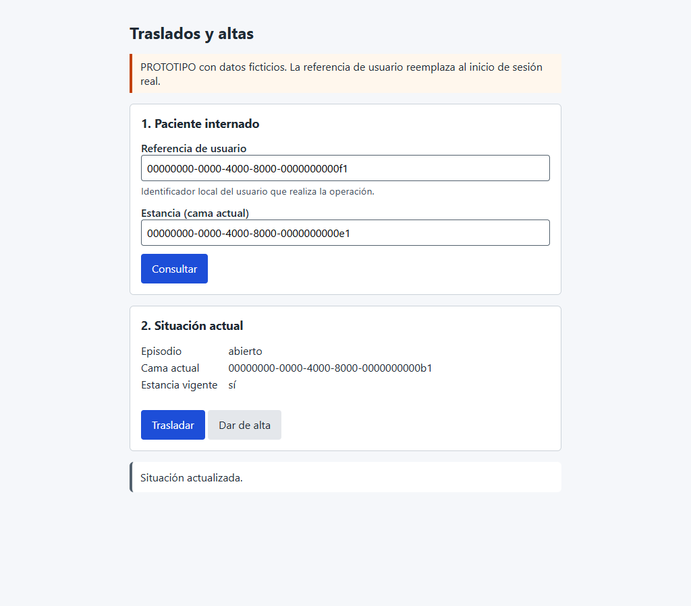 | 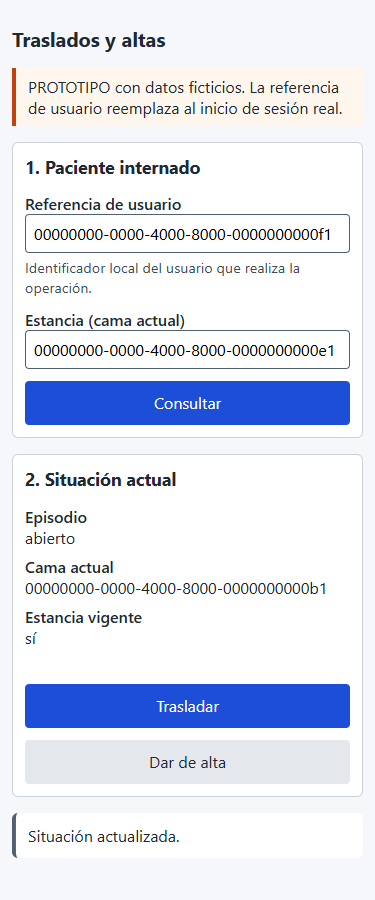 |
| 4. Confirmación | 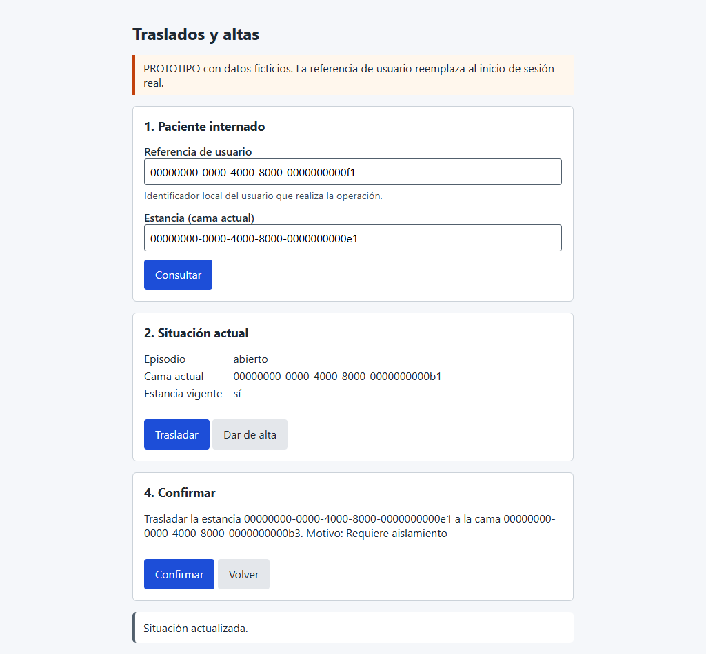 | 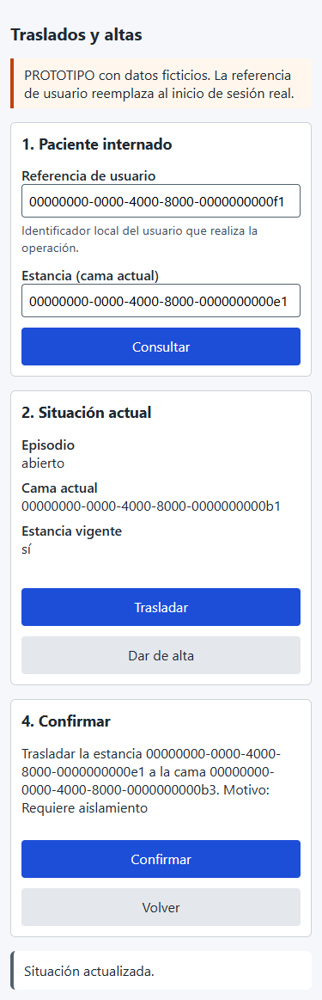 |
| Resultado | 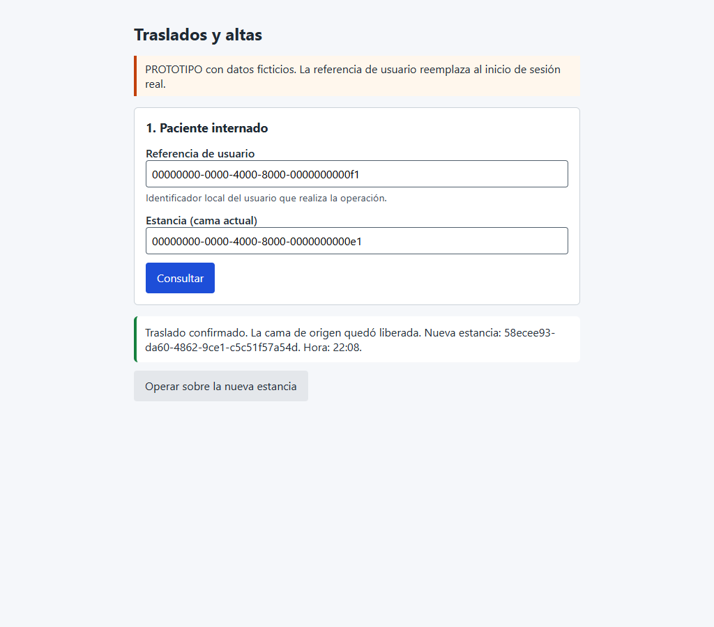 | 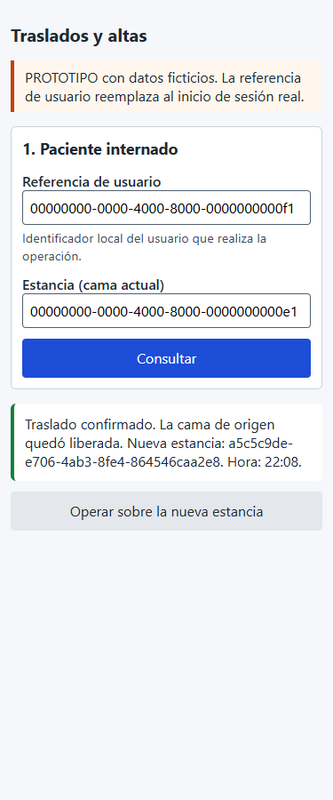 |

El mismo recorrido (`../semana-10/evidencia/recorrido-ui.mjs`) siguió con el alta de la nueva estancia: **9/9 en cada formato**.

## Error crítico: HOSPITAL inaccesible

| Escritorio | Móvil |
|---|---|
| 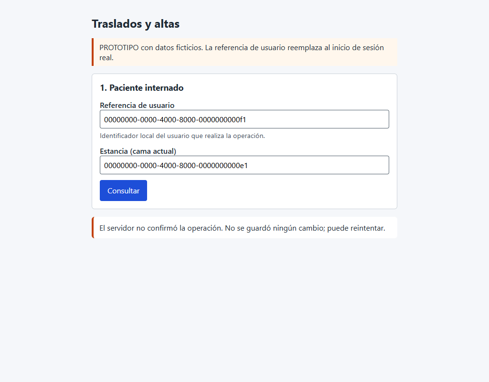 | 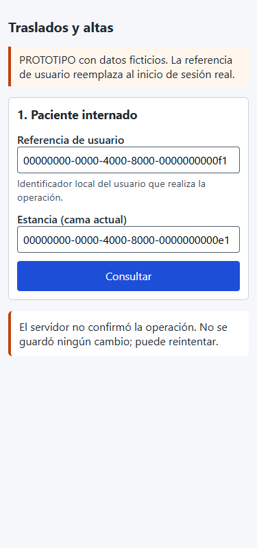 |

[`evidencia/error-critico.mjs`](./evidencia/error-critico.mjs) (2/2): la consulta responde **503**. La interfaz no muestra datos ni acciones e indica que no se guardó ningún cambio y que se puede reintentar.
