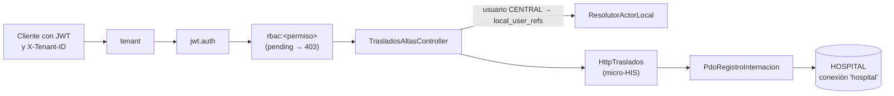

# Integración en la API v1 de Laravel

| Ruta | Permiso | Respuesta de éxito |
|---|---|---|
| `POST /api/v1/traslados` | `traslados.registrar` | 201 con la estancia destino |
| `POST /api/v1/altas` | `altas.registrar` | 200 con el episodio cerrado |
| `GET /api/v1/estancias/{id}/internacion` | `traslados.ver` | 200 con el estado |

Los mensajes, estados y cabeceras son los del micro-HIS (`openapi.yaml` de la Semana 5), más `trace_id` y `Cache-Control: no-store, private`.

## Lo que depende de otros módulos

| Dependencia | Estado comprobado | Responsable | Acción |
|---|---|---|---|
| Activar los permisos | En `pending`: todas las operaciones dan 403 | RBAC (ASII-02) | Moverlos a `roles` si se aprueban ([propuesta](./permisos-propuestos.md)) |
| Referencia local del usuario | Ningún módulo crea `local_user_refs`; sin ella, 403 `ACTOR_SIN_REFERENCIA_LOCAL` | Tenants e identidad (ASII-01) | Sincronizar los usuarios CENTRAL con membresía en el hospital a `local_user_refs` |
| Una base HOSPITAL por hospital | Una sola conexión `hospital` sirve a todos los tenants; `hospitals.clinical_endpoint` no se usa | Tenants y plataforma | Elegir la conexión por tenant. El rechazo por token cruzado (`TENANT_MISMATCH`) **no** demuestra el aislamiento físico de las bases |
