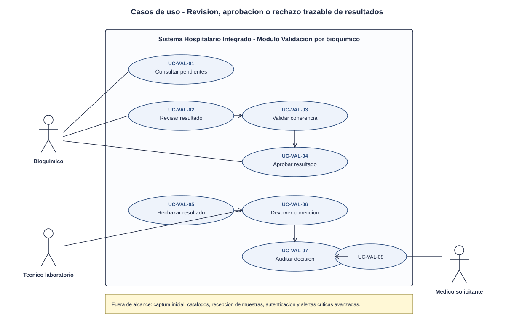
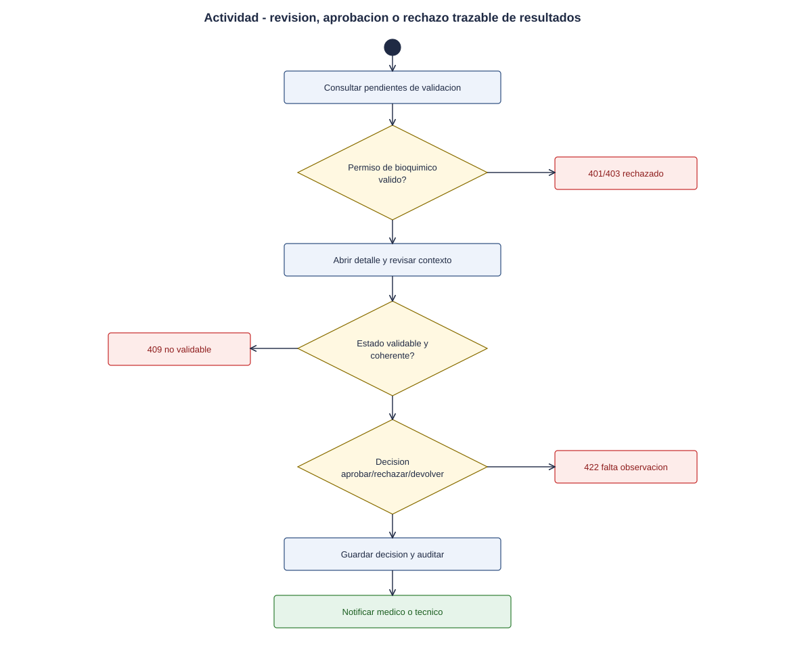
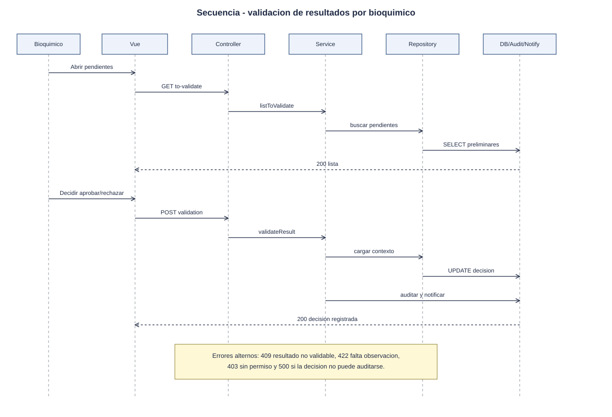

# Validacion de resultados por bioquimico - Semana 1

## Ficha de la asignacion

- **Estudiante:** Orellana Veliz, Gerson Giovanni (`gioore`)
- **Email:** gorellanav1@miumg.edu.gt
- **Modulo:** Validacion de resultados por bioquimico
- **Semana:** Semana 1 - Conceptos generales, orientacion a objetos y UML
- **Tarea individual:** Modele el proceso "revision, aprobacion o rechazo trazable de resultados de laboratorio". Casos de uso: delimitar actores y objetivo; el de actividad debe incluir decisiones, excepciones y resultado; el de secuencia debe mostrar participantes, mensajes, validaciones y respuesta. Mantenga trazabilidad entre los tres diagramas.
- **Entregable / evidencia:** UML de casos de uso y narrativa de alcance.
- **Estructura:** Sistema Hospitalario Integrado 2026 | Semanas 1-15.

---

## Contexto arquitectonico

- **Backend:** Laravel 12 (PHP 8.2+) con rutas API bajo `/api/v1`.
- **Base de datos:** PostgreSQL federado. La base **HOSPITAL** contiene resultados preliminares, versiones y estados clinicos; la base **CENTRAL** conserva identidad y auditoria transversal cuando aplique.
- **Multitenancy:** cada validacion se ejecuta dentro del hospital indicado por `X-Tenant-ID`.
- **Seguridad:** solo un usuario con rol/permiso de bioquimico puede aprobar, rechazar o devolver resultados a correccion.
- **Frontend:** Vue 3 para bandeja de resultados pendientes de validacion, detalle del resultado, decision y observaciones.

## 1. Diagrama de casos de uso

[Abrir el diagrama de casos de uso en SVG](./01-casos-de-uso.svg)

### Descripcion

El diagrama delimita la responsabilidad del bioquimico: revisar resultados preliminares, contrastarlos contra reglas tecnicas, aprobarlos para publicacion clinica o rechazarlos/devolverlos con observaciones trazables.

- **Actores principales:**
  - *Bioquimico:* valida resultados preliminares y toma la decision final.
  - *Tecnico de laboratorio:* recibe devoluciones y corrige resultados cuando corresponde.
  - *Medico solicitante:* consulta resultados aprobados.
- **Actores secundarios:** *Modulo de auditoria*, *Sistema HIS* y *Alertas criticas*.
- **Casos incluidos:** consultar pendientes, revisar resultado, validar coherencia, aprobar, rechazar, devolver para correccion, registrar observacion y notificar decision.

## 2. Diagrama de actividades

[Abrir el diagrama de actividades en SVG](./02-actividad.svg)

### Descripcion

El flujo inicia con la bandeja de resultados pendientes de validacion. El bioquimico revisa contexto, valor, unidad, rango, observaciones y versiones previas. Puede aprobar, rechazar o devolver a correccion. Toda decision exige trazabilidad y genera notificacion segun el resultado.

## 3. Diagrama de secuencia

[Abrir el diagrama de secuencia en SVG](./03-secuencia.svg)

### Descripcion

El diagrama asigna responsabilidades a objetos concretos:

- **Vue / Bandeja de validacion:** lista pendientes y muestra el detalle.
- **ResultValidationController:** recibe la decision del bioquimico.
- **ResultValidationService:** aplica reglas de negocio de validacion.
- **ResultRepository:** persiste estado, decision y version.
- **AuditLogger:** registra la decision con trazabilidad.
- **NotificationService:** notifica al medico o al tecnico segun aplique.

## 4. Narrativa de alcance y trazabilidad

La narrativa completa, con la tabla de trazabilidad UC - actividad - secuencia, esta en [narrativa-alcance-trazabilidad.md](./narrativa-alcance-trazabilidad.md).

## Fuentes editables

- Casos de uso: el SVG es editable en draw.io, Inkscape o un editor de texto.
- Actividad y secuencia: [`fuentes/02-actividad.mmd`](./fuentes/02-actividad.mmd) y [`fuentes/03-secuencia.mmd`](./fuentes/03-secuencia.mmd) (Mermaid; GitHub los renderiza y se pueden editar en mermaid.live).

## Declaracion de uso de IA

Se uso Codex/OpenAI para estructurar la evidencia, redactar el primer borrador y generar diagramas a partir del enunciado de Odoo y del repositorio del proyecto. El estudiante debe revisar nombres, reglas de negocio, trazabilidad y alcance antes de marcar la tarea como terminada en Odoo.
