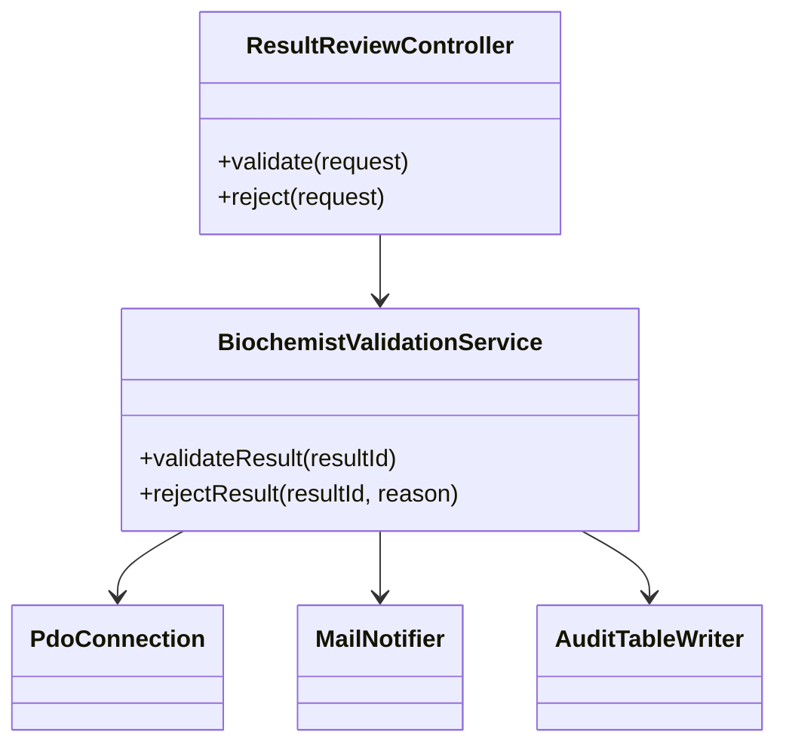
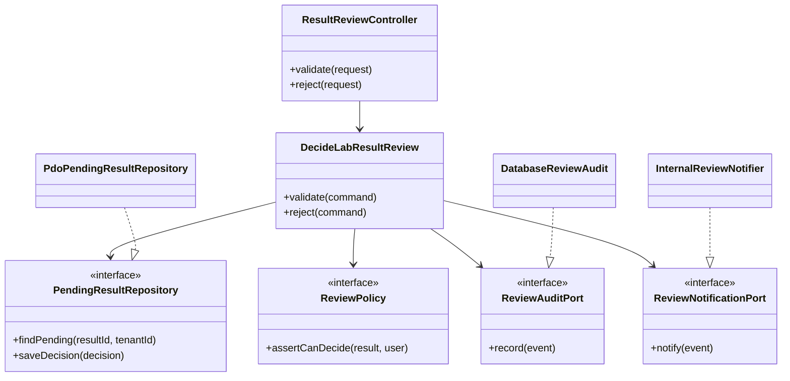

# Aplicacion de DIP - Validacion de resultados

## Principio aplicado

DIP indica que los modulos de alto nivel no deben depender de modulos de bajo nivel; ambos deben depender de abstracciones. En este modulo, el caso de uso `DecideLabResultReview` representa la regla principal de negocio y no deberia depender directamente de PDO, una cola, un correo, ni una tabla concreta.

Fuente academica indicada por el curso: `https://mvpcluster.com/diseno-de-software-2/`.

## Diseno antes de DIP

### Problemas detectados

- El servicio de dominio depende de detalles de infraestructura.
- Cambiar PDO por otro adaptador afecta el caso de uso.
- Probar reglas de decision requiere dobles grandes o una base real.
- Notificacion y auditoria quedan acopladas al flujo principal.

## Diseno despues de DIP

## Responsabilidades propuestas

| Contrato o componente | Responsabilidad | Tipo |
| --- | --- | --- |
| `ResultReviewController` | Traducir HTTP/formulario a comandos del caso de uso. | Presentation |
| `DecideLabResultReview` | Coordinar validacion o rechazo, transaccion y respuesta. | Application |
| `PendingResultRepository` | Obtener resultado pendiente y guardar decision. | Domain port |
| `ReviewPolicy` | Validar reglas de permiso, estado y concurrencia. | Domain service |
| `ReviewAuditPort` | Registrar decision trazable. | Domain port |
| `ReviewNotificationPort` | Avisar publicacion o recaptura. | Domain port |
| `PdoPendingResultRepository` | Implementar persistencia con PDO o adaptador concreto. | Infrastructure |

## Justificacion de dependencias

El flujo de validacion es una regla clinica del modulo, por lo que debe mantenerse estable aunque cambien la base de datos, la forma de auditar o el medio de notificacion. Con DIP, el caso de uso depende de interfaces pequenas y los adaptadores concretos dependen de esas interfaces.

## Beneficio verificable

- El caso de uso puede probarse con `InMemoryPendingResultRepository`.
- La regla de rechazo con motivo obligatorio se prueba sin base de datos.
- Una falla de auditoria puede simularse con un doble que lance excepcion.
- La infraestructura puede cambiar sin reescribir la decision clinica.
