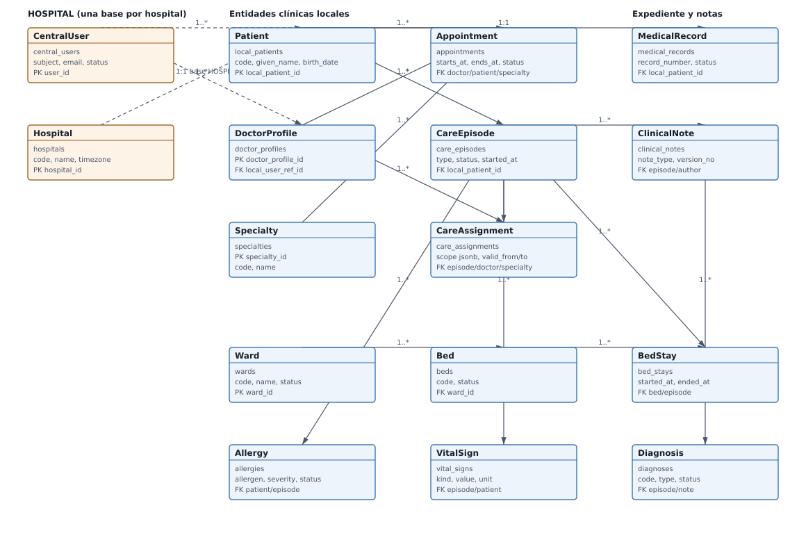

# Semana 1 — Conceptos generales, orientación a objetos y UML

## Portada

- **Estudiante:** Fajardo López, Javier Alexander (`Javifa2324`)
- **Módulo:** Verificación de Base de Datos PostgreSQL
- **Semana:** Semana 1 — Conceptos generales, orientación a objetos y UML
- **Tarea individual:** Identificar las entidades centrales del HIS (paciente, profesional, cita, cama, expediente) y representarlas como modelo de clases UML vinculado a las tablas existentes.
- **Entregable / evidencia:** Diagrama de clases UML y tabla de correspondencia clase → tabla PostgreSQL.
- **Estructura:** Sistema Hospitalario Integrado 2026 | Semanas 1–15.

## 1. Alcance

El modelo se construye **desde el esquema real**, no desde supuestos: se leyeron las
migraciones `database/migrations/central/` y `database/migrations/hospital/` que están
integradas en `origin/develop` (`af6c1d3`) y seモデルó lo que existe hoy.

Alcance incluido: entidades clínicas y de identificación con tabla ya migrada.
Alcance excluido: las entidades de la especificación que todavía **no** tienen
migración (`lab_orders`, `lab_order_items`, `specimens`, `lab_result_versions`,
`critical_alerts`, `medications`, `prescriptions`, `local_access_audits`,
`outbox_events`, `inbox_messages`). Para esas se deja la clase propuesta y
marcada como *pendiente*, no como implementada.

## 2. Diagrama de clases



- SVG: [01-modelo-clases.svg](./01-modelo-clases.svg)
- Fuente editable: [`fuentes/01-modelo-clases.mmd`](./fuentes/01-modelo-clases.mmd)

El SVG se regeneró desde la fuente con el generador documentado en la sección de
validación. No se usa Mermaid CLI porque el entorno de trabajo no tiene red para
instalarlo; el `.mmd` queda como fuente editable para regenerarlo cuando la red
esté disponible.

### 2.1 Lectura del modelo

- **Identidad y pertenencia.** `CentralUser` y `Hospital` viven en la base CENTRAL y se
  referencian desde HOSPITAL solo por UUID lógico, nunca por FK cruzada.
- **Núcleo clínico.** `Patient` es la raíz local: de ella cuelgan `CareEpisode`,
  `Appointment` y `MedicalRecord`.
- **Continuidad del cuidado.** `CareEpisode` es el agregado que agrupa
  `CareAssignment`, `ClinicalNote`, `Diagnosis`, `Allergy`, `VitalSign` y `BedStay`.
- **Camas.** `Ward` → `Bed` → `BedStay`; el intervalo de `BedStay` es la fuente
  autoritativa de ocupación y `Bed.status` es estado operativo.
- **Inmutabilidad.** `ClinicalNote` versionada y `MedicalRecord` con estado
  `open/closed` reflejan que el expediente no se reescribe.

## 3. Correspondencia clase → tabla

La tabla completa está en [02-clase-tabla.md](./02-clase-tabla.md). Resumen:

| Clase | Tabla | Base | Estado |
|---|---|---|---|
| `CentralUser` | `central_users` | CENTRAL | Migrada |
| `Hospital` | `hospitals` | CENTRAL | Migrada |
| `Patient` | `local_patients` | HOSPITAL | Migrada |
| `DoctorProfile` | `doctor_profiles` | HOSPITAL | Migrada |
| `Specialty` | `specialties` | HOSPITAL | Migrada |
| `Appointment` | `appointments` | HOSPITAL | Migrada |
| `CareEpisode` | `care_episodes` | HOSPITAL | Migrada |
| `CareAssignment` | `care_assignments` | HOSPITAL | Migrada |
| `MedicalRecord` | `medical_records` | HOSPITAL | Migrada |
| `ClinicalNote` | `clinical_notes` | HOSPITAL | Migrada |
| `Diagnosis` | `diagnoses` | HOSPITAL | Migrada |
| `Allergy` | `allergies` | HOSPITAL | Migrada |
| `VitalSign` | `vital_signs` | HOSPITAL | Migrada |
| `Ward` | `wards` | HOSPITAL | Migrada |
| `Bed` | `beds` | HOSPITAL | Migrada |
| `BedStay` | `bed_stays` | HOSPITAL | Migrada |

## 4. Validación ejecutada

```bash
# comando: git ls-tree -r --name-only origin/develop database/migrations/central database/migrations/hospital
# resultado: 5 migraciones CENTRAL y 6 migraciones HOSPITAL en origin/develop

# comando: grep -o "CREATE TABLE [a-z_]*" sobre cada migración
# resultado: 15 tablas CENTRAL y 16 tablas HOSPITAL creadas por el esquema vigente

# comando: xmllint --noout docs/verificacion-postgresql/semana-01/01-modelo-clases.svg
# resultado: sin salida (SVG válido)

# comando: podman run --rm localhost/php85-pgsql-full php vendor/bin/phpunit tests/Database
# resultado: OK (53 tests, 679 assertions) — el modelo se contrastó contra el esquema que pasa sus pruebas
```

## 5. Riesgos y dependencias

- Las entidades de laboratorio, alertas, medicamentos, prescripciones y auditoría
  todavía no tienen migración: su clase queda *propuesta* y no se dibuja como
  implementada.
- `doctor_schedules` (horarios de médicos) fue solicitada por el módulo de médicos
  y **no** está en la especificación de 27 entidades; se gestiona como
  propuesta pendiente de aprobación en el PR de la semana 7.
- El modelo se basará en `origin/develop`; si entran migraciones nuevas antes del
  cierre, hay que regenerar la tabla de correspondencia.
