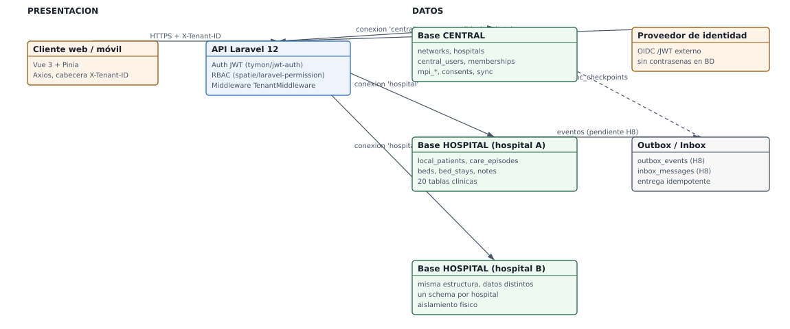

# Semana 3 — Diseño arquitectónico, vistas y patrones

## Portada

- **Estudiante:** Fajardo López, Javier Alexander (`Javifa2324`)
- **Módulo:** Verificación de Base de Datos PostgreSQL
- **Semana:** Semana 3 — Arquitectura de datos federada: base central vs. base por hospital
- **Entregable / evidencia:** Vista de despliegue y de datos (C4 o UML) con las conexiones central y hospital.
- **Estructura:** Sistema Hospitalario Integrado 2026 | Semanas 1–15.

## 1. Alcance

Documentar la arquitectura de datos **tal como está implementada**: una base CENTRAL
única y una base HOSPITAL por hospital, con las conexiones definidas en
`config/database.php` y las migraciones separadas en `database/migrations/central/`,
`database/migrations/hospital/` y `database/migrations/framework/`.

Lo que **no** está implementado se dibuja como pendiente: slice H8 (auditoría local,
outbox e inbox) y las tablas de laboratorio.

## 2. Vista de despliegue y de datos



- SVG: [01-arquitectura-federada.svg](./01-arquitectura-federada.svg)
- Fuente editable: [`fuentes/01-arquitectura-federada.mmd`](./fuentes/01-arquitectura-federada.mmd)

## 3. Qué vive en cada base

| Base | Contenido | Tablas | Migraciones |
|---|---|---:|---|
| CENTRAL | Red, hospitales, identidad y membresías, MPI, consentimientos, auditoría de acceso cruzado, sincronización | 15 | `database/migrations/central/` |
| HOSPITAL | Identidad local referenciada, profesionales, pacientes, episodios, asignaciones, agenda, salas, camas, estancias, expediente, notas, diagnósticos, alergias y signos vitales | 16 | `database/migrations/hospital/` |
| HOSPITAL (pendiente) | Medicamentos, prescripciones, laboratorio, muestras, resultados, alertas, auditoría local, outbox e inbox | 11 | Sin migración |

## 4. Reglas de la topología federada

1. **Una base HOSPITAL por hospital.** La selección se hace con `X-Tenant-ID` y el
   `TenantMiddleware`; el esquema es idéntico en todos los hospitales.
2. **Sin FK entre bases.** CENTRAL y HOSPITAL se relacionan por UUID lógico
   (`central_user_id`, `global_id`, `mpi_patient_id`). Esto está forzado por el
   escenario de una red con varios hospitales con datos clínicos independientes.
3. **Sin datos clínicos en CENTRAL.** CENTRAL guarda identidad, MPI, consentimientos y
   sincronización; ningún registro clínico viaje allí.
4. **Una entidad, un dueño.** Cada tabla tiene un módulo responsable; el módulo de
   verificación de BD valida que no haya dos migraciones para la misma tabla.
5. **Compatibilidad de esquema.** `hospitals.schema_version` permite detectar
   hospitales con esquema distinto durante una actualización.

## 5. Sincronización entre bases

- **Pendiente (slice H8).** `outbox_events` (HOSPITAL) publicará eventos y
  `inbox_messages` (CENTRAL) los consumirá de forma idempotente, con
  `sync_checkpoints` por hospital y canal.
- **Lo que ya funciona.** `sync_nodes`, `sync_checkpoints` e `inbox_messages` existen
  en CENTRAL (`CentralSyncIntegrityTest` los cubre).
- **Regla de diseño.** Los eventos llevan identificadores lógicos, no información
  clínica completa, y la entrega es reintentable sin duplicar efectos.

## 6. Validación ejecutada

```bash
# comando: grep -n "'central'\|'hospital'" -A 8 config/database.php
# resultado: dos conexiones con host, puerto, base, usuario y contraseña por variable de entorno

# comando: ls database/migrations/central database/migrations/hospital database/migrations/framework
# resultado: 5 migraciones CENTRAL, 6 HOSPITAL y las migraciones de framework separadas

# comando: xmllint --noout docs/verificacion-postgresql/semana-03/01-arquitectura-federada.svg
# resultado: sin salida (SVG válido)

# comando: podman run --rm --network host -v $PWD:/app -w /app localhost/php85-pgsql-full php vendor/bin/phpunit tests/Database/ConnectionIsolationTest.php tests/Database/MigrationLayoutTest.php
# resultado: OK — las dos bases se conectan y se validan por separado
```

## 7. Riesgos y pendientes

- Las 11 entidades HOSPITAL sin migración (laboratorio, alertas, medicamentos,
  prescripciones, auditoría local y mensajería) no tienen todavía restricciones que
  verificar; su auditoría queda pendiente de las migraciones de sus dueños.
- La sincronización entre hospital y red no tiene eventos implementados: los
consumidores de `inbox_messages` todavía no existen.
- Si un hospital nuevo entra en la red con `schema_version` menor, hay que definir la
  estrategia de actualización; hoy solo existe el campo.
