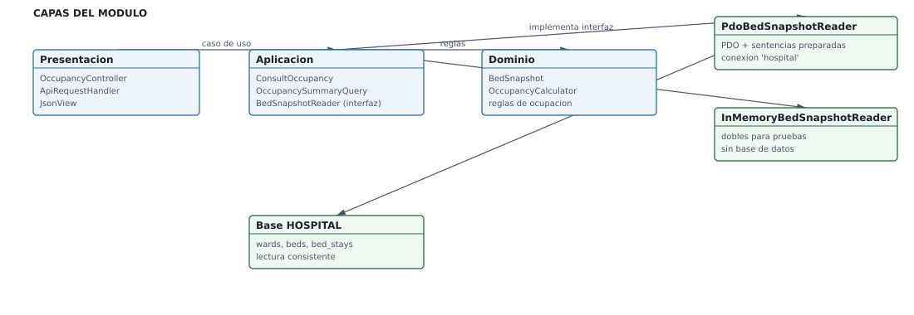

# Semana 4 — Arquitectura en capas y patrón repositorio

## Portada

- **Estudiante:** Fajardo López, Javier Alexander (`Javifa2324`)
- **Módulo:** Verificación de Base de Datos PostgreSQL
- **Semana:** Semana 4 — Acceso a persistencia e interfaz repositorio
- **Entregable / evidencia:** Diagrama de capas y propuesta de interfaz repositorio con sus consultas principales.
- **Estructura:** Sistema Hospitalario Integrado 2026 | Semanas 1–15.

## 1. Alcance

Revisar **cómo accede hoy cada capa a la base de datos** y proponer una interfaz
repositorio para una entidad del módulo asignado al grupo, con las consultas
principales escritas contra el esquema real.

Base del análisis: el módulo de ocupación hospitalaria ya publicado en
`micro-his/ocupacion-hospitalaria/` (semanas 3 y 5) es la referencia viva de acceso a
datos en este repositorio; las conclusiones aplican a los demás módulos.

## 2. Diagrama de capas



- SVG: [01-capas-persistencia.svg](./01-capas-persistencia.svg)
- Fuente editable: [`fuentes/01-capas-persistencia.mmd`](./fuentes/01-capas-persistencia.mmd)

## 3. Cómo accede hoy cada capa a la base

| Capa | Acceso a datos | Veredicto |
|---|---|---|
| Presentación (`OccupancyController`, `ApiRequestHandler`) | Ninguno: solo valida token, tenant y corte | Correcto |
| Aplicación (`ConsultOccupancy`, `OccupancySummaryQuery`) | Usa la interfaz `BedSnapshotReader` | Correcto |
| Dominio (`BedSnapshot`, `OccupancyCalculator`) | Ninguno | Correcto |
| Persistencia (`PdoBedSnapshotReader`) | SQL parametrizado con PDO sobre la conexión `hospital` | Correcto, a vigilar |

Reglas que se comprueban en el código:

1. El controlador no contiene SQL ni reglas de negocio.
2. Toda consulta usa sentencias preparadas (`$statement->execute([...])`), sin
   concatenación de valores.
3. El fallo de persistencia se traduce a un error de dominio
   (`PersistenceFailure`), no a una excepción de SQL expuesta al cliente.
4. Las columnas usadas por el módulo son `wards`, `beds` y `bed_stays`; el estado
   autoritativo de ocupación es el intervalo `bed_stays`, no `beds.status`.

## 4. Interfaz repositorio propuesta

```text
interface BedSnapshotReader
    readAt(cutoff: DateTimeImmutable): list<BedSnapshot>
```

Consultas principales que la interfaz debe sostener:

| Caso | Tablas | Operación | Nota de consistencia |
|---|---|---|---|
| Fotografía de ocupación en el corte | `wards`, `beds`, `bed_stays` | Lectura | Una sola sentencia con `EXISTS` sobre `bed_stays` |
| Cama ocupada en `T` | `bed_stays` | Lectura | `started_at <= T AND (ended_at IS NULL OR ended_at > T)` |
| Inconsistencia entre intervalo y estado | `bed_stays`, `beds` | Lectura | Se informa, no se corrige |
| Estancia abierta de un episodio | `bed_stays` | Lectura | Índice único `bed_stays_open_care_episode_unique` |
| Altas y traslados (ASII-07/08) | `bed_stays` | Escritura | Deben cerrar el intervalo en la misma transacción |

SQL de referencia (extracto real de `PdoBedSnapshotReader`; el juego completo está en [consultas-principales.sql](./consultas-principales.sql)):

```sql
SELECT b.bed_id, w.ward_id, w.code AS ward_code, b.status,
       EXISTS (
           SELECT 1 FROM bed_stays s
           WHERE s.bed_id = b.bed_id
             AND s.started_at <= :cutoff_start
             AND (s.ended_at IS NULL OR s.ended_at > :cutoff_end)
       ) AS has_active_stay
FROM beds b
JOIN wards w ON w.ward_id = b.ward_id
ORDER BY w.code, b.code
```

## 5. Repositorio compartido entre módulos

Un repositorio compartido de datos clínico puede servir a ASII-06 (camas), ASII-07
(admisión), ASII-08 (traslados) y ASII-09 (ocupación) si:

- la interfaz se define **por concepto de dominio** (`BedSnapshotReader`), no por tabla;
- cada módulo conserva su propia implementación y sus propias pruebas;
- la implementación real usa la conexión `hospital` y el tenant resuelto.

Lo que **no** se propone: una tabla compartida de "estado de cama" escribible por
varios módulos, porque `beds.status` es estado operativo no autoritativo y la
ocupación se deriva del intervalo de `bed_stays`.

## 6. Validación ejecutada

```bash
# comando: grep -rn "prepare(\|execute(" micro-his/ocupacion-hospitalaria/src
# resultado: consultas con sentencias preparadas y parámetros vinculados, sin concatenación

# comando: xmllint --noout docs/verificacion-postgresql/semana-04/01-capas-persistencia.svg
# resultado: sin salida (SVG válido)

# comando: podman run --rm --network host -v $PWD:/app -w /app localhost/php85-pgsql-full php vendor/bin/phpunit tests/Database/Hospital/SchedulingAndBedIntegrityTest.php
# resultado: OK — las consultas de la interfaz se apoyan en tablas y restricciones verificadas
```

## 7. Riesgos y pendientes

- La interfaz propuesta es una **propuesta** del módulo de BD: su adoption en los
  módulos de camas, admisión y traslados requiere acuerdo del equipo.
- El módulo de ocupación aún no expone la ruta en Laravel; el adaptador real con la
  conexión `hospital` se conecta al final de la semana 5 (ver sección de operación del
  plan del grupo).
- Los repositorios de los otros módulos no se revisaron a fondo en esta semana: el
  alcance fue la arquitectura de referencia y la propuesta de interfaz.
